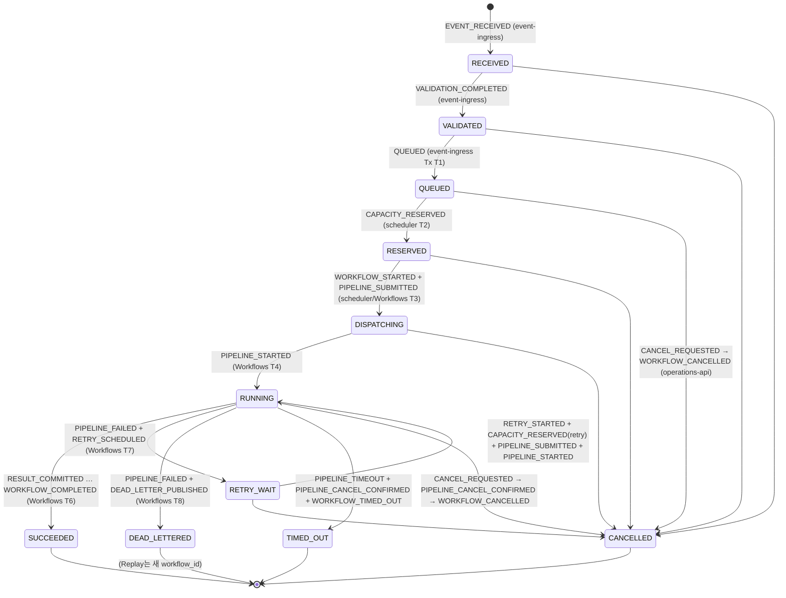

# AIPO Operations Console — 시스템 연동 스펙 (Integration Spec)

| 항목 | 내용 |
| --- | --- |
| 문서 버전 | v1.0 (2026-11-13) |
| 대상 | Platform(Cloud Run Ingress / Scheduler / Dispatcher / Reconciler / DLQ Manager), Cloud Workflows, ML Pipeline(Vertex AI Pipelines), Data(BigQuery / GCS), Operations API(FastAPI) 팀 |
| 근거 | `plan.md` §1–§10.2, `src/lib/types.ts`, `src/config/domain.ts`, `console.config.ts`, `src/app/api/v1/**`, `src/server/services/**`, `src/server/mock/engine.ts`, `src/components/atlas/**`, `docs/data-contract.md`, `docs/auth.md`, `docs/i18n.md`, `docs/adoption.md` |
| 기계 판독 계약 | [`docs/openapi.yaml`](./openapi.yaml) (OpenAPI 3.1, 61 paths / 65 operations, `components.schemas` = `src/lib/types.ts` 1:1) |
| 용어 | `docs/i18n.md` §2 Glossary를 따른다. Workflow, PipelineJob, Attempt, Replay Cycle, Capacity Slot, Fencing token, DLQ 등 플랫폼 용어와 상태 enum, 필드명, CSV 컬럼명은 영어 원문 그대로 쓴다. |

> 이 문서의 "필수"는 구현하지 않으면 콘솔 화면이 깨지거나 KPI를 측정할 수 없는 항목이다. "권장"은 운영 품질을 위한 항목이다.
> 필드명·타입·enum·ID 형식은 `src/lib/types.ts`와 Mock API의 실제 응답이 기준이다. Mock이 단순화한 부분은 각 절의 **[Mock ≠ Real]** 표시에서 실제 시스템이 해야 할 일을 적었다.

## 목차

0. 개요 & 범위
1. 화면별 데이터 요구사항
2. Operations API 계약
3. 저장소 스키마 (Firestore · BigQuery · GCS)
4. 결과 CSV 스펙
5. Pipeline / Sub-pipeline 규약
6. 이벤트 & 상태 전이 기록
7. 로그 표준
8. 감사(Audit) 로그
9. 인증/권한 연동
10. 실시간 갱신
11. 시간 범위 & 시간대
12. 비기능 요구사항
13. 구현 체크리스트 & 팀별 책임 매트릭스
- 부록 A. Glossary · B. 이벤트 타입별 샘플 페이로드 · C. 샘플 로그 · D. 샘플 Firestore 문서 · E. 코드·계획·문서 간 불일치 목록

---

## 0. 개요 & 범위

### 0.1 목적

AIPO Operations Console(Next.js 16, `applications/operations-web`)은 현재 내장 Mock 엔진(`src/server/mock/engine.ts`)이 만든 데이터로 동작한다. 이 문서는 Mock을 실제 GCP 시스템으로 교체할 때 다음을 정의한다.

1. 콘솔의 각 화면이 **어떤 정보를, 어떤 형태(타입·필드·단위)로, 얼마나 신선하게** 받아야 하는지
2. 그 정보를 만들기 위해 각 컴포넌트(Ingress, Scheduler, Dispatcher, Cloud Workflows, Vertex AI Pipelines, Reconciler, DLQ Manager, Operations API)가 **무엇을 어디에 어떻게 기록**해야 하는지 (상태·이벤트·로그·Artifact·감사)
3. 콘솔 ↔ Operations API 간 REST/SSE 계약 (`docs/openapi.yaml`)

범위 밖: Vertex AI Pipeline 내부 평가 로직, Terraform 모듈 구조(plan §9), Hermes 대시보드 자체.

### 0.2 데이터 흐름 (GCS 업로드 → 대시보드)

```mermaid
flowchart LR
  subgraph Producers
    U[실발화 수집기] -->|JSONL upload| GI[(GCS<br/>bixby-utterance-input)]
    OPS[운영자 Replay/Cancel]
  end
  GI -->|object.finalized| EA[Eventarc trigger<br/>gcs-utterance-finalized]
  EA -->|CloudEvent push| PS1[[Pub/Sub<br/>pipeline-batch-requested]]
  PS1 --> ING[Cloud Run<br/>event-ingress]
  ING -->|Tx: dedup_keys, events,<br/>workflows, pending_jobs, outbox| FS[(Firestore)]
  FS --> SCH[Cloud Run<br/>scheduler]
  SCH -->|Tx: capacity, reservations,<br/>workflows=RESERVED, outbox| FS
  SCH -->|executions.create| WF[Cloud Workflows<br/>pipeline-orchestrator]
  DSP[Cloud Run<br/>dispatcher] -. reconcile DISPATCHING .-> WF
  WF -->|pipelineJobs.create<br/>id={wf}-cycle-{c}-attempt-{a}| VX[Vertex AI Pipelines<br/>root + sub-pipelines]
  VX -->|artifacts| GA[(GCS<br/>bixby-pipeline-artifacts)]
  VX -->|persist: results.csv| GR[(GCS<br/>bixby-eval-results)]
  VX -->|load job| BQR[(BigQuery<br/>bixby_eval.utterance_results)]
  WF -->|status, retry, DLQ| FS
  WF -->|final failure| PS2[[Pub/Sub<br/>pipeline-dead-letter]] --> DLQM[Cloud Run<br/>dlq-manager] --> FS
  REC[Cloud Run Job<br/>reconciler 2m] -->|Vertex 실제 상태 대조| FS
  FS -->|outbox relay| PS3[[Pub/Sub<br/>aipo-events]]
  PS3 -->|BigQuery subscription| BQO[(BigQuery aipo_ops<br/>workflow_events …)]
  ING & SCH & WF & VX & DLQM & REC -->|structured JSON logs| CL[(Cloud Logging)]
  CL -->|Log Router sink| BQL[(BigQuery aipo_logs)]
  CL -.-> CT[(Cloud Trace)]
  subgraph Ops[Operations API · FastAPI on Cloud Run]
    API[REST /api/v1] --- SSE[SSE /api/v1/stream]
  end
  OPS -->|REST| API
  FS -->|snapshot listener| API
  PS3 -->|push subscription| API
  BQO & BQR & BQL & CL & GA & GR --> API
  VX -->|getPipelineJob task_details| API
  API -->|proxy rewrite + x-console-user-*| WEB[Operations Console<br/>Next.js · IAP]
```

### 0.3 데이터 종류별 System of Record

| 데이터 | System of Record | 보조 저장소 / 사본 | 콘솔이 읽는 경로 |
| --- | --- | --- | --- |
| Workflow 현재 상태, Attempt, PipelineJob 상태 트리, Capacity, Reservation, Pending Queue, DLQ 항목, Replay, Runtime Config, 활성 Alert | **Firestore** (현재 상태) | BigQuery `aipo_ops.workflow_runs` 등 (종료 후 스냅샷) | Operations API → Firestore 조회 / snapshot listener |
| 운영 이벤트 (Event Timeline, 상태 전이 이력) | **Pub/Sub `aipo-events`** (Outbox 발행 원본, 7일 보존·Replay 가능) | BigQuery `aipo_ops.workflow_events` (영구 이력), Firestore `workflows/{id}/events` (Hot 버퍼, 7일 TTL) | `/workflows/{id}/events`, `/events`, SSE `event` |
| 이력 · 분석 · KPI (처리량, 성공률, p95, 비용) | **BigQuery `aipo_ops`** | — | `/analytics/*`, `/overview.inRange`, `/capacity/history`, `/pipelines*` |
| 발화별 평가 결과 | **BigQuery `bixby_eval.utterance_results`** | GCS `results.csv` (원본 파일) | `/results*`, `/workflows/{id}/results` |
| 원본 로그 | **Cloud Logging** (30일) | BigQuery `aipo_logs` (Log Router sink, 400일) | `/logs`, `/workflows/{id}/logs`, SSE `log` |
| 분산 Trace | **Cloud Trace** | — | Trace ID 링크 (콘솔은 `trace_id` 표시·필터만) |
| Artifact, 입력 JSONL, 결과 CSV, Pipeline 템플릿 | **GCS** | BigQuery `aipo_ops.object_index` (파일명 검색 인덱스) | `/gcs/*`, `/files/search`, `/stages/{id}.objects` |
| 감사 기록 | **BigQuery `aipo_ops.audit_log`** (append-only) | Firestore `audit` (90일 Hot), GCS 일별 digest (Bucket Lock) | `/audit`, SSE `audit` |
| Pipeline Registry (정의·버전) | **Git `pipelines/definitions/*.yaml`** → CI가 컴파일 | GCS `templates/{pipeline_id}/{version}.yaml`, Firestore `config/registry` | `/meta.pipelines`, `/pipelines*` |
| 사용자·역할 | **IAP identity + `console.config.ts`/env** | — | `/auth/session`, `x-console-user-*` |

ADR-004(plan §3.3)에 따라 Firestore는 실시간 상태, BigQuery는 분석, Cloud Logging은 원본 로그, Cloud Trace는 분산 추적에 쓴다. **Operations API는 Firestore를 "현재", BigQuery를 "과거"로 읽는다.** 같은 화면에서 두 소스를 합칠 때(예: `/workflows` 목록)는 Firestore 결과를 우선한다(§3.1.12).

### 0.4 지연·신선도 목표 (plan §1.3 KPI 연계)

| ID | 목표 | 측정 구간 (기록 지점) | 측정 쿼리 | 근거 KPI |
| --- | --- | --- | --- | --- |
| F1 | **Event 등록 지연 p95 ≤ 10s** | `GCS_OBJECT_FINALIZED.occurred_at`(= GCS `timeCreated`) → `workflows/{id}.validated_at` | §3.2.10 Q-K2 | Event 등록 지연 p95 |
| F2 | **Pipeline 시작 지연 p95 ≤ 30s** (Capacity 확보 후) | `reserved_at` → `PIPELINE_STARTED.occurred_at` | Q-K3 | Pipeline 시작 지연 p95 |
| F3 | Firestore 상태 변경 → 콘솔 SSE 도달 p95 ≤ 2s | Firestore `update_time` → SSE 송신 시각 | Ops API 메트릭 `sse_publish_lag_ms` | Real-time Feedback (plan §6.4-6) |
| F4 | Overview live KPI 신선도 ≤ 5s | `tick` 주기 | — | Screen 1 |
| F5 | Event Timeline 신선도 ≤ 5s (SSE), 조회 ≤ 60s (BigQuery) | Outbox 발행 → BQ subscription 반영 | `_PARTITIONTIME` 지연 | Screen 4 ③ |
| F6 | 로그 신선도 ≤ 10s | 애플리케이션 write → Cloud Logging 조회 가능 | — | Screen 4 ④ |
| F7 | 결과 조회 ≤ 2 min | `BIGQUERY_COMMITTED` → `/results` 노출 | — | Results |
| F8 | 분석 집계 ≤ 5 min (5분 bucket), ≤ 1 h (일 단위), 비용 ≤ 24 h | Scheduled query 주기 | — | Screen 7 |
| F9 | 이벤트 추적 가능률 ≥ 99.9% | `correlation_id`로 GCS 업로드 ~ 종료 이벤트까지 연결된 비율 | Q-K6 | 이벤트 추적 가능률 |
| F10 | DLQ 기록 누락 0건 | `status=DEAD_LETTERED` Workflow ↔ `dead_letters` 대조 | Q-K5 | DLQ 기록 누락 |
| F11 | Capacity 초과 실행 0건 | 5분 스냅샷의 `active > limit` 건수 | Q-K4 | Capacity 초과 실행 |
| F12 | Retry 정책 준수율 100% | Attempt 수 ≤ 정책 상한 (범주별) | Q-K7 | Retry 정책 준수율 |

### 0.5 환경 상수 (현재 `domain.ts` 값)

| 항목 | 값 |
| --- | --- |
| Project / number / region | `bixby-eval-prod` / `418027761953` / `asia-northeast3` |
| Timezone | `Asia/Seoul` (KST, UTC+9, DST 없음) |
| Buckets | input `bixby-utterance-input`, artifacts `bixby-pipeline-artifacts`, results `bixby-eval-results` |
| BigQuery | results `bixby-eval-prod.bixby_eval.utterance_results`, events `bixby-eval-prod.aipo_ops.workflow_events` |
| Pub/Sub topics | `pipeline-batch-requested`, `pipeline-replay-requested`, `pipeline-batch-completed`, `pipeline-dead-letter`, (신규) `aipo-events`, `aipo-pipeline-telemetry`, `gcs-object-index` |
| Cloud Workflows | `pipeline-orchestrator` |
| Languages | `ko`, `en`, `ja`, `es` (`LangCode`) |
| 데이터 보존 창 | 최소 30일(`historyDays`, 30d preset) — 권장 BigQuery 400일 |

---

## 1. 화면별 데이터 요구사항

### 1.1 공통

- 모든 화면은 `GET /api/v1/auth/session`(콘솔 자체 응답)으로 사용자·권한을 받고, 하나의 SSE 연결(`GET /api/v1/stream`)을 공유한다(`src/lib/client/live-stream.tsx`).
- `useApi(key, fetcher, { revalidateOn: [...] })`는 표시된 SSE 이벤트를 받으면 해당 API를 다시 부른다. 즉, **SSE 이벤트는 "무엇이 바뀌었는지" 알리는 트리거**이고 화면 데이터의 원본은 REST 응답이다. 아래 표의 "SSE 트리거" 열이 실제 시스템이 반드시 발행해야 하는 이벤트다.
- 시간 범위가 있는 화면은 URL의 `?range=` / `?from=&to=`를 모든 ranged API에 그대로 전달한다(§11).

### 1.2 화면 × API 매트릭스

| 화면 (route · component) | 호출 API (주요 파라미터) | SSE 트리거 | Source system | 필요 신선도 | 화면이 실제 쓰는 핵심 필드 |
| --- | --- | --- | --- | --- | --- |
| **Orchestration canvas** (`/` · `canvas/canvas.tsx`, `canvas/inspector.tsx`) | `GET /stages?range`; `GET /stages/{id}?limit=1&objects_limit=1&range` (각 노드 배지); Inspector: `GET /stages/{id}?range&limit&q`; `GET /dead-letters?status=PENDING_REVIEW&pageSize=100`; `GET /replays`; `GET /results/file`; `GET /files/search?q&limit` | `tick`(배지 수), `transition`(흐름 애니메이션), `dlq`, Inspector: `event`, `log`, `job` | Firestore(활성 Workflow, reservations), BigQuery(종료 Workflow·이벤트), GCS index | ≤ 5s | `StageSummary.count/counts/byLanguage`, `TickSnapshot.stageCounts/active[]`(`ActiveWorkflowPos.stage/pct/status`), `StageDetail.metrics`(단계별 KPI, §1.4), `objects[]`(`FileSearchHit`), `events`, `logs` |
| **Board** (`/board` · `board/*.tsx`) | `GET /workflows?active=true&pageSize=500`; `GET /workflows?range&pageSize=500&sort=created_asc`; `GET /overview?range`; `GET /stages/{gcs_input,event_bus,ingress}?limit=1&objects_limit=1`; `GET /reservations?status=ORPHANED`; `GET /capacity/history?range`; `GET /files/search?q&limit=1000` | `tick`, `transition` | Firestore + BigQuery `capacity_snapshots` | ≤ 5s (river 차트 ≤ 5 min) | `WorkflowSummary`(status, stage, language, queued_at, started_at, progress.pct, attempt, retry_at), `CapacityHistory.ts/active/queue/limit`, `Reservation.status/lease_expires_at` |
| **Overview** (`/overview` · `overview.tsx`) | `GET /overview?range`; `GET /analytics/throughput?range&granularity=auto`; `GET /events?range&limit=14`; `GET /alerts?range`; `GET /incidents?range`; `POST /alerts/{id}/ack`, `/resolve` | `tick`, `transition`, `alert` | Firestore(live KPI, alert), BigQuery(inRange, throughput) | live ≤ 5s, inRange ≤ 60s | `OverviewKpis` 전체, `inRange: RangeKpis`, `statusDistribution`, `capacity`, `ThroughputSeries`, `Alert.status/severity/opened_at` |
| **Capacity** (`/capacity` · `capacity.tsx`) | `GET /languages/capacity`; `GET /config`; `GET /capacity/history?range&granularity=auto`; `PATCH /languages/{lang}/capacity?dry_run=1` → 실제 PATCH; `PATCH /capacity/global?dry_run=1` → 실제 PATCH | `tick`, `audit` | Firestore `languages`, `capacity`, `reservations`; BigQuery `capacity_snapshots` | ≤ 5s | `LanguageCapacity`(active/max/running/reserved/dispatching/retryWait/backlog/intake/utilization/avgWaitSec/p95WaitSec/oldestQueuedAt/throughputPerHour/status), `CapacityImpact`, `AppConfig.drift` |
| **Explorer** (`/explorer` · `explorer.tsx`) | `GET /workflows?range&status&language&version&pipeline_id&model_version&batch_id&error_code&event_type&q&sort&page&pageSize`; `GET /analytics/errors?top=40&range` | `transition` | Firestore(활성) ∪ BigQuery `workflow_runs` | ≤ 5s | `WorkflowListResponse.items/facets/total`, `WorkflowSummary.waitMs/runMs/totalMs/retries/lastErrorCode/input.uri` |
| **Pipelines** (`/pipelines` · `pipelines/catalog.tsx`, `common.tsx`) | `GET /pipelines?range`; `GET /pipelines/{id}/runs?range&pageSize=500&sort=start_asc` (페이지 순회); `GET /pipelines/{id}/runs?range=1h&status=RUNNING&pageSize=200` | `job` | Registry + BigQuery `pipeline_job_runs` + Firestore `pipeline_jobs`(RUNNING) | ≤ 30s, RUNNING ≤ 10s | `PipelineSummary`(runs/running/succeeded/failed/successRate/p95DurationMs/byVersion), `PipelineDefinition.versions[].nodes/edges/subpipelines/usedBy`, `PipelineRun` |
| **Pipeline detail** (`/pipelines/[id]` · `pipelines/status.tsx`) | `GET /pipelines/{id}?version&range`; 하위 노드: `GET /pipelines/{ref.pipeline_id}?version={ref.version}`; `GET /pipelines/{id}/runs?version&status&page&pageSize&sort=start_desc`; 선택 run: `GET /workflows/{wfId}/pipeline-runs` | `job` | Registry + BigQuery `pipeline_node_runs` | ≤ 30s | `PipelineDetail.nodeStats[]`(`NodeAggregate.counts/duration.p95Ms/topError.path`), `recentRuns`, `PipelineJobTree` |
| **Workflow detail** (`/workflows/[id]` · `detail.tsx`, `pipelines/job-explorer.tsx`) | `GET /workflows/{id}` (4s poll); `GET /workflows/{id}/pipeline-runs` (5s); `GET /workflows/{id}/events` (5s); `GET /workflows/{id}/attempts`; `GET /workflows/{id}/logs?order=asc&min_severity&component&event_type&q&trace_id&attempt&pipeline_job_id&job_scope=tree&node_path&limit=400` (4s); `GET /dead-letters/{dead_letter_id}`; `POST /workflows/{id}/cancel` | `transition`, `job`, `dlq` | Firestore(workflow·attempts·pipeline_jobs·events hot), Cloud Logging, Vertex API | ≤ 5s | `Workflow` 전체(input, result, attempts[], error.path/node_path, current_node_path, current_job_id, status_history), `JobNode`(status, progress, resources, inputs/outputs, error), `WorkflowEvent`, `LogEntry`(ts, severity, node_path/component/service, message, stack_trace, trace_id), `AttemptHistory.replayChain` |
| **Files** (`/files` · `files/files-screen.tsx`) | `GET /files/search?q&stage&bucket&language&range&limit` (+ `limit=1`로 단계별 count) | `transition` | BigQuery `object_index` (GCS notification + 상태 이벤트로 갱신) | ≤ 30s | `FileSearchHit`(stage, kind, bucket/object/uri, generation, size, updated, workflow_id, batch_id, pipeline_job_id, current_status, ref, match_ranges), `byStage` |
| **DLQ** (`/dlq` · `dlq.tsx`) | `GET /dead-letters?range&status&language&category&error_code&operator&pipeline_id&q&sort&page&pageSize`; `GET /dead-letters?pageSize=1`(카운트); `GET /replays?range`; `GET /workflows?range&replay=true&pageSize=200`; `GET /dead-letters/{id}`; `POST /dead-letters/{id}/replay`, `/close`, `/assign`; `POST /dead-letters/replay-batch` | `dlq`, `transition` | Firestore `dead_letters`, `replays`, Cloud Logging(최근 로그) | ≤ 5s | `DeadLetter`(failure_category, error_code, failure_reason, failed_path, attempts, attempt_history, last_log_excerpt, last_stack_trace, assigned_operator, status, replay_ids, notes), `outsideRange`, `Replay`, `BatchReplayResult` |
| **Results** (`/results` · `results.tsx`, `results/charts.tsx`) | `GET /results?range&language&capsule&intent&device&version&model_version&pipeline_id&result&failure_reason&workflow_id&batch_id&q&min_score&max_score&min_latency&max_latency&sort&page&pageSize`; `GET /results?…&pageSize=1`; `GET /results/{utterance_id}`; `GET /results/file`; `GET /gcs/objects?bucket=bixby-eval-results&delimiter=&limit=5000&range`; 다운로드 `GET /results/csv?…` | `transition` | BigQuery `utterance_results`, GCS results bucket | ≤ 2 min | `ResultRow` 23개 컬럼, `ResultsAggregates`(byCapsule, byDevice, byFailureReason, latency p50/p95, judgeScoreHistogram, latencyHistogramFine, byModelVersion, byPipeline, capsuleLanguage, byDate, byHour), `facets`, `ResultDetail.inputLine` |
| **Analytics** (`/analytics` · `analytics.tsx`, `analytics/pipelines.tsx`) | `GET /analytics/summary?range`; `GET /analytics/errors?range&top=40`; `GET /analytics/cost?range`; `GET /incidents?range`; `GET /pipelines/{id}?range` | `transition` | BigQuery `aipo_ops` 뷰, billing export | 5분 bucket ≤ 5 min, 일 ≤ 1 h, 비용 ≤ 24 h | `HourlyMetrics`, `FiveMinMetrics`, `DailyMetrics`(costUsd 7개 항목), `ComponentDuration`(leaf별 avg/p95, byLanguage/byVersion/byPipeline), `VersionComparison`, `LanguageSummary`, `ErrorAnalytics.topErrorCodes[].paths`, `PipelineSummary` |
| **Config** (`/config` · `config.tsx`) | `GET /config`; `PATCH /config`; `GET /operators`; `GET /audit?range&q&pageSize=50` | `audit` | Firestore `config/runtime`, Terraform output, Cloud Run Admin API, BigQuery `audit_log` | ≤ 5s | `AppConfig`(retry, timeouts, queuePolicy, pipelineVersionDetails, services[], alertPolicies[], terraformDefaults, runtimeConfig, drift[]), `AuditEntry` |
| **Hermes** (`/hermes` · `app/(console)/hermes/page.tsx`) | 서버 컴포넌트: session + `hermes:access` 검사 후 `HERMES_DASHBOARD_URL`로 307 | — | `console.config.ts`, env | — | `SessionInfo.links.hermes.allowed/configured` (URL은 노출하지 않음) |
| **Workflow index** (`/workflows` · `detail.tsx` `WorkflowsIndex`) | `GET /workflows?…` | `transition` | 위 Explorer와 동일 | ≤ 5s | `WorkflowSummary` |

### 1.3 전역 기능

| 기능 | 호출 API | 요구사항 |
| --- | --- | --- |
| **전역 시간 범위** (`time-range.tsx`, `RangePicker`) | `GET /meta` (revalidate on `sim`) | `MetaCatalog.dataWindow { earliest, now, earliestIso, nowIso, historyDays }`: `earliest` = BigQuery에 실제로 존재하는 가장 이른 데이터 시각(= `MIN(occurred_at)` of `workflow_events`, 캐시 10분), `now` = 서버 현재 시각(실제 시스템에는 가상 시계가 없다). `rangePresets`는 7개 preset 고정. 모든 ranged 응답은 `range: ResolvedRange`를 echo해야 하며 UI는 `range.label`을 표시한다. |
| **⌘K 검색** (`shell.tsx`) | `GET /workflows?q&pageSize=10&sort=updated_desc&range`; `GET /dead-letters?q&pageSize=8&range`; `GET /files/search?q&limit=8&range`; `GET /pipelines` | 각 호출 p95 ≤ 300ms (타이핑 중 연속 호출, 디바운스 후). `q`는 Workflow의 `workflow_id, batch_id, input.object, idempotency_key, correlation_id, trace_id, dead_letter_id, pipeline_id, model_version, attempts[].pipeline_job_id/error_code/failed_path`를 대상으로 한 대소문자 무시 부분일치다(엔진 `listWorkflows` 기준). DLQ `q`는 `dead_letter_id, workflow_id, batch_id, error_code, failure_reason, input_uri, failed_path, pipeline_id`. |
| **시뮬레이터 제어** (`shell.tsx` pause/resume/speed) | `POST /sim` | **Mock 전용.** 실제 API는 `POST /sim`에 404를 반환하고, `SimState.running=true, speed=1`을 `hello`/`sim` 이벤트로 보낸다(§10.6). |
| **Live 상태 표시** | SSE `hello`, `tick`, `sim` | `hello.serverTime`, `tick.now`는 UI의 상대 시간(`useSimNow()`) 기준이다. 실제 시스템은 서버 wall clock을 보낸다. |

### 1.4 Stage별 `StageDetail.metrics` 요구 키 (Canvas Inspector)

Mock은 일부 값을 상수로 채운다(**[Mock ≠ Real]** 표시). 실제 시스템은 아래 출처로 계산해야 한다. "…Today" 이름의 키도 **range 기준**으로 계산한다(legacy 이름 유지).

| Stage | 키 | 실제 출처 |
| --- | --- | --- |
| `gcs_input` | `objectsToday, bytesToday, utterancesToday, lastUploadAt, byLanguage` | `object_index` (bucket=input, `timeCreated` in range), object metadata `utterance_count`, `language` |
| `event_bus` | `deliveredToday, avgDeliveryLatencyMs`**[Mock 상수 420]**, `p95DeliveryLatencyMs`**[상수 1150]**, `redeliveriesToday`**[추정치]**, `subscriptionBacklog`, `deadLetterTopicMessages` | `EVENT_PUBLISHED`→`EVENT_RECEIVED` 시각 차, Ingress 로그의 `delivery_attempt>1` 건수, Cloud Monitoring `pubsub.googleapis.com/subscription/num_undelivered_messages`, dead-letter topic 메시지 수 |
| `ingress` | `receivedToday, validatedToday, duplicatesIgnoredToday`**[추정치]**, `validationErrorsToday`**[상수 0]**, `p95RegistrationLatencyMs`**[상수 1380]**, `inFlight` | `EVENT_RECEIVED`/`VALIDATION_COMPLETED`/`DUPLICATE_EVENT_IGNORED`/`VALIDATION_FAILED` 이벤트 수, Q-K2 |
| `registry_queue` | `queued, byLanguage, oldestQueuedAt, p95WaitSec, enqueuedInRange` | Firestore `pending_jobs`, `capacity/*` |
| `scheduler` | `activeSlots, globalMax, reservationsActive, reservationsOrphaned, admissionsLastHour, admissionsInRange, saturatedLanguages` | Firestore `reservations`, `capacity`, `CAPACITY_RESERVED` 이벤트 |
| `workflows` | `dispatching, executionsToday, cancelledToday, timedOut7d, p95StartLatencyMs`**[상수 4100]** | Firestore, Q-K3 |
| `vertex` | `running, runningByComponent`(legacy phase), `runningByLeaf, byPipeline{kind,runs,running,succeeded,failed,successRate,avgDurationSec,runningByNode}, runningChildJobs, utterancesInFlight, gpuInUse, gpuQuota`**[상수 16 → Cloud Quotas API]**, `avgDurationSec, p95DurationSec` | Firestore `pipeline_jobs`, BigQuery `pipeline_job_runs`, Cloud Quotas `custom_model_training_nvidia_l4_gpus` |
| `results` | `succeededToday, rowsWrittenToday, csvBytesToday, bqTable, passRateToday, aggregateFile, byPipeline, byModelVersion` | `RESULT_COMMITTED`/`BIGQUERY_COMMITTED` 이벤트 payload, `utterance_results` |
| `retry` | `retryWait, retriesToday, retryRate, nextRetryAt, policy` | Firestore workflows(`RETRY_WAIT`, `retry_at`), `config/runtime.retry` |
| `dlq` | `pendingReview, total, createdInRange, byStatus, byCategory, byPath, replays` | Firestore `dead_letters`, `replays` |

---

## 2. Operations API 계약

전체 path·파라미터·스키마는 [`docs/openapi.yaml`](./openapi.yaml)이 기준이다. 각 operation에는 다음 확장 필드가 있다.

| 확장 | 의미 |
| --- | --- |
| `x-permission` | 필요한 콘솔 permission key (`view`, `capacity:write`, `config:write`, `dlq:replay`, `workflow:cancel`, `sim:control`, `public`) |
| `x-range` | `true`면 `range`/`from`/`to`를 받고 응답에 `range: ResolvedRange`를 echo한다 |
| `x-source` | 실제 시스템의 System of Record |
| `x-freshness` | 허용 최대 지연 |
| `x-mock-only` | 실제 Operations API는 구현하지 않음(404) |

### 2.1 공통 규약

| 항목 | 규칙 |
| --- | --- |
| Base path | `/api/v1`. 콘솔은 `OPERATIONS_API_URL`(예: `https://ops-api.internal/api/v1`)로 `/api/v1/*`를 서버 측 rewrite한다. **`/api/v1/auth/**`는 rewrite하지 않는다**(콘솔이 직접 응답). |
| 인코딩 | JSON(UTF-8). 응답 헤더 `cache-control: no-store` (모든 `/api/v1` 응답). |
| 시각 | 모든 `*_at`, `ts`, `timeCreated`, `updated`, `opened_at`, `eval_ts`는 **epoch milliseconds (정수)**. 보조 문자열: `WorkflowEvent.timestamp`·`AuditEntry.timestamp`·`ResultRow.eval_timestamp`·`ResolvedRange.*Iso`는 **KST(+09:00) ISO-8601**, `LogEntry.timestamp`는 **UTC `Z`** ISO-8601. 저장은 UTC(§11). |
| 리스트 파라미터 | 콤마 구분 또는 반복(`status=RUNNING,QUEUED` = `status=RUNNING&status=QUEUED`). 빈 문자열은 "미지정". 단 `gcs/objects`의 `delimiter=`(빈 값)은 flat listing을 뜻한다. |
| Boolean 쿼리 | `1/true/yes/y`, `0/false/no/n` (대소문자 무시). 그 외 400. |
| 시각 쿼리 | `from`/`to`: epoch ms 또는 ISO-8601. URL에서 `+09:00`은 `%2B09:00`으로 인코딩. |
| 정렬 | 각 endpoint의 `sort` enum (openapi). 기본값: workflows `created_desc`, dead-letters `created_desc`, runs `start_desc`, results `eval_desc`, events·audit·replays 최신순. |
| ID 경로 파라미터 | `decodeURIComponent` 후 사용. child job id의 `.`은 그대로 path에 쓴다(`/pipeline-jobs/wf-…-attempt-3.response_judge`). |
| 사용자 식별 | 콘솔 proxy가 `x-console-user-id`(URI-encoded), `x-console-user-email`, `x-console-user-roles`(콤마), `x-console-user-permissions`(콤마)를 붙인다. 클라이언트가 보낸 동명 헤더와 legacy `x-operator`는 proxy가 제거한다(§9). |

### 2.2 응답 Envelope

| 형태 | 타입 | 사용 endpoint |
| --- | --- | --- |
| `RangedList<T>` = `{ items: T[], total, range }` | `RangedList` | `/events`, `/alerts`(+`openOutsideRange`), `/incidents`, `/replays`, `/stages`, `/pipelines`, `/analytics/{components,versions,languages,daily}` |
| `Paginated<T>` = `{ items, total, page, pageSize }` (+ `facets`, `range`) | `WorkflowListResponse`, `DeadLetterList`(+`outsideRange`), `PipelineRunsPage`, `Paginated<AuditEntry> & {range}` | `/workflows`, `/dead-letters`, `/pipelines/{id}/runs`, `/audit` |
| 결과 전용 | `ResultsPage { rows, total, page, pageSize, aggregates, file, range, facets }` — **`items`가 아니라 `rows`** | `/results` |
| 로그 전용 | `LogPage { items, total, components, services, range? }` — `components`/`services`는 필터 칩용 distinct 값(필터 적용 전) | `/logs`(range 있음), `/workflows/{id}/logs`(range 없음) |
| 단일 객체 | 해당 타입 | `/overview`, `/workflows/{id}`, `/pipelines/{id}`, `/analytics/{summary,throughput,quality,errors,cost}`, `/capacity/history`, `/files/search`(`FileSearchResult`), … |
| **bare array** (legacy, 유지) | `T[]` | `/workflows/{id}/events`(오름차순), `/reservations`(최신순), `/gcs/buckets` |

- `page`는 1부터. `total`은 필터 적용 후, 페이지 적용 전 건수다. `facets`는 **필터 적용 후 집합**에서 계산한다(자기 자신 facet을 제외하지 않음, `ResultsPage.facets` 주석과 동일).
- 실제 시스템에서 BigQuery 기반 목록은 `page`/`pageSize`를 `LIMIT/OFFSET`으로 구현해도 된다(최대 offset 10,000). 그 이상은 400 `INVALID_ARGUMENT` + `details.field="page"`. 커서 페이지네이션은 v2로 미룬다(UI 변경 필요).

### 2.3 오류 형식

```json
{
  "error": {
    "code": "CONFLICT",
    "message": "이미 Replay가 진행 중입니다: dlq-20261112-007",
    "key": "domain.dlqReplayInProgress",
    "details": { "dead_letter_id": "dlq-20261112-007", "status": "REPLAYING" }
  }
}
```

| HTTP | `code` | 용도 | `details` |
| --- | --- | --- | --- |
| 400 | `INVALID_ARGUMENT` | 쿼리/본문 검증 실패, 잘못된 range | `field`, `allowed`, `min`, `max` |
| 401 | `UNAUTHENTICATED` | 세션 없음, IAP JWT 검증 실패 | — |
| 403 | `FORBIDDEN` | 권한 부족 | `permission` (권장) |
| 404 | `NOT_FOUND` | 없는 리소스, Mock 전용 endpoint | — |
| 409 | `CONFLICT` | 상태 전이 불가(이미 종료/REPLAYING/CLOSED/ACKNOWLEDGED), Idempotency-Key 재사용 충돌 | `status`, `reason` |
| 429 | `RESOURCE_EXHAUSTED` | (실제 API 신규) 사용자별 rate limit | `retry_after_sec` |
| 500 | `INTERNAL` | 내부 오류 (메시지에 내부 정보 금지) | — |
| 503 | `UNAVAILABLE` | (실제 API 신규) BigQuery/Firestore 일시 장애 | — |

- `message`는 요청 locale로 번역한다: 쿠키 `console_locale`(ko|en) → `Accept-Language` → 기본 `ko`. 콘솔 proxy는 두 헤더를 그대로 전달한다.
- `key`는 `src/i18n/messages/{ko,en}/errors.ts`의 키(`code.*`, `validation.*`, `permission.*`, `domain.*`)다. FastAPI는 같은 키 카탈로그를 공유(빌드 시 JSON export)하여 `message`를 만들고 `key`를 echo한다. 키가 없는 자유 텍스트는 `key` 생략.
- 콘솔 자체 proxy가 만드는 401/403도 같은 형식이다(`permission.unverified`, `permission.apiDenied`).

### 2.4 Idempotency-Key (모든 변경 API)

| 항목 | 규칙 |
| --- | --- |
| 헤더 | `Idempotency-Key: <opaque ≤128자>` — 콘솔 `api.*`가 POST/PATCH마다 자동 생성(UUID v4). |
| 범위(scope) | `(actor, METHOD, path, key)`. Mock은 `(METHOD, path, key)`. |
| 저장 | Firestore `idempotency_keys/{sha256(actor + METHOD + path + key)}` = `{ request_hash, status, body, created_at, expire_at }`, TTL 24h (Mock 10분 인메모리). |
| 재요청 | 같은 scope·같은 `request_hash`(정규화된 JSON 본문의 SHA-256) → 저장된 status·body를 그대로 반환, 헤더 `idempotent-replay: true`. |
| 충돌 | 같은 scope·다른 본문 → 409 `CONFLICT`, `details.reason="IDEMPOTENCY_KEY_REUSED"`. |
| 처리 중 | 첫 요청 처리 중 재요청 → 409 `details.reason="IDEMPOTENCY_IN_PROGRESS"` (저장 문서를 `status=0`으로 먼저 create()). |
| 캐시 대상 | 2xx와 4xx 모두 저장한다(5xx는 저장하지 않음). Mock 구현(`src/server/http.ts` `idempotent()`)도 같은 규칙으로 10분간 저장한다 — 부록 E #12. |
| 감사 | 모든 감사 레코드에 `idempotency_key`를 남긴다(§8). |
| **[Mock ≠ Real] 클라이언트** | 현재 콘솔은 호출마다 새 키를 만든다. 사용자가 같은 다이얼로그에서 재시도해도 키가 바뀌므로 중복 방지가 안 된다. 다이얼로그를 열 때 키를 만들고 재시도 시 재사용하도록 바꿔야 한다(부록 E #13). Replay·Cancel은 서버 측 상태 검사(409)로도 보호된다. |

### 2.5 Endpoint 목록

R = ranged(`x-range: true`). 권한은 canonical key. 상세 파라미터는 openapi.

#### 2.5.1 Overview · Meta · Alerts

| Method | Path | R | 권한 | 응답 | 비고 |
| --- | --- | --- | --- | --- | --- |
| GET | `/overview` | R | view | `Overview` | legacy `*Today` 필드는 항상 KST 오늘, `inRange`는 range, `statusDistribution`/`capacity`는 live |
| GET | `/meta` | | view | `MetaCatalog` | 정적 카탈로그 + `dataWindow` + registry |
| GET | `/alerts` | R | view | `RangedList<Alert> & {openOutsideRange}` | `opened_at` 기준 |
| POST | `/alerts/{id}/ack` | | capacity:write \| dlq:replay \| workflow:cancel | `Alert` | body `{note?}`, 409 if ACKNOWLEDGED/RESOLVED |
| POST | `/alerts/{id}/resolve` | | 〃 | `Alert` | 409 if RESOLVED |
| GET | `/incidents` | R | view | `RangedList<Incident>` | `[started_at, resolved_at]` overlap |

#### 2.5.2 Capacity

| Method | Path | R | 권한 | 응답 | 비고 |
| --- | --- | --- | --- | --- | --- |
| GET | `/languages/capacity` | | view | `CapacitySnapshot` | |
| GET | `/languages/{lang}/capacity` | | view | `LanguageCapacity` | 404 unknown lang |
| PATCH | `/languages/{lang}/capacity?dry_run=1` | | capacity:write | `CapacityChangeResult` | body `LanguageCapacityPatch`; `reason` 필수(dry_run 제외); `max_concurrent` 0–100 & ≤ global; `priority_weight` 1–10; `max_starts_per_minute` 1–60 |
| GET | `/capacity/global` | | view | `GlobalCapacity` | |
| PATCH | `/capacity/global?dry_run=1` | | capacity:write | `GlobalCapacityChangeResult` | `max_concurrent` 1–200 & ≥ max(language), `max_starts_per_minute` 1–120 |
| GET | `/capacity/history` | R | view | `CapacityHistory` | `granularity=auto\|5m\|1h\|6h` |
| GET | `/reservations` | | view | `Reservation[]` | `status`[], `language` |

#### 2.5.3 Workflows · Pipelines

| Method | Path | R | 권한 | 응답 | 비고 |
| --- | --- | --- | --- | --- | --- |
| GET | `/workflows` | R | view | `WorkflowListResponse` | `range_by=active(기본)\|created\|updated`, pageSize 50 (≤500) |
| GET | `/workflows/{id}` | | view | `Workflow` | |
| GET | `/workflows/{id}/attempts` | | view | `AttemptHistory` | replayChain = 원본→replay 순 |
| GET | `/workflows/{id}/dag` | | view | `WorkflowDag` | legacy 6 phase |
| GET | `/workflows/{id}/pipeline-runs` | | view | `WorkflowPipelineRuns` | attempt별 `PipelineJobTree` |
| GET | `/workflows/{id}/events` | | view | `WorkflowEvent[]` | 오름차순, `ts ≤ now` |
| GET | `/workflows/{id}/logs` | | view | `LogPage` | `order` 기본 asc, `job_scope` 기본 tree |
| GET | `/workflows/{id}/results` | | view | `{rows, summary}` | SUCCEEDED만 rows 존재 |
| POST | `/workflows/{id}/cancel` | | workflow:cancel | `WorkflowSummary` | body `{reason?}`; 409 if terminal |
| GET | `/pipelines` | R | view | `RangedList<PipelineSummary & {definition}>` | `kind=root\|sub` |
| GET | `/pipelines/{id}` | R | view | `PipelineDetail` | `version` 기본 = 최신 non-DEPRECATED |
| GET | `/pipelines/{id}/runs` | R | view | `PipelineRunsPage` | run = job 1개(root 또는 child) |
| GET | `/pipeline-jobs/{jobId}` | | view | `PipelineJobDetail` | `job_scope` 기본 **self**, `limit` 100 |

#### 2.5.4 Events · Logs · DLQ · Results

| Method | Path | R | 권한 | 응답 | 비고 |
| --- | --- | --- | --- | --- | --- |
| GET | `/events` | R | view | `RangedList<WorkflowEvent>` | 최신순, `limit` 50 (≤5000) |
| GET | `/logs` | R | view | `LogPage` | `order` 기본 desc, `limit` 200 (≤5000), `system=1` |
| GET | `/dead-letters` | R | view | `DeadLetterList` | `created_at` 기준, pageSize 100 (≤500) |
| GET | `/dead-letters/{id}` | | view | `DeadLetterDetail` | `{id}`에 workflow_id도 허용 |
| POST | `/dead-letters/{id}/replay` | | dlq:replay | `ReplayResult` **201** | body `{reason, pipeline_version?, priority? 1–10}`; 409 if REPLAYING/REPLAYED/CLOSED |
| POST | `/dead-letters/replay-batch` | | dlq:replay | `BatchReplayResult` | `ids` 1–100, 중복 제거, id별 ok/error |
| POST | `/dead-letters/{id}/close` | | dlq:replay | `DeadLetter` | `resolution`(또는 `reason`) 필수; 409 if CLOSED/REPLAYING |
| POST | `/dead-letters/{id}/assign` | | dlq:replay | `DeadLetter` | `operator_id: string\|null` 필수 |
| GET | `/replays` | R | view | `RangedList<Replay>` | `created_at` 기준 |
| GET | `/results` | R | view | `ResultsPage` | `eval_ts` 기준, `ids`는 range 무시, pageSize 50 (≤1000) |
| GET | `/results/csv` | R | view | `text/csv` | §4.3 |
| GET | `/results/{utterance_id}` | | view | `ResultDetail` | |
| GET | `/results/file` | | view | `ResultFileMeta` | |

#### 2.5.5 Analytics (모두 R, view)

`/analytics/summary` → `AnalyticsSummary`; `/analytics/throughput` → `ThroughputSeries` (`granularity=auto|hour|5m`); `/analytics/quality` → `QualitySeries`; `/analytics/errors` → `ErrorAnalytics` (`top` 20, ≤50); `/analytics/components` → `RangedList<ComponentDuration>`; `/analytics/versions` → `RangedList<VersionComparison>`; `/analytics/languages` → `RangedList<LanguageSummary>`; `/analytics/cost` → `CostAnalytics`; `/analytics/daily` → `RangedList<DailyMetrics>`. 집계 정의는 §3.2.10.

#### 2.5.6 Stages · GCS · Files · Config · Identity · Realtime

| Method | Path | R | 권한 | 응답 | 비고 |
| --- | --- | --- | --- | --- | --- |
| GET | `/stages` | R | view | `RangedList<StageSummary>` | |
| GET | `/stages/{id}` | R | view | `StageDetail` | `limit` 60 (≤500), `objects_limit` 100 (≤1000), `q` |
| GET | `/gcs/buckets` | | view | `GcsBucket[]` | |
| GET | `/gcs/objects` | R | view | `GcsListing & {range}` | `range=all`이면 `range: null` |
| GET | `/gcs/object` | | view | `GcsObjectContent` | text preview 첫 N줄(20, ≤500). PII 정책 §7.6 |
| GET | `/files/search` | R | view | `FileSearchResult` | `limit` 100 (≤1000) |
| GET | `/config` | | view | `AppConfig` | |
| PATCH | `/config` | | config:write | `ConfigUpdateResult` | `defaultPipelineVersion`/`versionTraffic` 포함 |
| GET | `/audit` | R | view | `Paginated<AuditEntry> & {range}` | |
| GET | `/me` | | view | `MeInfo & {roles, user}` | proxy 모드에서 FastAPI가 `x-console-user-*`로 구현 |
| GET | `/operators` | | view | `{operators, rolePermissions, roles, permissions}` | |
| GET | `/auth/session` · POST `/auth/login` · POST `/auth/logout` | | public | `SessionInfo` 등 | **콘솔 전용**, upstream으로 가지 않음. login은 mock 전용 |
| GET/POST | `/sim` | | view / sim:control | `{sim, snapshot?, workflow?}` | **Mock 전용**. 실제 API는 404 |
| GET | `/stream` | | view | `text/event-stream` | §10 |

### 2.6 핵심 스키마 (발췌)

전체는 openapi `components.schemas`. 여기서는 연동 시 가장 자주 틀리는 부분만 적는다.

```ts
// ResolvedRange — 모든 ranged 응답의 range
{ from: EpochMs; to: EpochMs; label: string; preset: string; fromIso: string; toIso: string }
// label 예: "오늘 · 11월 12일 (목)" | "최근 7일" | "2026-11-10 09:00 ~ 2026-11-12 14:30"  (현재 ko 고정 → §11.5)

// WorkflowSummary (목록 행) — Workflow의 slim projection. dag/attempts 배열 없음
{ workflow_id, batch_id, language, status, stage, pipeline_id, pipeline_version, model_version, priority, event_type,
  replay_cycle, replay_of, replayed_by, dead_letter_id, pipeline_job_id,
  input: { uri, object, utteranceCount, sizeBytes },
  result: { uri, rows, passRate, passCount, failCount } | null,
  attempt, attemptsCount, retries /* = attemptsCount-1 */, current_node, current_node_path, progress: {processed,total,pct},
  error: WorkflowError | null, lastErrorCode, created_at, queued_at, started_at, completed_at, updated_at, retry_at,
  waitMs /* reserved_at - queued_at */, runMs /* Σ attempt.duration_ms */, totalMs /* completed_at - created_at */, trace_id }

// WorkflowError — 실패 위치 3종 표기
{ code, category: FailureCategory, message, node: ComponentId|null /* legacy phase */, attempt,
  path /* "response-judge/policy-guard/pii_scan" = pipeline id 체인 + leaf component */,
  node_path /* "response_judge/safety_check/pii_scan" = root 안의 node id 체인 */,
  component /* "pii_scan" */, pipeline_job_id /* 실패가 시작된 job (child 가능) */ }

// PipelineJobTransition — SSE `job`
{ job_id, root_job_id, parent_job_id, workflow_id, language, pipeline_id, pipeline_version,
  node_path /* 부모 안의 노드 경로, root는 null */, depth, from: JobStatus|null, to: JobStatus, at, error_code, error_path }
```

| 파생 필드 | 계산식 (Operations API가 계산) |
| --- | --- |
| `Workflow.stage` | `STATE_TO_STAGE[status]`: RECEIVED·VALIDATED→`ingress`, QUEUED→`registry_queue`, RESERVED→`scheduler`, DISPATCHING·CANCELLED·TIMED_OUT→`workflows`, RUNNING→`vertex`, RETRY_WAIT→`retry`, SUCCEEDED→`results`, DEAD_LETTERED→`dlq` |
| `waitMs` / `runMs` / `totalMs` | 위 주석 참조. 진행 중이면 `null` |
| `progress` | 현재 attempt root job의 `progress` (processed = Σ leaf 처리량이 아니라 **critical path 기준 진행률 × total**, §5.7) |
| `current_node_path` / `current_job_id` | RUNNING/FAILED인 component 노드 중 가장 깊고 가장 늦게 시작한 노드(FAILED 우선) |
| `current_node`, `dag`, `Attempt.dag`, `DeadLetter.failed_node` | legacy 6 phase projection: root 노드의 `legacyPhase`로 묶음 (§5.9) |
| `LanguageCapacity.active` | `running + reserved + dispatching` (= Firestore `capacity/{lang}.active_count`) |
| `LanguageCapacity.status` | `paused`→PAUSED, `!enabled`→DISABLED, `active ≥ max`→SATURATED, `backlog > backlogAlertThreshold`→BACKLOGGED, else OK (이 순서) |
| `LanguageCapacity.utilization` | `active / max` (소수 4자리) |

### 2.7 SSE 요약

| event | payload | 실제 발행 소스 | 발행 조건 |
| --- | --- | --- | --- |
| `hello` | `{ sim: SimState, serverTime }` | Ops API | 연결 직후 |
| `tick` | `TickSnapshot` | Ops API 집계 루프 (Firestore 카운터 읽기) | 5s 주기 (Mock 1.2s) |
| `transition` | `TransitionMessage` | Firestore listener `workflows` (status 필드 변경) | Workflow status 변경마다 |
| `event` | `WorkflowEvent` | Pub/Sub `aipo-events` push subscription | 도메인 이벤트마다 |
| `log` | `LogEntry` | Cloud Logging sink → Pub/Sub `aipo-log-stream` (WARNING 이상 + `TASK_PROGRESS` 샘플) | 고빈도 — 구독 화면만 |
| `alert` | `Alert` | Firestore listener `alerts` | open/ack/resolve |
| `audit` | `AuditEntry` | Firestore listener `audit` | 운영자 조작마다 |
| `dlq` | `DeadLetter` | Firestore listener `dead_letters` | 생성/상태/담당 변경 |
| `sim` | `SimState` | Ops API | Mock: pause/resume/speed/day-roll. 실제: 재동기화 요구(resync) 시 |
| `job` | `PipelineJobTransition` | Firestore listener `pipeline_jobs` (status 변경) | root·child job 상태 변경마다 |

세부(순서, `id:`, 재연결, fan-out)는 §10.

---

## 3. 저장소 스키마

### 3.1 Firestore (Native mode, `(default)` DB, `asia-northeast3`)

공통 규칙:
- 시각 필드는 Firestore `Timestamp`(UTC)로 저장하고, Operations API가 epoch ms로 변환한다. (아래 표의 `ts`)
- 모든 상태 문서는 `version`(int, 단조 증가)과 `updated_at`을 가진다. 쓰기는 `version` 비교(낙관적 잠금) 또는 Transaction으로 한다(plan §5.3).
- 문서 ID에 `/`는 쓸 수 없다. child job id의 `.`은 허용된다.
- 필드명은 API 필드명과 같게(snake_case) 저장한다. camelCase API 필드(`waitMs`, `utteranceCount` 등)는 저장 시 snake_case(`wait_ms`, `utterance_count`), API 응답 시 원래 이름으로 변환한다.

#### 3.1.1 `workflows/{workflow_id}`

| 필드 | 타입 | 설명 / 출처 |
| --- | --- | --- |
| `workflow_id` | string | `wf-{YYYYMMDD}-{lang}-{NNNN}` (§5.2) |
| `batch_id` | string | `batch-{YYYYMMDD}-{lang}-{NNNN}`. Replay는 원본 batch_id 유지 |
| `language` | string `LangCode` | |
| `status` | string `WorkflowStatus` | |
| `stage` | string `StageId` | status에서 파생, 쿼리 편의를 위해 저장 |
| `pipeline_id`, `pipeline_version`, `model_version` | string | Ingress가 결정 (§4.6) |
| `replay_cycle` | int | 원본 0, Replay마다 +1 |
| `replay_of`, `replayed_by`, `dead_letter_id` | string \| null | Replay 체인 |
| `priority` | int 1–10 | 기본 5, Replay 기본 8 |
| `event_type` | string | `pipeline.batch.requested` \| `pipeline.batch.replay.requested` |
| `event_id` | string | 수신 CloudEvent의 registry id (`evt-{YYYYMMDD}-{hex8}`) |
| `idempotency_key` | string(64 hex) | §6.5 |
| `correlation_id` | string | `corr-{hex16}` — Ingress가 발급, 모든 하위 이벤트·로그·Label로 전파 |
| `trace_id` | string(32 hex) | Ingress의 root span trace id |
| `input` | map | `{bucket, object, generation, size_bytes, utterance_count, md5_hash, content_type, uri}` |
| `result` | map \| null | `{uri, summary_uri, size_bytes, rows, pass_count, fail_count, pass_rate, bq_table, committed_at}` |
| `created_at`, `validated_at`, `queued_at`, `reserved_at`, `started_at`, `completed_at`, `updated_at` | ts \| null | 각 상태 진입 시각 |
| `wait_ms`, `run_ms`, `total_ms` | int \| null | 종료/진입 시 계산해 저장 |
| `attempt` | int | 현재 attempt 번호 (0 = 아직 없음) |
| `current_job_id`, `current_node_path`, `current_node` | string \| null | Pipeline projector가 갱신 |
| `progress` | map `{processed, total, pct}` | root job progress 사본 |
| `reservation_id`, `workflow_execution_id`, `pipeline_job_id` | string \| null | 현재 attempt 기준 |
| `error` | map \| null | `WorkflowError` |
| `retry_at`, `cancel_requested_at` | ts \| null | |
| `cancelled_by`, `cancel_reason` | string \| null | |
| `status_history` | array<{status, at}> | 최대 64개(초과 시 앞에서 자름, 전체는 BigQuery) |
| `version` | int | 쓰기마다 +1 = 이벤트 `seq`(§6.1) |
| `search_tokens` | array<string> | ⌘K/Explorer `q` 대응(아래 3.1.12) |

Subcollections:
- `workflows/{id}/attempts/{attempt}` (문서 ID = attempt 번호 문자열 `"1"`, `"2"`…) — `Attempt` 필드 전체(`dag` 제외; legacy dag는 API가 projection). 필수: `attempt, pipeline_job_id, workflow_execution_id, vertex_resource, pipeline_id, pipeline_version, status, created_at, started_at, completed_at, duration_ms, error_code, error_category, error_message, failed_node, failed_path, failed_node_path, failed_component, failed_job_id, backoff_sec, retry_at, job_ids[]`.
- `workflows/{id}/events/{event_id}` — 최근 이벤트 Hot 버퍼(§6 envelope 그대로). TTL 정책 `expire_at = occurred_at + 7d`. `/workflows/{id}/events`는 이 컬렉션을 먼저 읽고, 7일 경과 Workflow는 BigQuery를 읽는다.

#### 3.1.2 `pipeline_jobs/{job_id}` (root + child 공통)

| 필드 | 타입 | 설명 |
| --- | --- | --- |
| `job_id` | string | 논리 ID. root `{workflow_id}-cycle-{c}-attempt-{a}`, child `{parent_job_id}.{node_id}` |
| `root_job_id`, `parent_job_id`, `parent_node_id` | string \| null | |
| `depth` | int | root 0 |
| `workflow_id`, `attempt`, `language`, `pipeline_id`, `pipeline_version`, `model_version` | | |
| `vertex_resource` | string | `projects/{num}/locations/{region}/pipelineJobs/{vertex_job_id}` (child가 nested이면 root의 resource, §5.4) |
| `vertex_job_id`, `vertex_task_id` | string \| null | 실제 Vertex ID 매핑 (§5.4) |
| `status` | `JobStatus` | |
| `start_at`, `end_at` | ts \| null | |
| `duration_ms` | int \| null | |
| `progress` | `{processed, total, pct}` | |
| `nodes` | array<`JobNode`> | 노드 수 ≤ 32. `progress`, `resources`, `inputs`, `outputs`, `error` 포함 |
| `edges` | array<{from,to}> | registry에서 복사 |
| `children` | array<`PipelineJobRef`> | |
| `error` | map \| null | `{code, category, message, path}` |
| `updated_at`, `version` | | |

문서 크기 상한 1 MiB — `inputs/outputs`가 많으면 URI만 저장하고 size는 `object_index`에서 조인한다.

#### 3.1.3 Capacity 관련

| 컬렉션 / 문서 | 필드 | 비고 |
| --- | --- | --- |
| `languages/{code}` | `code, name, name_en, locale, enabled, paused, max_concurrent_pipelines, batch_size, priority_weight, max_starts_per_minute, backlog_alert_threshold, p95_wait_slo_sec, updated_at, updated_by, version` | plan §5.2. Runtime 값. Terraform 기본값은 `config/terraform_defaults` |
| `capacity/global` | `active_count, max_count, max_starts_per_minute, starts_window: array<ts>(최근 60s), updated_at, version` | Admission Transaction의 핵심 문서 |
| `capacity/{lang}` | `active_count, max_count, running, reserved, dispatching, retry_wait, backlog, intake, oldest_queued_at, starts_window, updated_at, version` | `running/reserved/dispatching/retry_wait/backlog/intake`는 상태 전이 Transaction에서 같이 증감(카운터). Reconciler가 2분마다 실측값으로 보정 |
| `capacity/_fence` | `next_fencing_token: int` | Reservation마다 +1 (Mock 시작값 48120) |
| `reservations/{reservation_id}` | `reservation_id, workflow_id, language, slot_weight(1), status(ACTIVE\|RELEASED\|ORPHANED), attempt, lease_expires_at, fencing_token, created_at, updated_at, released_at, note` | `rsv-{YYYYMMDD}-{hex6}`. Lease = `reservationLeaseMin`(10분), 실행 중 Workflows가 갱신. **Lease 만료만으로 반환하지 않는다**(plan §4.2) — Reconciler가 Vertex 상태 확인 후 RELEASED 또는 ORPHANED 표시 |

#### 3.1.4 `pending_jobs/{language}/items/{workflow_id}`

plan §5.2는 `pending_jobs/{job_id}`, stage 정의는 `pending_jobs/{lang}`, Mock `QUEUED` payload는 `job_id: "job-{…}"`로 서로 다르다(부록 E #9). 이 스펙은 **언어별 subcollection**으로 확정한다.

| 필드 | 타입 | 설명 |
| --- | --- | --- |
| `workflow_id`, `batch_id`, `language` | string | |
| `priority` | int | 원본 priority |
| `enqueue_time` | ts | = `queued_at` |
| `attempt` | int | 다음 실행할 attempt |
| `replay_cycle` | int | |
| `not_before` | ts \| null | Retry backoff(`retry_at`) — 재진입 시 |
| `aging_boost` | int | Scheduler가 주기 갱신: `min(maxBoost, floor((now-enqueue_time)/boostPerMinutes))` |
| `effective_priority` | int | `priority + aging_boost` |

복합 인덱스: `(effective_priority DESC, enqueue_time ASC)` collection group `items`. 선택 순서는 plan §4.2(Priority → 대기 시간 → FIFO)와 Mock(`priority + aging`, 동률이면 `queued_at` 오름차순)이 같다.

#### 3.1.5 DLQ / Replay

| 컬렉션 | 필드 |
| --- | --- |
| `dead_letters/{dead_letter_id}` | `DeadLetter` 전체: `dead_letter_id`(`dlq-{YYYYMMDD}-{NNN}`), `workflow_id, original_event_id, language, batch_id, failure_category, error_code, failure_reason`(자유 텍스트 = 마지막 오류 메시지), `failed_node, failed_path, failed_component, failed_job_id, attempts, pipeline_id, pipeline_version, model_version, input_uri, utterance_count, last_execution_id, last_pipeline_job_id, status, assigned_operator, created_at, updated_at, last_log_excerpt`(WARNING 이상 최근 4줄, `HH:MM:SS.mmm SEVERITY [component] message`), `last_stack_trace`(≤16 KiB), `attempt_history[]`, `replay_ids[]`, `resolution, notes[{at, by, text}]`, `version` |
| `replays/{replay_id}` | `Replay` 전체: `replay_id`(`rpl-{YYYYMMDD}-{NNN}`), `dead_letter_id, original_workflow_id, replay_workflow_id, replay_cycle, requested_by, approved_by, reason, pipeline_version_from, pipeline_version_to, status, created_at, approved_at, scheduled_for, completed_at` |

인덱스: `dead_letters (status, created_at DESC)`, `(language, created_at DESC)`, `(failure_category, created_at DESC)`, `(assigned_operator, updated_at DESC)`, `(pipeline_id, created_at DESC)`; `replays (dead_letter_id, created_at DESC)`, `(status, created_at DESC)`.

#### 3.1.6 Event registry / Dedup / Outbox / Idempotency

| 컬렉션 | 필드 | 비고 |
| --- | --- | --- |
| `dedup_keys/{idempotency_key}` | `workflow_id, event_id, created_at, expire_at(+180d)` | Ingress Transaction에서 `create()` — 이미 있으면 중복 → `DUPLICATE_EVENT_IGNORED` |
| `events/{event_id}` | 수신 command envelope 원문(plan §4.1 JSON) + `received_at, ce_id, ce_source, delivery_attempt, validation{checks[], result, errors[]}, workflow_id` | FileSearchHit `ingress` 단계의 `ref = events/{event_id}` |
| `outbox/{event_id}` | `event_type, topic, ordering_key(=workflow_id 또는 "system"), payload(§6.1 envelope), publish_status(PENDING\|PUBLISHED\|FAILED), attempts, next_attempt_at, created_at, published_at, message_id, expire_at` | plan §5.2. TTL: PUBLISHED 후 7일 |
| `idempotency_keys/{hash}` | §2.4 | TTL 24h |
| `processed_events/{consumer}__{event_id}` | `processed_at, expire_at(+7d)` | 소비자 멱등성(§6.6) |
| `counters/wf_{YYYYMMDD}_{lang}` | `next_seq` | workflow_id / batch_id 순번 발급 |

#### 3.1.7 Config / Alerts / Audit

| 문서 | 필드 |
| --- | --- |
| `config/runtime` | `AppConfig`의 런타임 부분: `global{max_concurrent, max_starts_per_minute}`, `retry{max_retries, max_attempts, backoff_seconds[], non_retryable[], limited_retry{}}`, `workflow_timeout_min, pipeline_timeout_min, reservation_lease_min, queue_policy{mode, aging{enabled, boost_per_minutes, max_boost}, cross_language}, default_pipeline_version, version_traffic{}, services{id:{enabled}}, alert_policies{id:{enabled}}, version, updated_at` |
| `config/terraform_defaults` | CI가 `terraform output -json`에서 flatten해 기록(`languages.ko.maxConcurrent` 같은 키, `AppConfig.terraformDefaults`와 동일) |
| `config/drift_notes` | `{ "<flattened key>": {changed_by, changed_at, reason} }` — `AppConfig.drift[].changedBy/changedAt/reason`의 원천. 값이 Terraform 기본값으로 돌아오면 키 삭제 |
| `config/registry` | CI가 발행하는 Pipeline Registry JSON(§5.1)과 `releases`, `models` |
| `alerts/{alert_id}` | `Alert` 전체 (`ALT-{NNNN}`), Cloud Monitoring incident id `monitoring_incident_id` 추가 |
| `incidents/{incident_id}` | `Incident` (`INC-{YYYYMMDD}-{NN}`) |
| `audit/{audit_id}` | §8. TTL 90일 (영구본은 BigQuery) |

#### 3.1.8 Transaction 경계

| # | 단계 (실행 주체) | 한 Transaction 안에서 읽기/쓰기 | Outbox 이벤트 |
| --- | --- | --- | --- |
| T1 | 등록 (event-ingress) | `create dedup_keys/{key}` · `create events/{event_id}` · `get+update counters/…` · `create workflows/{id}` (status=VALIDATED→QUEUED) · `create pending_jobs/{lang}/items/{id}` · `capacity/{lang}.backlog++` | `EVENT_RECEIVED`, `VALIDATION_COMPLETED`, `QUEUED` |
| T2 | Admission (scheduler) | `get capacity/global, capacity/{lang}, languages/{lang}` · 조건 `!paused && enabled && lang.active < lang.max && global.active < global.max && starts(60s) < max_starts` · `delete pending_jobs/…/{id}` · `update capacity/_fence` · `create reservations/{rid}` · `capacity/* active_count++, backlog--, reserved++` · `update workflows/{id}` status=RESERVED | `CAPACITY_RESERVED` |
| T3 | Dispatch (scheduler→Workflows, dispatcher 보정) | `executions.create` 성공 후 `create attempts/{n}` (DISPATCHING, execution id) · workflows status=DISPATCHING · `reserved--, dispatching++`. API 응답 유실 시 dispatcher가 execution label(`workflow_id`, `attempt`)로 조회 후 보정 | `WORKFLOW_STARTED`, `PIPELINE_SUBMITTED` |
| T4 | Pipeline 시작 (Workflows callback / projector) | attempts status=RUNNING, `started_at` · workflows status=RUNNING · `pipeline_jobs/{root}` create/update · `dispatching--, running++` | `PIPELINE_STARTED` |
| T5 | Node/child 상태 (projector) | `pipeline_jobs/{job}` nodes[]·status·progress · workflows `current_*`, `progress` | `TASK_*`, `CHILD_PIPELINE_*` |
| T6 | 성공 종료 (Workflows) | attempts SUCCEEDED · workflows status=SUCCEEDED, `result`, `completed_at` · `reservations/{rid}` RELEASED · `running--, active--` | `PIPELINE_SUCCEEDED`, `RESULT_COMMITTED`, `BIGQUERY_COMMITTED`, `CAPACITY_RELEASED`, `WORKFLOW_COMPLETED` |
| T7 | 실패 → Retry (Workflows) | attempts FAILED(+error) · workflows status=RETRY_WAIT, `retry_at` · reservation RELEASED · `running--, active--, retry_wait++` · `create pending_jobs/…` with `not_before=retry_at` | `PIPELINE_FAILED`, `CAPACITY_RELEASED`, `RETRY_SCHEDULED` |
| T8 | 실패 → DLQ (Workflows → dlq-manager) | Workflows: attempts FAILED, workflows status=DEAD_LETTERED, reservation RELEASED · dlq-manager: `create dead_letters/{id}` · workflows.`dead_letter_id` | `PIPELINE_FAILED`, `DEAD_LETTER_PUBLISHED` (Workflows가 `pipeline-dead-letter` 발행), dlq-manager는 `DEAD_LETTER_STORED` 로그 |
| T9 | Cancel (Ops API → Workflows) | Ops API: workflows `cancel_requested_at, cancelled_by, cancel_reason` (+ QUEUED/RETRY_WAIT이면 바로 pending 삭제, status=CANCELLED, 카운터 조정) · 감사 · RUNNING이면 command `pipeline.batch.cancel.requested` 발행 → Workflows가 `pipelineJobs.cancel` 후 확인되면 T6'(CANCELLED) | `CANCEL_REQUESTED`, `PIPELINE_CANCEL_CONFIRMED`, `CAPACITY_RELEASED`, `WORKFLOW_CANCELLED` |
| T10 | Replay (Ops API) | `get dead_letters/{id}` 상태 검사 · 이전 APPROVED replay → SUPERSEDED · `create replays/{rid}` · dead_letters status=REPLAYING, `replay_ids` · 원본 workflows.`replayed_by` · 새 `workflows/{new}`(RECEIVED, `replay_of`, `replay_cycle+1`) · 감사 | `REPLAY_REQUESTED`, `REPLAY_APPROVED` (원본 workflow 기준), command `pipeline.batch.replay.requested` |
| T11 | 운영 설정 변경 (Ops API) | `languages/{lang}` 또는 `config/runtime` · `config/drift_notes` · `audit/{id}` | `CONFIG_UPDATED` (+ command `pipeline.config.updated`) |

Transaction 안에서 Pub/Sub를 직접 호출하지 않는다. 이벤트는 항상 `outbox` 문서로 쓰고 Relay가 발행한다(§6.5).

#### 3.1.9 경합(hot document) 관리

- `capacity/global`은 모든 Admission·종료 Transaction이 쓴다. 최대 처리량은 global `max_starts_per_minute=12` + 종료 ≈ 분당 30회 미만으로 Firestore 단일 문서 권장치(초당 1회 지속)보다 작다. 언어 수·처리량이 10배 이상 늘면 `capacity/global`을 shard counter(`capacity/global/shards/{0..9}`)로 바꾸고 Admission은 Scheduler 단일 인스턴스(현재 `maxInstances: 1`)에서 직렬화한다.
- Scheduler는 Cloud Run `max-instances=1`, `concurrency=1`로 Admission 루프를 직렬화한다(Mock `SERVICES.scheduler`와 같음).

#### 3.1.10 필수 복합 인덱스

| 컬렉션 | 필드 | 용도 |
| --- | --- | --- |
| `workflows` | `status ASC, updated_at DESC` | stage 화면, Board active |
| `workflows` | `language ASC, status ASC, queued_at ASC` | Capacity backlog, oldestQueuedAt |
| `workflows` | `created_at DESC` / `updated_at DESC` | Explorer 최근(Hot 7일) |
| `workflows` | `dead_letter_id ASC` | DLQ ↔ workflow |
| `workflows` | `replay_of ASC` | replay chain |
| `pipeline_jobs` | `workflow_id ASC, attempt ASC` | pipeline-runs |
| `pipeline_jobs` | `pipeline_id ASC, status ASC, start_at DESC` | RUNNING runs |
| `reservations` | `status ASC, language ASC, created_at DESC` | `/reservations` |
| `items` (collection group) | `effective_priority DESC, enqueue_time ASC` | Admission |
| `outbox` | `publish_status ASC, next_attempt_at ASC` | Relay 폴링 |
| `alerts` | `status ASC, opened_at DESC` | Overview |
| `audit` | `ts DESC`, `actor ASC, ts DESC`, `action ASC, ts DESC` | `/audit` |

#### 3.1.11 Firestore → BigQuery 동기화

Firestore 문서의 종료 스냅샷은 Outbox 이벤트(`WORKFLOW_COMPLETED`, `WORKFLOW_CANCELLED`, `WORKFLOW_TIMED_OUT`, `DEAD_LETTER_PUBLISHED`)를 받는 `bq-projector`(Ops API worker)가 `workflow_runs`, `pipeline_job_runs`, `pipeline_node_runs`, `dlq_history`에 MERGE한다. 상태 변경 이력은 `workflow_events`가 원본이다. "Stream Firestore to BigQuery" Extension은 쓰지 않는다(스키마 통제를 위해).

#### 3.1.12 목록 조회 병합 규칙 (`/workflows`)

1. 활성(non-terminal) Workflow와 7일 이내 Workflow는 Firestore, 그 이전은 BigQuery `workflow_runs`.
2. 같은 `workflow_id`가 양쪽에 있으면 `version`이 큰 쪽(Firestore 우선).
3. `q` 검색은 Firestore `search_tokens array-contains`(토큰 = 각 ID 전체 + `-` 분할 조각, 소문자)와 BigQuery `SEARCH()`/`LIKE`를 병행한다. 부분 문자열 검색은 BigQuery에서만 완전 지원한다 — UI 동작(부분일치)을 지키려면 7일 이내도 BigQuery `workflow_runs_live` 뷰(스트리밍 MERGE)로 조회하는 구현을 권장한다.

### 3.2 BigQuery

데이터셋:

| Dataset | 위치 | 용도 | 기본 만료 |
| --- | --- | --- | --- |
| `bixby-eval-prod.aipo_ops` | `asia-northeast3` | 운영 이벤트·이력·KPI·감사·비용·객체 인덱스 | 테이블별 지정 |
| `bixby-eval-prod.bixby_eval` | `asia-northeast3` | 발화별 평가 결과 (`domain.bigquery.resultsTable`) | 없음(영구) |
| `bixby-eval-prod.aipo_logs` | `asia-northeast3` | Cloud Logging sink (§7.9) | 400일 |
| `bixby-eval-prod.billing_export` | `asia-northeast3` | Cloud Billing detailed export | 정책 |

공통: 모든 TIMESTAMP는 UTC. KST 날짜가 필요한 곳은 `DATE(ts, "Asia/Seoul")`. 파티션 필터 필수(`require_partition_filter = TRUE`) — 콘솔 range가 항상 파티션 조건이 된다.

#### 3.2.1 `aipo_ops.workflow_events`

```sql
CREATE TABLE `bixby-eval-prod.aipo_ops.workflow_events` (
  event_id STRING NOT NULL,            -- ev-{hex12} (도메인 이벤트) — §6.1
  event_type STRING NOT NULL,          -- = WorkflowEvent.name, e.g. TASK_PII_SCAN_FAILED
  event_version STRING NOT NULL,       -- "1.0"
  occurred_at TIMESTAMP NOT NULL,      -- = WorkflowEvent.ts
  published_at TIMESTAMP,
  ingested_at TIMESTAMP DEFAULT CURRENT_TIMESTAMP(),
  seq INT64,                           -- workflow 문서 version (순서 보장)
  stage STRING,                        -- StageId
  source STRING,                       -- producer service (event-ingress, scheduler, cloud-workflows, vertex-ai, ...)
  severity STRING,                     -- Severity
  correlation_id STRING, causation_id STRING, trace_id STRING, span_id STRING,
  workflow_id STRING, batch_id STRING, language STRING, attempt INT64, replay_cycle INT64,
  pipeline_job_id STRING, root_pipeline_job_id STRING, pipeline_id STRING, pipeline_version STRING,
  component STRING, node_path STRING,
  payload JSON
)
PARTITION BY DATE(occurred_at)
CLUSTER BY workflow_id, event_type, language
OPTIONS (partition_expiration_days = 400, require_partition_filter = TRUE,
         description = "AIPO domain events (outbox → Pub/Sub aipo-events → BigQuery subscription)");
```

적재: Pub/Sub `aipo-events`의 **BigQuery subscription**(`use_table_schema=true`, `drop_unknown_fields=false`). 중복(at-least-once)은 조회 시 제거한다:

```sql
CREATE OR REPLACE VIEW `bixby-eval-prod.aipo_ops.v_workflow_events` AS
SELECT * EXCEPT(rn) FROM (
  SELECT *, ROW_NUMBER() OVER (PARTITION BY event_id ORDER BY ingested_at) rn
  FROM `bixby-eval-prod.aipo_ops.workflow_events`
  WHERE DATE(occurred_at) >= DATE_SUB(CURRENT_DATE(), INTERVAL 400 DAY))
WHERE rn = 1;
```

#### 3.2.2 `aipo_ops.workflow_runs` (Workflow 종료/최신 스냅샷)

```sql
CREATE TABLE `bixby-eval-prod.aipo_ops.workflow_runs` (
  workflow_id STRING NOT NULL, batch_id STRING, language STRING, status STRING, stage STRING,
  pipeline_id STRING, pipeline_version STRING, model_version STRING,
  priority INT64, event_type STRING, event_id STRING, idempotency_key STRING, correlation_id STRING, trace_id STRING,
  replay_cycle INT64, replay_of STRING, replayed_by STRING, dead_letter_id STRING,
  input STRUCT<bucket STRING, object STRING, generation STRING, size_bytes INT64, utterance_count INT64, md5_hash STRING, uri STRING>,
  result STRUCT<uri STRING, summary_uri STRING, size_bytes INT64, rows INT64, pass_count INT64, fail_count INT64, pass_rate FLOAT64, committed_at TIMESTAMP>,
  created_at TIMESTAMP NOT NULL, validated_at TIMESTAMP, queued_at TIMESTAMP, reserved_at TIMESTAMP,
  started_at TIMESTAMP, completed_at TIMESTAMP, updated_at TIMESTAMP,
  wait_ms INT64, run_ms INT64, total_ms INT64,
  attempts_count INT64, last_attempt_duration_ms INT64, last_error_code STRING, last_error_category STRING, last_failed_path STRING,
  error JSON, attempts JSON,              -- Attempt[] (dag 제외)
  version INT64
)
PARTITION BY DATE(created_at)
CLUSTER BY language, status, pipeline_id
OPTIONS (partition_expiration_days = 400, require_partition_filter = FALSE);
```

`require_partition_filter=FALSE`인 이유: `range_by=active`(lifetime overlap)는 `created_at ≤ to AND (completed_at IS NULL OR completed_at ≥ from)`이라 파티션 하한이 없다. 대신 쿼리에 `created_at >= TIMESTAMP_SUB(@from, INTERVAL 2 DAY)`를 항상 추가한다(Workflow 최대 수명 = `workflowTimeoutMin` × 재시도 + backoff ≪ 2일).

#### 3.2.3 `aipo_ops.pipeline_job_runs` / `pipeline_node_runs`

```sql
CREATE TABLE `bixby-eval-prod.aipo_ops.pipeline_job_runs` (
  job_id STRING NOT NULL, root_job_id STRING, parent_job_id STRING, parent_node_id STRING, depth INT64,
  workflow_id STRING, attempt INT64, replay_cycle INT64, language STRING,
  pipeline_id STRING, pipeline_version STRING, model_version STRING, vertex_resource STRING, vertex_job_id STRING,
  status STRING,                       -- JobStatus
  start_at TIMESTAMP, end_at TIMESTAMP, duration_ms INT64,
  processed INT64, total INT64,
  error_code STRING, error_category STRING, error_path STRING, error_message STRING,
  updated_at TIMESTAMP
)
PARTITION BY DATE(start_at)
CLUSTER BY pipeline_id, pipeline_version, status
OPTIONS (partition_expiration_days = 400);

CREATE TABLE `bixby-eval-prod.aipo_ops.pipeline_node_runs` (
  job_id STRING NOT NULL, root_job_id STRING, workflow_id STRING, attempt INT64, language STRING,
  pipeline_id STRING,                  -- 이 노드를 가진 pipeline (sub-pipeline이면 sub id)
  root_pipeline_id STRING, pipeline_version STRING,
  node_id STRING NOT NULL, kind STRING, component STRING, ref_pipeline_id STRING, ref_version STRING,
  child_job_id STRING, node_path STRING, legacy_phase STRING,
  status STRING, start_at TIMESTAMP, end_at TIMESTAMP, duration_ms INT64,
  processed INT64, total INT64, pass INT64, fail INT64,
  machine_type STRING, cpu_cores INT64, cpu_util_pct FLOAT64, gpu_type STRING, gpu_count INT64, gpu_util_pct FLOAT64,
  mem_limit_gb FLOAT64, mem_used_gb FLOAT64, image STRING,
  error_code STRING, error_category STRING, error_path STRING, error_message STRING
)
PARTITION BY DATE(start_at)
CLUSTER BY pipeline_id, node_id, status
OPTIONS (partition_expiration_days = 400);
```

`SKIPPED`/`PENDING` 노드는 `start_at`이 NULL이므로 attempt 종료 시각(`end_at` of root)을 `start_at` 대신 파티션 키로 넣는 별도 컬럼 `partition_ts`를 두거나 NULL 파티션(`__NULL__`)을 허용한다. 권장: `partition_ts TIMESTAMP NOT NULL = COALESCE(start_at, root.end_at, root.start_at)`로 파티션.

#### 3.2.4 `bixby_eval.utterance_results`

§4.5 참조.

#### 3.2.5 `aipo_ops.dlq_history`

```sql
CREATE TABLE `bixby-eval-prod.aipo_ops.dlq_history` (
  dead_letter_id STRING NOT NULL, workflow_id STRING, original_event_id STRING, language STRING, batch_id STRING,
  failure_category STRING, error_code STRING, failure_reason STRING,
  failed_node STRING, failed_path STRING, failed_component STRING, failed_job_id STRING,
  attempts INT64, pipeline_id STRING, pipeline_version STRING, model_version STRING,
  input_uri STRING, utterance_count INT64, last_execution_id STRING, last_pipeline_job_id STRING,
  status STRING, assigned_operator STRING, resolution STRING,
  created_at TIMESTAMP NOT NULL, updated_at TIMESTAMP, closed_at TIMESTAMP, replayed_at TIMESTAMP,
  replay_ids ARRAY<STRING>, snapshot_at TIMESTAMP   -- 상태 변경마다 1행 (SCD type 2)
)
PARTITION BY DATE(created_at) CLUSTER BY status, failure_category, language
OPTIONS (partition_expiration_days = 1095);
```

#### 3.2.6 `aipo_ops.audit_log`

§8.3 참조.

#### 3.2.7 `aipo_ops.capacity_snapshots`

```sql
CREATE TABLE `bixby-eval-prod.aipo_ops.capacity_snapshots` (
  ts TIMESTAMP NOT NULL,                -- 5분 경계 (UTC), Scheduler가 매 5분 기록
  language STRING NOT NULL,             -- 'ko'|'en'|'ja'|'es'|'_global'
  active INT64, running INT64, reserved INT64, dispatching INT64, retry_wait INT64,
  queue INT64,                          -- backlog (QUEUED)
  intake INT64,                         -- RECEIVED + VALIDATED
  limit_max INT64,                      -- max_concurrent at that time
  max_starts_per_minute INT64, paused BOOL, enabled BOOL,
  avg_wait_sec INT64, p95_wait_sec INT64, oldest_queued_at TIMESTAMP,
  reservations_active INT64, reservations_orphaned INT64
)
PARTITION BY DATE(ts) CLUSTER BY language
OPTIONS (partition_expiration_days = 400);
```

`CapacityHistory`: 5m = 원본, 1h = 시간 bucket 평균(`active`) / 최대(`queue`), 6h = KST 기준 6시간 bucket **최대값**(Mock `agg = max`). `limit`은 현재 설정값(상수 series), `globalLimit`은 현재 global max.

#### 3.2.8 `aipo_ops.cost_daily` (비용)

```sql
CREATE OR REPLACE TABLE `bixby-eval-prod.aipo_ops.cost_daily`
PARTITION BY date CLUSTER BY component AS
SELECT
  DATE(usage_start_time, "Asia/Seoul") AS date,
  CASE
    WHEN service.description = 'Vertex AI' AND EXISTS(SELECT 1 FROM UNNEST(labels) l WHERE l.key='aipo_component' AND l.value IN ('llm_judge','toxicity','mos_predict')) THEN 'llmJudge'
    WHEN service.description = 'Vertex AI' THEN 'vertex'
    WHEN service.description = 'Workflows' THEN 'workflows'
    WHEN service.description = 'Cloud Run' THEN 'cloudRun'
    WHEN service.description IN ('Cloud Firestore','Firestore') THEN 'firestore'
    WHEN service.description = 'BigQuery' THEN 'bigquery'
    WHEN service.description = 'Cloud Storage' THEN 'storage'
    ELSE 'other' END AS component,
  SUM(cost) + SUM(IFNULL((SELECT SUM(c.amount) FROM UNNEST(credits) c), 0)) AS cost_usd
FROM `bixby-eval-prod.billing_export.gcp_billing_export_resource_v1_*`
WHERE project.id = 'bixby-eval-prod'
GROUP BY 1, 2;
```

- `DailyMetrics.costUsd = {vertex, llmJudge, workflows, cloudRun, firestore, bigquery, storage, total}` — `other`는 `total`에만 합산.
- 작업별 비용 귀속을 위해 Vertex PipelineJob/CustomJob에 `aipo_component`, `aipo_pipeline_id`, `aipo_language` label을 붙인다(§5.5). Gemini(LLM Judge) 호출 비용은 Vertex AI의 SKU로 나오므로 호출 측 요청 label(`labels` 필드)에 같은 키를 넣는다.
- billing export 지연(최대 24h)으로 오늘은 `partial: true`.

#### 3.2.9 `aipo_ops.object_index` (파일명 검색)

```sql
CREATE TABLE `bixby-eval-prod.aipo_ops.object_index` (
  stage STRING NOT NULL,               -- StageId
  kind STRING NOT NULL,                -- gcs_object|pubsub_message|firestore_doc|reservation|execution|dlq_entry
  bucket STRING, object STRING, uri STRING, generation STRING, size INT64,
  updated TIMESTAMP NOT NULL,
  workflow_id STRING, batch_id STRING, language STRING, pipeline_job_id STRING, root_pipeline_job_id STRING,
  ref STRING,                          -- message id / Firestore path / reservation id / execution id / dead_letter_id
  content_type STRING, metadata JSON, deleted BOOL DEFAULT FALSE
)
PARTITION BY DATE(updated) CLUSTER BY stage, workflow_id
OPTIONS (partition_expiration_days = 400);
CREATE SEARCH INDEX object_index_search ON `bixby-eval-prod.aipo_ops.object_index`(object, workflow_id, batch_id);
```

공급원: (1) GCS Pub/Sub notification(`OBJECT_FINALIZE`, `OBJECT_DELETE`) — 3개 bucket 모두 → topic `gcs-object-index` → indexer가 object metadata(§3.3.4)를 읽어 행 생성; (2) 도메인 이벤트 — `EVENT_PUBLISHED`(pubsub_message), `VALIDATION_COMPLETED`(firestore_doc `events/{event_id}`), `QUEUED`(firestore_doc `workflows/{id}`), `CAPACITY_RESERVED`(reservation), `WORKFLOW_STARTED`/`PIPELINE_SUBMITTED`(execution), `RETRY_SCHEDULED`(firestore_doc `workflows/{id}/attempts/{n}`), `DEAD_LETTER_PUBLISHED`(dlq_entry). **비 GCS 레코드도 `bucket`/`object`에 원본 입력 파일을 넣는다**(파일명으로 모든 단계를 찾기 위해). `current_status`는 조회 시 Firestore/`workflow_runs` 조인으로 채운다. 매칭은 `object`, `workflow_id`, `batch_id`에 대한 대소문자 무시 부분일치, `match_ranges`는 API가 계산(필드당 최대 8개), 정렬 `updated DESC`.

#### 3.2.10 화면·KPI를 만드는 집계 정의와 쿼리

**정의 (코드 기준, 변경 시 콘솔과 같이 바꿀 것)**

| 지표 | 정의 | 코드 위치 |
| --- | --- | --- |
| Workflow 성공률 (`successRate`, `successRateToday`, `byLanguage.successRate`) | `SUCCEEDED / (SUCCEEDED + DEAD_LETTERED + TIMED_OUT)`, 분모·분자 모두 **`completed_at` in range**. `CANCELLED`는 제외(유효 요청 아님 — plan KPI "최종 성공 건수 / 유효 요청 건수") | `services/overview.ts` |
| Pipeline/Job 성공률 (`PipelineSummary.successRate`, `byVersion`) | `SUCCEEDED / (SUCCEEDED + FAILED)` (job 단위, 재시도 각각 1 run). CANCELLED·SKIPPED 제외 | `services/pipelines.ts` |
| `VersionComparison.pipelineSuccessRate`, `LanguageSummary.successRate` | Workflow 단위, 범위와 **lifetime이 겹치는** Workflow 중 terminal(SUCCEEDED/DEAD_LETTERED/TIMED_OUT)에서 SUCCEEDED 비율 | `services/analytics.ts` |
| `avgProcessingMs` / `p95ProcessingMs` | range 내 종료된 **SUCCEEDED** Workflow의 **마지막 attempt `duration_ms`** 평균 / p95 | overview |
| `avgWaitMs` | 위 집합의 `wait_ms` 평균 | overview |
| `p95DurationMs` (pipeline), `NodeAggregate.duration` | SUCCEEDED job/노드 `duration_ms`의 p50/p95 | pipelines |
| `retries` | range 내 `created_at`인 attempt 중 `attempt > 1` 건수 | overview |
| `retryRate` | range 내 생성된 Workflow 중 attempt ≥ 2 비율 | overview |
| `errorDistribution` | range 내 `completed_at`인 attempt의 `error_category`별 건수 (attempt 단위) | overview |
| `utterancePassRate` | range 내 `eval_ts`인 결과 행의 `PASS / 전체` | overview / results |
| `dlqCreated`, `alertsOpened` | `created_at` / `opened_at` in range | overview |
| p95 계산법 | nearest-rank: 오름차순 정렬 후 `ceil(0.95·n)`번째 (BigQuery는 `APPROX_QUANTILES(x,100)[OFFSET(95)]` 허용, 오차 ±1 bucket) | `projections.pctl` |

**Q-O1 — `/overview.inRange` 핵심**

```sql
DECLARE f TIMESTAMP DEFAULT @from; DECLARE t TIMESTAMP DEFAULT @to;
WITH done AS (
  SELECT * FROM `aipo_ops.workflow_runs`
  WHERE created_at >= TIMESTAMP_SUB(f, INTERVAL 2 DAY) AND completed_at BETWEEN f AND t)
SELECT
  COUNTIF(status='SUCCEEDED') AS succeeded,
  COUNTIF(status='DEAD_LETTERED') AS dead_lettered,
  COUNTIF(status='TIMED_OUT') AS timed_out,
  COUNTIF(status='CANCELLED') AS cancelled,
  SAFE_DIVIDE(COUNTIF(status='SUCCEEDED'), COUNTIF(status IN ('SUCCEEDED','DEAD_LETTERED','TIMED_OUT'))) AS success_rate,
  AVG(IF(status='SUCCEEDED', last_attempt_duration_ms, NULL)) AS avg_processing_ms,
  APPROX_QUANTILES(IF(status='SUCCEEDED', last_attempt_duration_ms, NULL), 100)[OFFSET(95)] AS p95_processing_ms,
  AVG(IF(status='SUCCEEDED', wait_ms, NULL)) AS avg_wait_ms
FROM done;
```

(`last_attempt_duration_ms` = 마지막 attempt의 `duration_ms`. `workflow_runs`에 비정규화해 둔다.)

**Q-A1 — `HourlyMetrics` / `ThroughputSeries(hour)` (scheduled query, 5분마다 최근 2시간 재계산 → `aipo_ops.metrics_hourly`)**

```sql
SELECT
  TIMESTAMP_TRUNC(completed_at, HOUR) AS ts, language,
  COUNTIF(status IN ('SUCCEEDED','DEAD_LETTERED','TIMED_OUT')) AS throughput,           -- 완료 pipelines
  SUM(IF(status='SUCCEEDED', result.rows, 0)) AS utterances,
  SAFE_DIVIDE(COUNTIF(status='SUCCEEDED'), COUNTIF(status IN ('SUCCEEDED','DEAD_LETTERED','TIMED_OUT'))) AS success_rate,
  SAFE_DIVIDE(COUNTIF(attempts_count > 1), COUNT(*)) AS retry_rate,
  AVG(IF(status='SUCCEEDED', last_attempt_duration_ms, NULL))/1000 AS avg_duration_sec,
  APPROX_QUANTILES(IF(status='SUCCEEDED', last_attempt_duration_ms, NULL), 100)[OFFSET(95)]/1000 AS p95_duration_sec
FROM `aipo_ops.workflow_runs`
WHERE created_at >= TIMESTAMP_SUB(@from, INTERVAL 2 DAY) AND completed_at BETWEEN @from AND @to
GROUP BY ts, language;
-- queueDepth / active: capacity_snapshots의 시간 평균; errors[category]: attempt 실패를 workflow_events(PIPELINE_FAILED, PIPELINE_TIMEOUT)에서 집계
```

`ThroughputSeries` 의미: `granularity=hour`이면 `byLanguage` = 시간당 **완료 pipeline 수**, `total` = 언어 합; `granularity=5m`이면 `byLanguage` = 5분당 완료 수(`FiveMinMetrics.completed`), `utterances` = 5분당 평가 발화 수, **`total` = 발화 수 합**(Mock 구현). 단위가 granularity에 따라 다르다는 점에 유의(부록 E #17).

**Q-A2 — `FiveMinMetrics` (`aipo_ops.metrics_5m`, 5분마다 append, 최근 48h만 유지)**: `ts`(5분 경계), 언어별 `utterances`(그 5분에 `eval_ts`가 속한 결과 행 수), `completed`, `active`/`queue`(capacity_snapshots), 전체 `successRate`, `passRate`.

**Q-A3 — `/analytics/errors.topErrorCodes`**

```sql
WITH f AS (
  SELECT occurred_at,
         JSON_VALUE(payload.error_code)     AS code,
         JSON_VALUE(payload.error_category) AS category,
         JSON_VALUE(payload.failed_path)    AS failed_path
  FROM `aipo_ops.v_workflow_events`
  WHERE occurred_at BETWEEN @from AND @to
    AND event_type IN ('PIPELINE_FAILED', 'PIPELINE_TIMEOUT'))
SELECT code, ANY_VALUE(category) AS category, COUNT(*) AS count, UNIX_MILLIS(MAX(occurred_at)) AS lastAt,
       ARRAY(SELECT AS STRUCT p, COUNT(*) n FROM UNNEST(ARRAY_AGG(failed_path IGNORE NULLS)) p GROUP BY p) AS paths  -- API가 Record<path,count>로 변환
FROM f GROUP BY code ORDER BY count DESC, lastAt DESC LIMIT @top;
```

(`PIPELINE_TIMEOUT` payload에는 `error_code="PIPELINE_TIMEOUT", error_category="TIMEOUT"`을 반드시 넣는다 — §6.3.)

**Q-A4 — `/analytics/components` (leaf 단위, SUCCEEDED attempt만)**

```sql
SELECT n.component, AVG(n.duration_ms)/1000 avg_sec,
       APPROX_QUANTILES(n.duration_ms,100)[OFFSET(95)]/1000 p95_sec, COUNT(*) n,
       n.language, n.pipeline_version, n.root_pipeline_id
FROM `aipo_ops.pipeline_node_runs` n
JOIN `aipo_ops.pipeline_job_runs` r ON r.job_id = n.root_job_id AND r.status = 'SUCCEEDED'
WHERE n.kind = 'component' AND n.status = 'SUCCEEDED' AND r.end_at BETWEEN @from AND @to
GROUP BY GROUPING SETS ((n.component), (n.component, n.language), (n.component, n.pipeline_version), (n.component, n.root_pipeline_id));
```

**Q-A5 — `/analytics/versions`**: `workflow_runs`에서 lifetime overlap인 Workflow를 `pipeline_version`별로 집계(`runs`, `terminal`, `succeeded`, `retryRate`, 마지막 attempt duration avg/p95) + `utterance_results`(`eval_ts` in range, SUCCEEDED workflow)에서 `utterances, utterancePassRate, byCapsule, avgLatencyMs, p95LatencyMs, avgJudgeScore`. `status/trafficPct/modelUnderTest/judgeModel`은 registry `releases`, `costPerRunUsd`는 `cost_daily` ÷ runs (Mock은 상수 1.38/1.52/1.71).

**Q-A6 — `/analytics/daily`** (`aipo_ops.metrics_daily`, KST 날짜): `pipelines{lang,total}` = 그날 완료 Workflow 수, `utterances`, `successRate`, `retries`, `deadLettered`, `timedOut`, `errorCategories`, `costUsd`(cost_daily pivot), `partial = (date = 오늘 KST)`.

**Q-P1 — `/pipelines/{id}` nodeStats**

```sql
SELECT node_id, ANY_VALUE(kind) kind, ANY_VALUE(component) component,
       COUNTIF(status='PENDING') pending, COUNTIF(status='RUNNING') running, COUNTIF(status='SUCCEEDED') succeeded,
       COUNTIF(status='FAILED') failed, COUNTIF(status='CANCELLED') cancelled, COUNTIF(status='SKIPPED') skipped,
       APPROX_QUANTILES(IF(status='SUCCEEDED', duration_ms, NULL), 100) q
FROM `aipo_ops.pipeline_node_runs`
WHERE pipeline_id = @id AND pipeline_version = @version AND partition_ts BETWEEN TIMESTAMP_SUB(@from, INTERVAL 1 DAY) AND @to
  AND COALESCE(end_at, CURRENT_TIMESTAMP()) >= @from AND COALESCE(start_at, partition_ts) <= @to
GROUP BY node_id;
-- topError: 같은 조건 + status='FAILED' GROUP BY node_id, error_code, error_path ORDER BY COUNT(*) DESC LIMIT 1 per node
-- RUNNING/PENDING job은 Firestore pipeline_jobs에서 더한다
```

**KPI 검증 쿼리 (§0.4)**

```sql
-- Q-K2 Event 등록 지연 p95 (목표 ≤ 10s): GCS finalize → VALIDATION_COMPLETED
SELECT APPROX_QUANTILES(TIMESTAMP_DIFF(v.occurred_at, g.occurred_at, MILLISECOND), 100)[OFFSET(95)] AS p95_ms
FROM `aipo_ops.v_workflow_events` g JOIN `aipo_ops.v_workflow_events` v USING (workflow_id)
WHERE g.event_type='GCS_OBJECT_FINALIZED' AND v.event_type='VALIDATION_COMPLETED'
  AND DATE(g.occurred_at) = @d AND DATE(v.occurred_at) BETWEEN @d AND DATE_ADD(@d, INTERVAL 1 DAY);

-- Q-K3 Pipeline 시작 지연 p95 (목표 ≤ 30s): CAPACITY_RESERVED → PIPELINE_STARTED, 같은 attempt
SELECT APPROX_QUANTILES(TIMESTAMP_DIFF(s.occurred_at, r.occurred_at, MILLISECOND), 100)[OFFSET(95)]
FROM `aipo_ops.v_workflow_events` r JOIN `aipo_ops.v_workflow_events` s
  ON s.workflow_id = r.workflow_id AND s.attempt = r.attempt   -- CAPACITY_RESERVED envelope.attempt = reservation.attempt (다음 실행 attempt)
WHERE r.event_type='CAPACITY_RESERVED' AND s.event_type='PIPELINE_STARTED' AND DATE(r.occurred_at)=@d AND DATE(s.occurred_at)>=@d;

-- Q-K4 Capacity 초과 실행 (목표 0건)
SELECT ts, language, active, limit_max FROM `aipo_ops.capacity_snapshots`
WHERE DATE(ts)=@d AND active > limit_max AND language != '_global'
UNION ALL SELECT ts, '_global', active, limit_max FROM `aipo_ops.capacity_snapshots` WHERE DATE(ts)=@d AND language='_global' AND active > limit_max;
-- 주의: 운영자가 limit를 낮춘 직후의 overLimitBy(실행 중 작업 유지)는 정책상 허용 → 직전 CAPACITY_UPDATED 이후 신규 CAPACITY_RESERVED가 있는지로 판정

-- Q-K5 DLQ 기록 누락 (목표 0건)
SELECT w.workflow_id FROM `aipo_ops.workflow_runs` w
LEFT JOIN `aipo_ops.dlq_history` d ON d.workflow_id = w.workflow_id
WHERE w.status='DEAD_LETTERED' AND DATE(w.created_at) >= DATE_SUB(@d, INTERVAL 2 DAY) AND d.dead_letter_id IS NULL;

-- Q-K6 이벤트 추적 가능률 (목표 ≥ 99.9%): 종료 Workflow 중 correlation_id로 시작~종료 이벤트가 모두 연결된 비율
SELECT SAFE_DIVIDE(COUNTIF(has_start AND has_end), COUNT(*)) FROM (
  SELECT w.workflow_id,
    LOGICAL_OR(e.event_type IN ('GCS_OBJECT_FINALIZED','EVENT_PUBLISHED')) has_start,
    LOGICAL_OR(e.event_type IN ('WORKFLOW_COMPLETED','DEAD_LETTER_PUBLISHED','WORKFLOW_CANCELLED','WORKFLOW_TIMED_OUT')) has_end
  FROM `aipo_ops.workflow_runs` w JOIN `aipo_ops.v_workflow_events` e ON e.correlation_id = w.correlation_id
  WHERE DATE(w.created_at)=@d AND w.status IN ('SUCCEEDED','DEAD_LETTERED','CANCELLED','TIMED_OUT') AND DATE(e.occurred_at) BETWEEN @d AND DATE_ADD(@d, INTERVAL 2 DAY)
  GROUP BY w.workflow_id);

-- Q-K7 Retry 정책 준수율 (목표 100%): attempts_count ≤ 범주별 상한
SELECT COUNTIF(attempts_count > CASE last_error_category WHEN 'INPUT_SCHEMA' THEN 1 WHEN 'AUTH_PERMISSION' THEN 1 WHEN 'CODE_DEFECT' THEN 2 ELSE 3 END) AS violations
FROM `aipo_ops.workflow_runs` WHERE DATE(created_at)=@d;
```

#### 3.2.11 Retention 요약

| 테이블 | Partition | Cluster | 보존 |
| --- | --- | --- | --- |
| `workflow_events` | `DATE(occurred_at)` | workflow_id, event_type, language | 400일 |
| `workflow_runs` | `DATE(created_at)` | language, status, pipeline_id | 400일 |
| `pipeline_job_runs` | `DATE(start_at)` | pipeline_id, pipeline_version, status | 400일 |
| `pipeline_node_runs` | `DATE(partition_ts)` | pipeline_id, node_id, status | 400일 |
| `utterance_results` | `DATE(eval_ts)` | language, pipeline_version, model_version, capsule_id | 영구(정책 결정 전) |
| `dlq_history` | `DATE(created_at)` | status, failure_category, language | 3년 |
| `audit_log` | `DATE(ts)` | action, actor | **7년**, 테이블 삭제 보호 |
| `capacity_snapshots` | `DATE(ts)` | language | 400일 |
| `metrics_5m` / `metrics_hourly` / `metrics_daily` | ts / ts / date | language | 48h / 400일 / 영구 |
| `cost_daily` | `date` | component | 영구 |
| `object_index` | `DATE(updated)` | stage, workflow_id | 400일 (bucket lifecycle 이후 `deleted=TRUE`) |
| `aipo_logs.*` | `_PARTITIONTIME` (sink) | — | 400일 |

30d preset을 지원하려면 위 모든 테이블에 **최소 31 KST일**이 있어야 한다(오늘 partial 포함). Cloud Logging 기본 30일 보존만으로는 `range=30d` 로그 조회가 경계에서 잘리므로 `/logs`는 30일 초과 구간을 `aipo_logs`에서 읽는다.

### 3.3 GCS

#### 3.3.1 Bucket

| Bucket | 용도 | Versioning | Lifecycle | Notification |
| --- | --- | --- | --- | --- |
| `bixby-utterance-input` | 언어별 실발화 입력 JSONL | ON | 30일 후 NEARLINE, **90일 후 삭제**(noncurrent 7일) | Eventarc `object.finalized` → event-ingress, Pub/Sub `gcs-object-index` |
| `bixby-pipeline-artifacts` | Vertex `pipeline_root`(중간 산출물), 템플릿 | OFF | `pipeline_root/`: **30일 후 삭제**; `templates/`: 삭제 안 함 | `gcs-object-index` |
| `bixby-eval-results` | 결과 CSV·summary.json·일별 aggregate | ON | 90일 후 NEARLINE, 365일 후 COLDLINE, **삭제 안 함(최소 365일)** | `gcs-object-index` |
| (참조) `bixby-utterance-audio` | 음성 원본(`audio_uri`) | — | 수집 시스템 소관 | — |

모든 bucket: Uniform bucket-level access, Public access prevention, CMEK 권장, `retentionDays` 값은 `GcsBucket.retentionDays`로 `/gcs/buckets`에 노출(현재 90/30/365).

#### 3.3.2 Object naming

| 종류 | 경로 | 예 |
| --- | --- | --- |
| 입력 JSONL | `gs://bixby-utterance-input/{YYYY-MM-DD}/{lang}/batch-{NNNN}.jsonl` (날짜 = 업로드 KST 날짜, NNNN = 날짜·언어별 순번) | `gs://bixby-utterance-input/2026-11-12/ko/batch-0033.jsonl` |
| Pipeline 템플릿 | `gs://bixby-pipeline-artifacts/templates/{pipeline_id}/{version}.yaml` | `templates/policy-guard/1.0.0.yaml` |
| Component artifact (콘솔 표준 경로) | `gs://bixby-pipeline-artifacts/pipeline_root/{job_id}/{node_id}/{file}` (`job_id`는 논리 ID, child 포함) | `pipeline_root/wf-20261112-en-0005-cycle-0-attempt-3.response_judge.safety_check/pii_scan/pii_findings.jsonl` |
| Workflow 결과 CSV | `gs://bixby-eval-results/{YYYY-MM-DD}/{lang}/{workflow_id}/results.csv` (날짜 = Workflow `created_at` KST) | `2026-11-12/ko/wf-20261112-ko-0033/results.csv` |
| Workflow summary | 같은 폴더 `summary.json` | |
| 일별 aggregate | `gs://bixby-eval-results/{YYYY-MM-DD}/aggregate/results_{version}.csv`, `results_{version}_only.csv` | `2026-11-12/aggregate/results_v1.2-rc.csv` |

Component별 출력 파일명은 `domain.ts` `components.*.outputs[].file`이 기준이다(예: `normalized_utterances.jsonl`, `intent_predictions.jsonl`, `intent_metrics.json`, `judge_scores.jsonl`, `pii_findings.jsonl`, `results.csv`, `eval_summary.json`, `regression_report.json`).

**[Mock ≠ Real] Vertex `pipeline_root` 레이아웃**: KFP v2는 artifact URI를 `{pipeline_root}/{project_number}/{pipeline_job_name}/{task_name}_{task_id}/{output_name}` 형태로 자동 결정하므로 위 "콘솔 표준 경로"와 다르다. 다음 중 하나를 택한다.
1. (권장) 각 component가 KFP 출력 외에 **콘솔 표준 경로로 사본을 쓰지 않는다.** 대신 Pipeline projector가 `PipelineJob.job_detail.task_details[].outputs.*.artifacts[].uri`를 읽어 `JobNode.outputs[].uri`와 `object_index`에 **실제 URI**를 기록한다. 콘솔은 URI를 그대로 표시하므로 경로 형식에 의존하지 않는다. 단, 파일명 검색이 `workflow_id`로 동작하도록 object metadata(§3.3.4)를 component가 반드시 설정한다(KFP가 만든 객체에는 component 코드가 `blob.metadata`를 patch).
2. `PipelineJob` 생성 시 `pipeline_root = gs://bixby-pipeline-artifacts/pipeline_root/{job_id}`로 지정해 prefix만 맞춘다(하위는 KFP 형식).

#### 3.3.3 입력 JSONL 레코드 (schema `bixby-utterance/2.3`)

```json
{"utterance_id":"<수집기 ID>","session_id":"sess-3fa2c1","language":"ko","locale":"ko-KR","device_type":"Galaxy S26",
 "capsule_hint":"weather","utterance_text":"내일 서울 날씨 어때?","asr_text":"내일 서울 날씨 어때","asr_confidence":0.93,
 "expected_intent":"weather.forecast","expected_response":"내일 서울은 맑고 최고 12도입니다.",
 "audio_uri":"gs://bixby-utterance-audio/2026-11-12/ko/<id>.opus","client_ts":"2026-11-11T14:02:11+09:00","app_version":"bixby-4.2.18"}
```

필수 필드: `utterance_id, language, utterance_text, expected_intent, expected_response, device_type` (Preprocess의 `INPUT_SCHEMA_INVALID` 기준). **[Mock ≠ Real]** Mock은 입력의 `utterance_id`를 `utt-{workflow seq}-{nnnn}`으로 만들지만, 실제 입력은 Workflow가 생기기 전에 만들어지므로 그럴 수 없다. 결과 행의 `utterance_id` 규칙은 §4.2.

#### 3.3.4 Object metadata (필수 — 파일명 검색과 추적의 근거)

| Bucket | 필수 `x-goog-meta-*` | 설정 주체 |
| --- | --- | --- |
| input | `language`, `batch_id`(없으면 Ingress가 발급 후 patch), `utterance_count`, `source`(`bixby-prod-utterance-log`), `pii_scrubbed`(`true`), `schema`(`bixby-utterance/2.3`); 선택 `pipeline_id`, `pipeline_version`, `priority` (지정 시 Ingress가 traffic split 대신 사용) | 수집기 (업로드 시) |
| input (Ingress 등록 후) | `workflow_id`, `correlation_id`, `idempotency_key` | event-ingress (metadata patch, `ifMetagenerationMatch`) |
| artifacts | `workflow_id`, `pipeline_job_id`(emitting job, child 포함), `root_pipeline_job_id`, `pipeline_id`, `task`(node id), `component`, `node_path`, `attempt`, `language`, `batch_id`, `correlation_id` | 각 component |
| results `results.csv` | `workflow_id`, `pipeline_job_id`(root), `pipeline_id`, `pipeline_version`, `model_version`, `rows`, `batch_id`, `language`, `input_generation`, `schema_version`(`aipo-results/1`), `sha256` | persist component |
| results `summary.json` | `workflow_id`, `pipeline_job_id` | persist |
| results aggregate | `rows`, `scope`(예: `all-versions (candidate v1.2-rc vs baseline v1.1)`, `v1.2-rc`), `generated_by`(`aggregate-daily`) | 일별 aggregate job |

`generation`은 GCS가 부여한 값을 그대로 쓴다(Workflow `input.generation`, Idempotency Key의 구성요소). 콘솔은 `generation`, `metageneration`, `md5Hash`, `crc32c`, `contentType`, `storageClass`, `timeCreated`, `updated`, `metadata`를 `GcsObject`로 표시한다.

---

## 4. 결과 CSV 스펙

### 4.1 컬럼 (순서 고정 — `RESULT_COLUMNS`, `MetaCatalog.resultColumns`)

| # | 컬럼 | API 타입 | BigQuery | 값 / enum | 예 |
| --- | --- | --- | --- | --- | --- |
| 1 | `utterance_id` | string | STRING NOT NULL | §4.2 | `utt-20261112-ko-0033-0007` |
| 2 | `workflow_id` | string | STRING NOT NULL | `wf-{YYYYMMDD}-{lang}-{NNNN}` | `wf-20261112-ko-0033` |
| 3 | `batch_id` | string | STRING | `batch-{YYYYMMDD}-{lang}-{NNNN}` | `batch-20261112-ko-0033` |
| 4 | `pipeline_job_id` | string | STRING NOT NULL | 결과를 만든 **root** job (`…-cycle-{c}-attempt-{a}`) | `wf-20261112-ko-0033-cycle-0-attempt-2` |
| 5 | `language` | enum | STRING | `ko`\|`en`\|`ja`\|`es` | `ko` |
| 6 | `capsule` | enum | STRING | capsule **한국어 label** (`domain.capsules[].label`: 날씨, 알람·타이머, 음악, 기기제어(SmartThings), 전화·메시지, 캘린더, 길찾기, 설정, 일반 Q&A) — 표시용 | `날씨` |
| 7 | `capsule_id` | enum | STRING | `weather`, `alarm_timer`, `music`, `device_control`, `call_message`, `calendar`, `navigation`, `settings`, `general_qa` — **집계 키** | `weather` |
| 8 | `intent_expected` | string | STRING | Bixby intent id (`{capsule}.{action}`) | `weather.forecast` |
| 9 | `intent_predicted` | string | STRING | 예측 intent (같으면 동일 값) | `calendar.create` |
| 10 | `utterance_text` | text | STRING | 원문 발화 (PII 스크럽 후) | |
| 11 | `asr_text` | text | STRING | ASR 결과 | |
| 12 | `expected_response` | text | STRING | 기대 응답 | |
| 13 | `actual_response` | text | STRING | 실제 응답 (TIMEOUT이면 빈 문자열) | |
| 14 | `judge_score` | number | NUMERIC(3,2) | 0.00–1.00, 소수 2자리. TIMEOUT이면 0 | `0.87` |
| 15 | `judge_reason` | text | STRING | LLM Judge 사유 | |
| 16 | `result` | enum | STRING NOT NULL | `PASS`\|`FAIL` | `FAIL` |
| 17 | `failure_reason` | enum | STRING | PASS면 **빈 문자열 `""`**; FAIL이면 `INTENT_MISMATCH`\|`SLOT_ERROR`\|`RESPONSE_QUALITY`\|`TIMEOUT`\|`ASR_ERROR`\|`POLICY_VIOLATION` | `SLOT_ERROR` |
| 18 | `latency_ms` | number | INT64 | end-to-end 응답 지연 ms. **8000 초과 = TIMEOUT 판정** | `1432` |
| 19 | `device_type` | enum | STRING | `Galaxy S26`, `Galaxy Watch`, `Galaxy Buds`, `TV`, `Family Hub` (`domain.devices[].id`) | `Galaxy S26` |
| 20 | `model_version` | string | STRING | 평가 대상 NLU 모델 (§4.5) | `bixby-nlu-2026.10` |
| 21 | `pipeline_id` | enum | STRING | root pipeline id | `bixby-eval-full` |
| 22 | `pipeline_version` | enum | STRING | root release (`v1.0`\|`v1.1`\|`v1.2-rc`) | `v1.1` |
| 23 | `eval_timestamp` | datetime | (→ `eval_ts`) | **KST ISO-8601 with offset** (`YYYY-MM-DDTHH:mm:ss.SSS+09:00`) — 발화가 평가된 시각 | `2026-11-12T14:21:07.120+09:00` |

- API `ResultRow`에는 CSV에 없는 `eval_ts`(epoch ms)가 더 있다. BigQuery에는 `eval_ts TIMESTAMP`로 저장하고 `eval_timestamp`는 저장하지 않는다(API가 생성).
- 컬럼 추가는 **맨 뒤에만** 한다. 콘솔은 `columns` 메타(`/results/file`)를 따라 표시하므로 추가 컬럼은 무시되거나 그대로 내보내진다. 이름 변경·삭제·순서 변경은 하위 호환 위반이다.
- 권장 추가 컬럼(23번 뒤): `agent_version`(release의 `modelUnderTest`, 예 `bixby-agent-3.5.0`), `judge_model`(예 `gemini-2.5-flash`), `attempt`, `replay_cycle`, `asr_confidence`, `slot_expected`(JSON), `slot_predicted`(JSON), `pii_flags`, `toxicity_score`.

### 4.2 `utterance_id` 규칙

콘솔은 `utt-{YYYYMMDD}-{lang}-{NNNN}-{nnnn}`(= `utt-` + workflow_id에서 `wf-`를 뺀 값 + `-` + 배치 내 1부터의 4자리 순번)을 쓰고, `/results/{utterance_id}`에서 이 문자열을 잘라 workflow를 찾는다(`services/results.ts`).

실제 시스템 규칙:
1. Preprocess가 입력 순서대로 `utterance_id = "utt-" + workflow_id[3:] + "-" + pad4(line_no)`를 **새로 발급**한다(1-based, 빈 줄·검증 실패 줄도 번호를 소비해 원본 줄 번호와 일치시킨다). 입력의 수집기 ID는 `source_utterance_id`로 보존(권장 추가 컬럼).
2. 같은 Workflow의 재시도(attempt 2,3)는 같은 `utterance_id`를 만든다. Replay(새 workflow_id)는 다른 `utterance_id`를 만든다.
3. Operations API의 `/results/{utterance_id}`는 문자열 파싱 대신 BigQuery `WHERE utterance_id = @id`(clustering 대상 아님 → `workflow_id` 추출로 파티션/클러스터 프루닝 보조)로 조회한다. `ResultDetail.inputLine`은 입력 JSONL의 같은 줄 번호(`line_no`)를 GCS range read로 읽는다(`input.generation` 고정).

### 4.3 파일 형식

| 항목 | GCS `results.csv` (Pipeline 출력) | 콘솔 다운로드 `/results/csv` |
| --- | --- | --- |
| 인코딩 | UTF-8, **BOM 없음** | UTF-8 **with BOM (``)** — Excel 한글 깨짐 방지 |
| 줄바꿈 | CRLF (`\r\n`), 마지막 줄도 CRLF | CRLF |
| 헤더 | 1행, 컬럼명 그대로 | 1행 (`columns=` 지정 시 그 순서) |
| 구분자 | `,` | `,` |
| Quoting | 값에 `"` `,` CR LF가 있거나 **앞뒤 공백**이 있으면 `"…"`로 감싸고 내부 `"`는 `""` (RFC 4180 + 공백 규칙, `csvCell`) | 동일 |
| NULL | 빈 문자열 (빈 칸) | 동일 |
| 숫자 | `judge_score` 소수점 `.` 2자리, `latency_ms` 정수, 천 단위 구분자 없음 | 동일 |
| Content-Type | `text/csv; charset=utf-8` | `text/csv; charset=utf-8` + `content-disposition: attachment; filename="<ascii>"; filename*=UTF-8''<encoded>` |
| 파일명 | `results.csv` (경로 §3.3.2) | `bixby-eval-results_{YYYY-MM-DD}[_{suffix}].csv`, suffix = `_`로 이은 [range preset(오늘 제외), language, version, model_version, result 소문자, `selected`(ids 지정 시)]; `filename=` 지정 시 `[^\w.\-가-힣]`→`_` |
| 응답 헤더 | — | `x-row-count`, `x-range-from`, `x-range-to`, `x-range-label`(URI-encoded) |

`summary.json` (Workflow별, `eval_summary` 출력을 그대로 승격):

```json
{
  "schema_version": "aipo-summary/1",
  "workflow_id": "wf-20261112-ko-0033", "pipeline_job_id": "wf-20261112-ko-0033-cycle-0-attempt-2",
  "pipeline_id": "bixby-eval-full", "pipeline_version": "v1.1", "model_version": "bixby-nlu-2026.10",
  "language": "ko", "rows": 100, "pass": 87, "fail": 13, "pass_rate": 0.87,
  "by_capsule": {"weather": {"total": 14, "pass": 13, "fail": 1, "passRate": 0.9286}},
  "by_device": {"Galaxy S26": {"total": 50, "pass": 45, "fail": 5, "passRate": 0.9}},
  "by_failure_reason": {"SLOT_ERROR": 4, "INTENT_MISMATCH": 5, "TIMEOUT": 1, "ASR_ERROR": 3},
  "latency": {"avgMs": 1490, "p50Ms": 1380, "p95Ms": 2410}, "avg_judge_score": 0.81,
  "results_uri": "gs://bixby-eval-results/2026-11-12/ko/wf-20261112-ko-0033/results.csv",
  "results_generation": "1731389012345678", "results_sha256": "…", "bq_table": "bixby-eval-prod.bixby_eval.utterance_results",
  "generated_at": "2026-11-12T05:21:40.120Z"
}
```

`by_*`의 각 값은 `RateStat {total, pass, fail, passRate}` 형태로 `ResultsSummary`와 같다.

### 4.4 Pipeline의 기록 절차 (atomic write + finalize event)

`persist` component(모든 root pipeline의 마지막 노드)가 수행한다. 입력: `aggregate`(또는 `compare_baseline`)의 `results_csv` artifact.

```
1. 검증       rows == input.utterance_count (불일치 → PIPELINE_FAILED, category PIPELINE_EXECUTION)
              utterance_id 중복 없음, enum 값 검증, failure_reason ""⇔PASS
2. 임시 업로드 gs://bixby-eval-results/_staging/{workflow_id}/{pipeline_job_id}/results.csv
              (resumable upload, crc32c 검증)
3. 최종 복사   objects.rewrite → {date}/{lang}/{workflow_id}/results.csv
              precondition: ifGenerationMatch=0 (최초) — 이미 있으면 같은 pipeline_job_id의
              재실행인지 metadata로 확인 후 ifGenerationMatch=<기존 generation>으로 덮어씀
              metadata(§3.3.4) 동시 설정 → generation G 획득
4. summary    summary.json 업로드 (results_generation=G 포함)
5. BigQuery   load job id = "persist_" + sha1(pipeline_job_id + G)[0:20]  (결정적 → 재시도 시 중복 load 방지)
              source = gs://…/results.csv#G (generation 고정), skip_leading_rows=1,
              destination = bixby_eval.utterance_results_staging (WRITE_TRUNCATE per job via partition decorator 금지 → 임시 테이블)
              → MERGE INTO utterance_results USING staging ON (utterance_id, pipeline_job_id) WHEN NOT MATCHED INSERT
6. 확인       SELECT COUNT(*) … WHERE pipeline_job_id=@job == rows
7. 로그/출력  structured log event_type=RESULT_COMMITTED, BIGQUERY_COMMITTED (§7) + KFP output
              {results_uri, results_generation, rows, pass, fail, bq_job_id}
8. 정리       _staging 삭제
```

그 다음 **Cloud Workflows**(`pipeline-orchestrator`, step `commit_results`, log service `result-commit`)가 PipelineJob `SUCCEEDED`를 확인한 뒤:
- `results.csv` 존재·generation·`rows` metadata를 다시 확인하고,
- T6 Transaction으로 `workflows/{id}.result`(`uri, summaryUri, sizeBytes, rows, passCount, failCount, passRate, bqTable, committed_at`)를 쓰고,
- Outbox에 `RESULT_COMMITTED` → `BIGQUERY_COMMITTED` → `CAPACITY_RELEASED` → `WORKFLOW_COMPLETED`(topic `pipeline-batch-completed`에도 발행) 순으로 이벤트를 넣는다(payload §부록 B).

`RESULT_COMMITTED`가 기록되기 전에는 Workflow를 `SUCCEEDED`로 바꾸지 않는다. 6번 확인 실패 시 persist는 실패(재시도 대상, `PIPELINE_EXECUTION`).

일별 aggregate(`{date}/aggregate/results_{version}.csv`, `_only.csv`)는 Cloud Scheduler(매 10분) + Cloud Run Job `aggregate-daily`가 BigQuery `EXPORT DATA`로 만든다(오늘 KST 날짜, SUCCEEDED 기준). `ResultFile.scope` 문자열과 `rowCount`, `sizeBytes`, `generatedAt`은 object metadata/`updated`에서 읽는다.

### 4.5 BigQuery `bixby_eval.utterance_results`

```sql
CREATE TABLE `bixby-eval-prod.bixby_eval.utterance_results` (
  utterance_id STRING NOT NULL, workflow_id STRING NOT NULL, batch_id STRING, pipeline_job_id STRING NOT NULL,
  language STRING NOT NULL, capsule STRING, capsule_id STRING, intent_expected STRING, intent_predicted STRING,
  utterance_text STRING, asr_text STRING, expected_response STRING, actual_response STRING,
  judge_score NUMERIC(3,2), judge_reason STRING, result STRING NOT NULL, failure_reason STRING,
  latency_ms INT64, device_type STRING, model_version STRING, pipeline_id STRING, pipeline_version STRING,
  eval_ts TIMESTAMP NOT NULL,
  -- 권장 추가
  attempt INT64, replay_cycle INT64, agent_version STRING, judge_model STRING, source_utterance_id STRING, line_no INT64,
  results_uri STRING, results_generation STRING, loaded_at TIMESTAMP DEFAULT CURRENT_TIMESTAMP()
)
PARTITION BY DATE(eval_ts)
CLUSTER BY language, pipeline_version, model_version, capsule_id
OPTIONS (require_partition_filter = TRUE,
         description = "Per-utterance PASS/FAIL (persist component). Raw utterance text — access via authorized view only.");
```

- `utterance_text`, `asr_text`, `expected_response`, `actual_response`, `judge_reason`은 원문이므로 **column-level security**(policy tag `aipo.pii.utterance`)를 건다. Operations API 서비스 계정만 fine-grained reader. 콘솔 Viewer도 결과 화면에서 원문을 본다(현재 UI 요구) — 원문 조회는 감사 대상(§8.2 `RESULT_VIEWED`, 권장).
- `/results` aggregates(`byCapsule`, `byDevice`, `byVersion`, `byIntent`, `byDate`(KST), `byHour`(KST "HH"), `capsuleLanguage`, `judgeScoreHistogram`(0.1 bucket 10개), `latencyHistogram`(1s bucket, 12s+), `latencyHistogramFine{edgesMs, counts}`(8s+ = TIMEOUT), `latency{avgMs,p50Ms,p95Ms}`, `avgJudgeScore`, `byModelVersion`, `byPipeline`, `byFailureReason`)는 **필터 적용 후 전체 행**에 대해 계산한다(페이지 무관). 한 번의 `GROUPING SETS` 쿼리 + 히스토그램 쿼리로 만든다.
- `eval_ts`는 결과 행의 평가 시각이다. 화면 range는 `eval_ts` 기준(§11.2).

### 4.6 `model_version` vs `pipeline_version`

| 필드 | 의미 | 결정 주체 | 예 | 등록처 |
| --- | --- | --- | --- | --- |
| `pipeline_version` | **root pipeline release train** (평가 로직·프롬프트·sub-pipeline 버전 묶음). 모든 root pipeline이 같은 release 이름을 공유 | Ingress: 입력 metadata 지정값 → 없으면 `config/runtime.version_traffic` 가중 랜덤(현재 v1.1 50 / v1.2-rc 50). Replay는 요청 시 변경 가능 | `v1.0`(DEPRECATED), `v1.1`(STABLE), `v1.2-rc`(CANARY) | `domain.releases`, `AppConfig.pipelineVersionDetails` |
| sub-pipeline version | sub-pipeline 자체 semver. root version이 고정(pin) | registry | `nlu-eval@2.2.0-rc` | `domain.pipelines[].versions` |
| `model_version` | **평가 대상(model under test) Bixby NLU 모델** — pipeline_version과 독립 | Ingress: 배치 생성 시점에 released 상태인 모델 중 `weight` 가중 선택(Mock `modelFor`) 또는 입력 metadata | `bixby-nlu-2026.09`(RETIRED), `bixby-nlu-2026.10`(PRODUCTION), `bixby-nlu-2026.11-rc`(CANDIDATE) | `domain.models` |
| `modelUnderTest` (release 속성) | release가 호출하는 **Bixby Agent 빌드** | release 정의 | `bixby-agent-3.5.0` | `PipelineVersionDetail.modelUnderTest` |
| `judgeModel` | LLM Judge 모델 | release 정의 | `gemini-2.5-flash` | `PipelineVersionDetail.judgeModel` |

"model under test"라는 말이 `model_version`(NLU 모델)과 `modelUnderTest`(Agent 빌드) 두 곳에 쓰인다(부록 E #15). 연동 시 `model_version`은 NLU 모델 ID로만 쓰고, Agent 빌드는 권장 컬럼 `agent_version`에 기록한다. 세 값(`pipeline_version`, `model_version`, `agent_version`) 모두 Workflow 생성 시 고정되며 재시도 동안 바뀌지 않는다.

---

## 5. Pipeline / Sub-pipeline 규약

### 5.1 Registry 정의 형식

Git `pipelines/definitions/{pipeline_id}.yaml`(plan §9.2)이 원본이고, CI가 (1) KFP로 컴파일해 `gs://bixby-pipeline-artifacts/templates/{pipeline_id}/{version}.yaml`에 올리고, (2) 전체를 `registry.json`으로 합쳐 Firestore `config/registry`와 콘솔 `src/config/domain.ts`(생성 스크립트)에 반영한다. 형식은 `PipelineDef`/`PipelineVersionDef`/`PipelineNodeDef`(`src/lib/types.ts`)와 1:1이다.

```yaml
# pipelines/definitions/bixby-eval-full.yaml
id: bixby-eval-full
label: Bixby Eval · Full
labelKo: 빅스비 전체 평가
kind: root                    # root = Workflow로 스케줄 가능 / sub = 다른 pipeline에서만 호출
durationFactor: 1             # root only, bixby-eval-full 대비 상대 실행 시간
mixWeight: 0.6                # root only, 신규 배치 배정 가중치
# languages: [ko, en]         # root only, 생략 = 전체
description: 전처리 → ASR · NLU · 응답 평가(하위 Pipeline 병렬) → 집계 → 저장.
versions:
  - version: v1.1             # root는 release train 이름
    status: STABLE            # STABLE | CANARY | DEPRECATED
    releasedAt: "2026-11-05T11:00:00+09:00"
    notes: response-judge 1.1 (policy-guard 하위 Pipeline 추가)
    nodes:                    # 위상 정렬 순서 필수
      - { id: preprocess,     kind: component,   component: preprocess, deps: [],            legacyPhase: preprocess }
      - { id: asr_eval,       kind: subpipeline, ref: { pipeline: asr-eval, version: 1.0.0 },       deps: [preprocess], legacyPhase: latency_check }
      - { id: nlu_eval,       kind: subpipeline, ref: { pipeline: nlu-eval, version: 2.1.0 },       deps: [preprocess], legacyPhase: intent_eval }
      - { id: response_judge, kind: subpipeline, ref: { pipeline: response-judge, version: 1.1.0 }, deps: [preprocess], legacyPhase: response_eval }
      - { id: aggregate,      kind: component,   component: aggregate,  deps: [asr_eval, nlu_eval, response_judge], legacyPhase: aggregate }
      - { id: persist,        kind: component,   component: persist,    deps: [aggregate],   legacyPhase: persist }
---
# pipelines/definitions/response-judge.yaml
id: response-judge
label: Response Judge
labelKo: 응답 평가
kind: sub
description: LLM Judge 채점 → 안전성 검사(policy-guard 하위 Pipeline) + 지연 측정.
versions:
  - version: 1.1.0            # sub는 자체 semver
    status: STABLE
    releasedAt: "2026-11-05T10:00:00+09:00"
    notes: safety_check(policy-guard) 추가
    nodes:
      - { id: llm_judge,     kind: component,   component: llm_judge,     deps: [] }
      - { id: latency_check, kind: component,   component: latency_check, deps: [] }
      - { id: safety_check,  kind: subpipeline, ref: { pipeline: policy-guard, version: 1.0.0 }, deps: [llm_judge] }
```

Component 정의(`components.{id}`)도 같은 저장소 `pipelines/components/{id}/component.yaml`에 두고 `ComponentSpec` 필드(`id, label, labelKo, ev, weight, machineType, cpu, gpu{type,count}, memGb, image, description, metric, outputs[{name,file,type,bytesPerUtterance?,fixedBytes?}], persists?`)를 메타데이터로 갖는다. `ev`는 이벤트 이름 stem(`TASK_{ev}_STARTED|COMPLETED|FAILED`), `metric`은 progress의 pass/fail 기준(§5.7).

검증(CI 필수): node id는 `^[a-z][a-z0-9_]{0,30}$`, 같은 version 안에서 유일; `deps`는 앞 노드만 참조(위상 순서); `ref`는 존재하는 sub pipeline·version; 순환 참조 금지; root의 모든 노드에 `legacyPhase` 존재; 모든 root version의 마지막 노드는 `persists: true` component.

### 5.2 ID 규칙

| 대상 | 형식 | 발급 주체 | 예 |
| --- | --- | --- | --- |
| Workflow | `wf-{YYYYMMDD}-{lang}-{NNNN}` (KST 생성일, 날짜·언어별 순번 4자리; Replay도 새 순번) | event-ingress (`counters`) | `wf-20261112-ko-0033` |
| Batch | `batch-{YYYYMMDD}-{lang}-{NNNN}` (입력 파일 순번과 동일; Replay는 원본 유지) | 수집기 metadata 또는 Ingress | `batch-20261112-ko-0033` |
| Command event (registry) | `evt-{YYYYMMDD}-{hex8}` | event-ingress | `evt-20261112-9f3a1c22` |
| Domain event | `ev-{hex12}` | 각 producer (UUIDv7 하위 48bit 권장 — 시간 정렬) | `ev-0193a8f2c4d1` |
| Log | `log-{hex16}` (= Cloud Logging `insertId` 사용 가능) | 로거 | |
| Correlation | `corr-{hex16}` | event-ingress | `corr-5b1e0f7a9c3d2e41` |
| Trace / Span | 32 hex / 16 hex (W3C) | OpenTelemetry | |
| Idempotency key | 64 hex (SHA-256) | event-ingress | §6.5 |
| Reservation | `rsv-{YYYYMMDD}-{hex6}` | scheduler | `rsv-20261112-a41f0c` |
| Fencing token | 단조 증가 정수 | scheduler (`capacity/_fence`) | `48151` |
| Workflow execution | `projects/{project}/locations/{region}/workflows/pipeline-orchestrator/executions/{uuid}` | Cloud Workflows | |
| **Root PipelineJob (논리)** | `{workflow_id}-cycle-{c}-attempt-{a}` — `c` = `replay_cycle`(원본 0), `a` = 1부터 | scheduler/Workflows (결정적, plan §4.3) | `wf-20261112-en-0005-cycle-0-attempt-3` |
| **Child job (논리)** | `{parent_job_id}.{node_id}` (중첩 시 반복) | Pipeline projector | `wf-20261112-en-0005-cycle-0-attempt-3.response_judge.safety_check` |
| Node path | root 안의 node id를 `/`로 연결 | | `response_judge/safety_check/pii_scan` |
| Error path | 실패 leaf까지의 **pipeline id 체인 + leaf component** | | `response-judge/policy-guard/pii_scan` |
| Task id | Vertex `task_id`(int64 문자열) | Vertex | |
| Dead letter | `dlq-{YYYYMMDD}-{NNN}` (일별 순번) | dlq-manager | `dlq-20261112-007` |
| Replay | `rpl-{YYYYMMDD}-{NNN}` | Operations API | `rpl-20261112-004` |
| Audit | `aud-{NNNNN}` (Mock) → 실제: `aud-{YYYYMMDD}-{ulid}` 권장 | Operations API | |
| Alert / Incident | `ALT-{NNNN}` / `INC-{YYYYMMDD}-{NN}` | alert bridge | `ALT-0012`, `INC-20261112-01` |
| Utterance | `utt-{YYYYMMDD}-{lang}-{NNNN}-{nnnn}` | Preprocess (§4.2) | `utt-20261112-ko-0033-0007` |

콘솔은 job id에서 `jobId.split(".")[0]`로 root를, `/-attempt-(\d+)/`로 attempt를, `/^(.*)-cycle-\d+-attempt-\d+$/`로 workflow_id를 추출한다(`files/common.tsx`, `services/pipelines.ts`). **이 형식을 바꾸면 화면이 깨진다.**

Note: Replay는 새 workflow_id를 만들고 `replay_cycle = 원본 + 1`이다. 따라서 Replay workflow의 첫 root job은 `{new_workflow_id}-cycle-1-attempt-1`이다.

### 5.3 Vertex AI 제약과 논리 ID 매핑

- Vertex `pipelineJobId`는 소문자·숫자·`-`만 허용하고 128자 이하다(첫 글자 영문 소문자). Root 논리 ID(`wf-20261112-ko-0033-cycle-0-attempt-1`, 37자)는 **그대로 사용**한다 → `vertex_resource = projects/418027761953/locations/asia-northeast3/pipelineJobs/{root_job_id}`.
- Child 논리 ID는 `.`과 `_`를 포함하므로 Vertex ID로 쓸 수 없다. 매핑: `vertex_job_id = sanitize(job_id)` = `.`→`--`, `_`→`-`, 128자 초과 시 앞 115자 + `-` + `sha1(job_id)[0:12]`. 역매핑은 Firestore `pipeline_jobs/{job_id}.vertex_job_id`로 한다(문자열 역변환 금지: `_`/`-` 충돌).
- Label 값은 소문자·숫자·`_`·`-`, 63자 이하다 → `.`, `/`, `@` 포함 값은 Label로 넣지 않고 **runtime parameter `aipo_context`**(§5.5)로 넘긴다.

### 5.4 Sub-pipeline 실행 방식

| 방식 | 설명 | Child "job"의 정체 | 장점 | 단점 |
| --- | --- | --- | --- | --- |
| **A. Nested pipeline component (권장)** | KFP v2에서 sub-pipeline을 `@dsl.pipeline` 함수로 정의하고 root pipeline 안에서 component처럼 호출. 컴파일 결과 하나의 PipelineSpec, **Vertex PipelineJob 1개** | 논리 job. `vertex_resource` = root의 resource, `vertex_task_id` = sub-DAG task id. task_details의 `parent_task_id` 체인으로 트리 구성 | 취소·Timeout·Retry가 root 단위로 원자적 (plan §4.3 Retry = 전체 PipelineJob 기준과 일치); GPU quota·비용 단순; Mock 모델(`job_ids`)과 의미 동일 | sub-pipeline 단독 재실행 불가; sub 버전은 root 컴파일 시 고정 |
| B. Launcher component | root의 노드가 `aiplatform.PipelineJob(...).submit()`으로 child PipelineJob을 만들고 완료까지 poll | 실제 Vertex PipelineJob (`vertex_job_id` = sanitize) | sub-pipeline 독립 실행·캐시; 별도 quota 관리 | 취소 전파를 직접 구현해야 함(root cancel 시 launcher가 child cancel); launcher 노드 비용; 실패 시 고아 child 위험 → Reconciler가 `aipo_root_job` label로 정리 |

이 스펙의 나머지는 방식과 무관하게 **논리 job 트리**(`PipelineJobTree`)를 Operations API가 제공한다고 가정한다. 방식 A의 projector 규칙:

1. `getPipelineJob(root)`의 `job_detail.task_details[]`를 읽는다.
2. root DAG(`parent_task_id = root DAG task`)의 task 중 컴파일 시 task key가 node id인 것(`task_name` = node id; KFP가 `_`를 `-`로 바꾸므로 registry의 node id와 `-`↔`_` 정규화 비교)을 `JobNode`로 만든다.
3. task가 sub-DAG(`type = DAG` 또는 `execution` 없이 하위 task를 가짐)이면 `kind=subpipeline`, `child_job_id = {job_id}.{node_id}`이고, 그 하위 task들로 재귀적으로 child `PipelineJob`을 만든다.
4. 상태·시각·`outputs.artifacts[].uri`·`error`를 task에서 복사한다. Vertex가 주지 않는 `progress`, `resources.*.utilPct`, `memory.usedGb`는 telemetry 로그(§5.7)에서 채운다.

### 5.5 Vertex PipelineJob Label · Parameter (필수)

Label (Vertex PipelineJob, 하위 CustomJob에 전파됨, billing export에 노출 → 비용 귀속):

| Label key | 값 규칙 | 예 |
| --- | --- | --- |
| `aipo_env` | `prod`\|`staging`\|`dev` | `prod` |
| `aipo_workflow_id` | 그대로 (≤ 19자) | `wf-20261112-ko-0033` |
| `aipo_attempt` | 정수 문자열 | `2` |
| `aipo_cycle` | replay_cycle | `0` |
| `aipo_pipeline_id` | 그대로 | `bixby-eval-full` |
| `aipo_pipeline_version` | `.`→`-` | `v1-2-rc`, sub: `2-2-0-rc` |
| `aipo_language` | LangCode | `ko` |
| `aipo_batch_id` | 그대로 | `batch-20261112-ko-0033` |
| `aipo_correlation_id` | 그대로 | `corr-5b1e0f7a9c3d2e41` |
| `aipo_model_version` | `.`→`-` | `bixby-nlu-2026-11-rc` |
| `aipo_parent_job` | child만: `sha1(parent_job_id)[0:16]` | |
| `aipo_root_job` | `sha1(root_job_id)[0:16]` (root는 자기 자신) | |
| `aipo_node_id` | child만: `_`→`-` | `safety-check` |
| `aipo_depth` | 정수 | `2` |
| `aipo_component` | CustomJob(leaf)만 | `pii_scan` |

Runtime parameter `aipo_context` (STRING, JSON) — 모든 root/child pipeline의 **첫 번째 입력 파라미터**로 선언하고 모든 component에 전달한다:

```json
{
  "workflow_id": "wf-20261112-en-0005", "attempt": 3, "replay_cycle": 0,
  "root_job_id": "wf-20261112-en-0005-cycle-0-attempt-3",
  "job_id": "wf-20261112-en-0005-cycle-0-attempt-3.response_judge.safety_check",
  "parent_job_id": "wf-20261112-en-0005-cycle-0-attempt-3.response_judge",
  "node_path": "response_judge/safety_check", "depth": 2,
  "pipeline_id": "policy-guard", "pipeline_version": "1.0.0",
  "root_pipeline_id": "bixby-eval-full", "root_pipeline_version": "v1.1",
  "model_version": "bixby-nlu-2026.10", "language": "en", "batch_id": "batch-20261112-en-0005",
  "correlation_id": "corr-5b1e0f7a9c3d2e41",
  "traceparent": "00-4bf92f3577b34da6a3ce929d0e0e4736-00f067aa0ba902b7-01",
  "input_uri": "gs://bixby-utterance-input/2026-11-12/en/batch-0005.jsonl", "input_generation": "1731387600123456",
  "results_uri": "gs://bixby-eval-results/2026-11-12/en/wf-20261112-en-0005/results.csv",
  "telemetry_topic": "projects/bixby-eval-prod/topics/aipo-pipeline-telemetry"
}
```

방식 A에서는 sub-pipeline 노드 호출 시 `job_id`, `parent_job_id`, `node_path`, `depth`, `pipeline_id`, `pipeline_version`만 바꾼 `aipo_context`를 root가 계산해 넘긴다(컴파일 시 상수 결합 + 런타임 문자열 결합).

PipelineJob 생성 규칙 (Cloud Workflows step `create_pipeline_job`):
1. `pipelineJobs.get(root_job_id)` → 있으면 재사용(응답 유실 대비, plan §4.3).
2. 없으면 `pipelineJobs.create(pipelineJobId=root_job_id, templateUri=templates/{pipeline_id}/{pipeline_version}.yaml, labels, runtimeConfig.parameterValues.aipo_context, serviceAccount=sa-vertex-pipeline@…, network)`. 409 ALREADY_EXISTS는 1로 처리.
3. 성공 시 `PIPELINE_SUBMITTED` 이벤트(payload: `pipeline_job_id, pipeline_id, pipeline_version, template_uri, child_jobs, service_account`).

### 5.6 상태 매핑

| Vertex `PipelineState` | `JobStatus` (root) | `AttemptStatus` |
| --- | --- | --- |
| `PIPELINE_STATE_QUEUED`, `PIPELINE_STATE_PENDING` | `PENDING` | `DISPATCHING` |
| `PIPELINE_STATE_RUNNING`, `PIPELINE_STATE_CANCELLING`, `PIPELINE_STATE_PAUSED` | `RUNNING` | `RUNNING` |
| `PIPELINE_STATE_SUCCEEDED` | `SUCCEEDED` | `SUCCEEDED` |
| `PIPELINE_STATE_FAILED` | `FAILED` | `FAILED` |
| `PIPELINE_STATE_CANCELLED` (운영자 취소) | `CANCELLED` | `CANCELLED` |
| `PIPELINE_STATE_CANCELLED` (Timeout에 의한 취소) | **`FAILED`** + error `PIPELINE_TIMEOUT` | `TIMED_OUT` |

| Vertex task `State` | `JobStatus` (node / child) |
| --- | --- |
| `PENDING`, `NOT_TRIGGERED`(아직) | `PENDING` |
| `RUNNING`, `CANCEL_PENDING`, `CANCELLING` | `RUNNING` |
| `SUCCEEDED`, `CACHED` | `SUCCEEDED` |
| `FAILED` | `FAILED` |
| `CANCELLED` | `CANCELLED` |
| `SKIPPED`, `NOT_TRIGGERED`(pipeline 종료 후) | `SKIPPED` |

실패 전파 규칙(콘솔이 그대로 표시): 실패 leaf = `FAILED`, 그 조상 sub-pipeline 노드와 child job = `FAILED`, 실행 중이던 형제 = `CANCELLED`, 시작 안 한 노드 = `SKIPPED`. 종료된 job에 `PENDING`/`RUNNING` 노드가 남으면 projector가 위 규칙으로 정리한다.

### 5.7 Progress · Resource 보고 (component 필수)

각 component는 다음 **telemetry 로그**를 남긴다(Cloud Logging → Log Router sink → Pub/Sub `aipo-pipeline-telemetry` → projector). 로그 공통 필드는 §7.

| `event_type` | 시점 | `jsonPayload` 추가 필드 |
| --- | --- | --- |
| `TASK_STARTED` | 시작 | `machine_type`, `accelerator`, `image` |
| `TASK_PROGRESS` | 10% 단위 또는 30s마다(먼저 오는 쪽), 그리고 종료 직전 | `progress: {processed, total, pct, pass, fail}`, 선택 `metrics: {...}` |
| `TASK_METRICS` | 60s마다 | `resources: {cpu_util_pct, mem_used_gb, gpu_util_pct}` |
| `TASK_COMPLETED` | 성공 | `progress`(최종), `duration_ms`, `outputs: [{name, uri, size_bytes}]` |
| `TASK_FAILED` | 실패 | `error: {code, category, message, path, node_path}`, `stack_trace` |
| `TASK_CANCELLED` | 취소 신호 처리 | `progress`(중단 시점), `cancel_cause: "pipeline timeout"\|"pipeline cancel"\|"sibling failure {path}"` |

`progress.pass/fail` 의미는 `ComponentSpec.metric`을 따른다:

| metric | pass 조건 (행 단위) | 해당 component |
| --- | --- | --- |
| `none` | 항상 pass(= 처리 수), fail = 검증 거부 수 | preprocess, tts_synthesize |
| `intent` | `intent_predicted == intent_expected` | intent_classify, capsule_route |
| `slot` | `failure_reason != SLOT_ERROR` | slot_fill |
| `response` | `judge_score ≥ 0.7` | llm_judge, mos_predict |
| `latency` | `latency_ms ≤ 8000` | latency_check |
| `asr` | `failure_reason != ASR_ERROR` | wer_calc, cer_calc, noise_robustness |
| `safety` | `failure_reason != POLICY_VIOLATION` | toxicity, pii_scan |
| `pass` | `result == PASS` | aggregate, compare_baseline, persist |

Sub-pipeline 노드의 `progress`는 **마지막(sink) leaf들의 progress 최소값**, `resources`는 하위 leaf 합(`machineType = "sub-pipeline (N components)"`), `outputs`는 sink leaf outputs다. Root job `progress.pct` = 경과 시간 / 예상 critical-path 시간(완료 시 1), `processed = round(pct × total)`.

사람용 progress 메시지(`message`)는 Mock과 같은 형식을 유지한다(로그 화면 가독성용; **UI는 파싱하지 않는다** — 구조화 필드 `progress`가 원본):

```
{node_id} {processed}/{total} ({pct×100:.1f}%) pass={pass} fail={fail}
intent_classify 640/1000 (64.0%) pass=598 fail=42
preprocess 500/1000 (50.0%) valid=500 rejected=0                       # metric none
latency_check 300/1000 (30.0%) p50=1340ms p95=2510ms over_8s=4          # metric latency
llm_judge 410/1000 (41.0%) judged=410 avg_score=0.86 pass=371 fail=39   # metric response
```

### 5.8 실패 경로 · 오류 분류

실패 leaf는 `TASK_FAILED` 로그와 KFP 실패(exit code ≠ 0)를 함께 낸다. `error.code`는 아래 카탈로그 중 하나(신규 코드는 이 표에 추가 후 사용).

| error_code | category | 대표 component | Retry 정책 |
| --- | --- | --- | --- |
| `PII_SCANNER_CRASH` | PIPELINE_EXECUTION | pii_scan | Retry (최대 3 attempts) |
| `COMPONENT_OOM` | PIPELINE_EXECUTION | intent_classify, noise_robustness, slot_fill | Retry |
| `PIPELINE_FAILED` | PIPELINE_EXECUTION | aggregate, compare_baseline | Retry |
| `SAFETY_CLASSIFIER_UNAVAILABLE` | MODEL_TRANSIENT | toxicity | 정책에 따라 Retry |
| `LLM_JUDGE_UNAVAILABLE` | MODEL_TRANSIENT | llm_judge, toxicity, mos_predict | 〃 |
| `BIXBY_AGENT_5XX` | MODEL_TRANSIENT | intent_classify, slot_fill | 〃 |
| `VERTEX_QUOTA_EXCEEDED` | QUOTA | GPU component | Backoff 후 Retry |
| `COMPONENT_HEARTBEAT_TIMEOUT` | TIMEOUT | llm_judge, mos_predict, intent_classify | 취소 확인 후 Retry 여부 판정 |
| `PIPELINE_TIMEOUT` | TIMEOUT | (root, Workflows 판정) | 남은 workflow 예산 < 예상 실행 시간이면 Retry 안 함 → `TIMED_OUT` |
| `INPUT_SCHEMA_INVALID` | INPUT_SCHEMA | preprocess | **즉시 DLQ** (1 attempt) |
| `PERMISSION_DENIED` | AUTH_PERMISSION | preprocess | **Retry 중단, 운영자 알림** (1 attempt) |
| `COMPONENT_CODE_ERROR` | CODE_DEFECT | aggregate, compare_baseline | 제한적 Retry 1회 (최대 2 attempts) |

경로 계산:
- `node_path` = root부터 실패 leaf까지 node id를 `/`로: `response_judge/safety_check/pii_scan`
- `path`(= `error.path`, `failed_path`, `error_path`) = 실패 leaf를 품은 **sub-pipeline id들** + leaf **component id**: `response-judge/policy-guard/pii_scan`. Root 노드(예: `aggregate`)에서 실패하면 `path = "aggregate"`. Timeout·Cancel은 `path = null`.
- `failed_job_id` = leaf를 직접 가진 job(child 가능): `…attempt-3.response_judge.safety_check`
- `failed_node`(legacy) = 실패 leaf의 root 조상 노드의 `legacyPhase`.

Retry 판정은 Cloud Workflows가 한다: `maxAttempts(category) = retryable ? (limitedRetry[category] + 1 ?? retry.maxAttempts) : 1`, backoff = `retry.backoffSeconds[attempt-1]` (마지막 값 반복). 현재 `[60, 300]`, `maxAttempts = 3`.

### 5.9 Legacy 6-phase projection (하위 호환)

`GET /workflows/{id}/dag`, `Workflow.dag`, `Attempt.dag`, `current_node`, `WorkflowError.node`, `DeadLetter.failed_node`, `StageDetail.metrics.vertex.runningByComponent`는 `preprocess, intent_eval, response_eval, latency_check, aggregate, persist` 6 phase로 유지한다. Operations API가 root 노드의 `legacyPhase`로 묶어 계산한다: 묶인 노드 중 FAILED가 있으면 FAILED → RUNNING이 있으면 RUNNING → 전부 SUCCEEDED면 SUCCEEDED → CANCELLED가 있으면 CANCELLED → 일부 SUCCEEDED면 (종료 시 SUCCEEDED, 아니면 RUNNING); 묶인 노드가 없는 phase는 진행 중 PENDING, 종료 후 SKIPPED. `mapped_nodes`에 node id 목록. 신규 UI는 job endpoint를 쓴다.

---

## 6. 이벤트 & 상태 전이 기록

### 6.1 두 계층의 이벤트

| 계층 | 이름 규칙 | 전송 | 예 | 콘솔 노출 |
| --- | --- | --- | --- | --- |
| **Command event** (plan §4.1) | 소문자 dotted CloudEvent type | Pub/Sub (`pipeline-batch-requested`, `pipeline-replay-requested`, …) | `pipeline.batch.requested`, `pipeline.batch.cancel.requested`, `pipeline.batch.replay.requested`, `pipeline.config.updated` | `Workflow.event_type`, 이벤트 payload의 `event_type` |
| **Domain event** | `UPPER_SNAKE` (`EVENT_CATALOG`) | Outbox → Pub/Sub `aipo-events` | `CAPACITY_RESERVED`, `TASK_PII_SCAN_FAILED` | `WorkflowEvent.name` (Event Timeline, `/events`, SSE `event`) |

### 6.2 공통 Envelope (domain event)

```json
{
  "event_id": "ev-0193a8f2c4d1",
  "event_type": "CAPACITY_RESERVED",
  "event_version": "1.0",
  "occurred_at": "2026-11-12T05:14:02.310Z",
  "seq": 7,
  "correlation_id": "corr-5b1e0f7a9c3d2e41",
  "causation_id": "ev-0193a8f2b0aa",
  "trace_id": "4bf92f3577b34da6a3ce929d0e0e4736",
  "span_id": "00f067aa0ba902b7",
  "workflow_id": "wf-20261112-ko-0033",
  "batch_id": "batch-20261112-ko-0033",
  "language": "ko",
  "attempt": 2,
  "replay_cycle": 0,
  "pipeline_job_id": null,
  "root_pipeline_job_id": null,
  "pipeline_id": "bixby-eval-full",
  "pipeline_version": "v1.1",
  "component": null,
  "node_path": null,
  "stage": "scheduler",
  "source": "scheduler",
  "severity": "INFO",
  "payload": { "reservation_id": "rsv-20261112-a41f0c", "slot_weight": 1, "fencing_token": 48151,
               "lease_expires_at": "2026-11-12T14:24:02+09:00", "language_active": "10/10", "global_active": "29/36", "waited_ms": 512000 }
}
```

| 필드 | 필수 | 규칙 |
| --- | --- | --- |
| `event_id` | ✓ | 전역 유일. 소비자 dedup 키 |
| `event_type` | ✓ | §6.3 카탈로그 |
| `event_version` | ✓ | payload 스키마 버전 `"1.0"`. 비호환 변경 시 `"2.0"` + 병행 발행 |
| `occurred_at` | ✓ | 사실 발생 시각 UTC RFC 3339(ms). 발행 시각 아님 |
| `seq` | workflow 이벤트 ✓ | `workflows/{id}.version` (해당 변경을 만든 Transaction 후 값). 같은 workflow 내 순서 |
| `correlation_id` | ✓(workflow) | Ingress 발급값. 시스템 이벤트는 null |
| `causation_id` | 권장 | 이 이벤트를 유발한 이벤트의 `event_id` (예: `RETRY_STARTED` ← `RETRY_SCHEDULED`) |
| `trace_id`, `span_id` | ✓ | 발행 시점 OTel context |
| `workflow_id` … `node_path` | 해당 시 | **emitting job** 기준: `pipeline_job_id` = 이벤트를 낸 job(child 포함), `root_pipeline_job_id` = attempt의 root, `component` = `TASK_*`의 leaf id |
| `stage`, `source` | ✓ | 카탈로그 기본값(`EVENT_CATALOG[type].stage/source`) — producer가 다르면 실제 producer |
| `severity` | ✓ | 이름 규칙: `FAILED`/`DEAD_LETTER_PUBLISHED`/`TIMED_OUT`/`TIMEOUT` 포함 → `ERROR`; `RETRY`/`CANCEL` 포함 → `WARNING`; 그 외 `INFO` (Mock `sevFor`) |
| `payload` | ✓ | 타입별 스키마(부록 B). PII·원문 금지 |

API 투영(`WorkflowEvent`): `event_type`→`name`, `occurred_at`→`ts`(epoch ms) + `timestamp`(KST ISO), `label` = `eventLabel(name, locale)`(서버가 locale로 채우거나 ko 카탈로그 값), 나머지 동명 필드 그대로. `seq`, `causation_id`, `span_id`, `replay_cycle`, `pipeline_version`, `event_version`은 현재 `WorkflowEvent`에 없으므로 API는 생략해도 된다(추가는 하위 호환).

Pub/Sub 메시지: `data` = envelope JSON, attributes = `event_type, event_version, workflow_id, language, stage, severity`, `ordering_key = workflow_id`(시스템 이벤트는 `"system"`).

### 6.3 이벤트 카탈로그

`TASK_{EV}_{STARTED|COMPLETED|FAILED}`는 `domain.ts`의 모든 component `ev`에 대해 존재한다: `PREPROCESS, WER_CALC, CER_CALC, NOISE_ROBUSTNESS, INTENT_CLASSIFY, SLOT_FILL, CAPSULE_ROUTE, LLM_JUDGE, TOXICITY, PII_SCAN, LATENCY_CHECK, TTS_SYNTHESIZE, MOS_PREDICT, AGGREGATION(aggregate), COMPARE_BASELINE, PERSIST` (+ legacy `INTENT_EVAL`, `RESPONSE_EVAL`).

| event_type | stage | Producer (실제) | 발생 조건 | payload 필수 키 |
| --- | --- | --- | --- | --- |
| `GCS_OBJECT_FINALIZED` | gcs_input | event-ingress (CloudEvent 수신 시 GCS 시각으로 기록) | 입력 객체 finalize | `bucket, name, generation, size, contentType, md5Hash` |
| `EVENT_PUBLISHED` | event_bus | event-ingress (CloudEvent/Pub/Sub 메타로 기록) | Eventarc→Pub/Sub 전달 | GCS: `ce_type, ce_id, ce_source, trigger, subscription`; Replay: `topic, message_id, delivery_attempt` |
| `EVENT_RECEIVED` | ingress | event-ingress | 수신 | plan §4.1 command 본문 + `idempotency_key, correlation_id, replay_cycle_id, replay_of` |
| `DUPLICATE_EVENT_IGNORED` | ingress | event-ingress | dedup 적중 | `idempotency_key, existing_workflow_id, ce_id, delivery_attempt` |
| `VALIDATION_COMPLETED` | ingress | event-ingress | 검증 통과·등록 | `schema, checks[], duplicate:false, idempotency_key, utterance_count, firestore_doc` |
| `VALIDATION_FAILED` (신규) | ingress | event-ingress | 필수 필드 누락 등 | `errors[{field, message}], schema` → Workflow 미생성, `events/{event_id}`만 기록 |
| `QUEUED` | registry_queue | scheduler(Ingress Tx) | pending 등록 | `queue: "pending_jobs/{lang}", priority, position` |
| `CAPACITY_RESERVED` | scheduler | scheduler | Admission | `reservation_id, slot_weight, fencing_token, lease_expires_at, language_active "a/max", global_active "a/max", waited_ms, retry?` |
| `CAPACITY_RELEASED` | scheduler | cloud-workflows / reconciler | Slot 반환 | `reservation_id, language_active` |
| `SLOT_RECONCILED` | scheduler | reconciler | 고아 Slot 정리 | `reservation_id, workflow_id, action: released\|orphaned, vertex_state` |
| `WORKFLOW_STARTED` | workflows | cloud-workflows | execution 시작 | `workflow, revision, execution_id` |
| `PIPELINE_SUBMITTED` | workflows | dispatcher/cloud-workflows | PipelineJob create | `pipeline_job_id, pipeline_id, pipeline_version, template_uri, child_jobs, service_account` (retry: `attempt`) |
| `PIPELINE_STARTED` | vertex | cloud-workflows (첫 RUNNING 관측) | | `pipeline_job_id, state, resource_name` |
| `CHILD_PIPELINE_STARTED` | vertex | projector | child job RUNNING | `child_pipeline_job_id, pipeline_id, pipeline_version, parent_node, template_uri` |
| `CHILD_PIPELINE_SUCCEEDED` / `_FAILED` / `_CANCELLED` | vertex | projector | | `child_pipeline_job_id, pipeline_id, pipeline_version, duration_ms` / `error_code, path` |
| `TASK_{EV}_STARTED` | vertex | projector (telemetry) | leaf 시작 | `task, component, task_id, machine_type, accelerator` |
| `TASK_{EV}_COMPLETED` | vertex | projector | leaf 성공 | `task, component, duration_ms, processed, pass, fail` |
| `TASK_{EV}_FAILED` | vertex | projector | leaf 실패 | `task, component, error_code, error_category, message, path` |
| `TASK_EVALUATION_COMPLETED` | vertex | projector | 평가 phase 노드 모두 완료(aggregate 직전) | `tasks[]` |
| `PIPELINE_SUCCEEDED` | vertex | cloud-workflows | | `pipeline_job_id, state, duration_ms` |
| `PIPELINE_FAILED` | vertex | cloud-workflows | | `pipeline_job_id, state, failed_task, failed_component, failed_path, failed_job_id, error_code, error_category, message` |
| `PIPELINE_TIMEOUT` | workflows | cloud-workflows | `pipelineTimeoutMin` 초과 | `pipeline_job_id, timeout_min, error_code:"PIPELINE_TIMEOUT", error_category:"TIMEOUT"` |
| `PIPELINE_CANCEL_CONFIRMED` | workflows | cloud-workflows | Vertex CANCELLED 확인 | `pipeline_job_id, state` |
| `RESULT_COMMITTED` | results | cloud-workflows(result-commit) | CSV 확인 | `uri, generation, rows, size_bytes, pass, fail` |
| `BIGQUERY_COMMITTED` | results | cloud-workflows(result-commit) | BQ 확인 | `table, rows_inserted, job_id` |
| `WORKFLOW_COMPLETED` | results | cloud-workflows | 성공 종료 | `status, attempts, total_duration_ms, pass_rate, topic` |
| `RETRY_SCHEDULED` | retry | cloud-workflows | 재시도 예약 | `next_attempt, backoff_seconds, retry_at, error_code` |
| `RETRY_STARTED` | retry | cloud-workflows/scheduler | 재진입 | `previous_attempt, next_attempt, previous_error` |
| `DEAD_LETTER_PUBLISHED` | dlq | cloud-workflows (→ dlq-manager 저장) | 최종 실패 | `dead_letter_id, topic, failure_category, error_code, attempts` |
| `REPLAY_REQUESTED` | dlq | operations-api | | `dead_letter_id, replay_id, requested_by, reason, pipeline_version, event_type` |
| `REPLAY_APPROVED` | dlq | operations-api | | `dead_letter_id, replay_id, approved_by, replay_workflow_id, replay_cycle` (또는 `scheduled_for`) |
| `DEAD_LETTER_CLOSED` | dlq | operations-api | | `dead_letter_id, closed_by, resolution` |
| `CANCEL_REQUESTED` | workflows | operations-api | | `requested_by, reason, event_type:"pipeline.batch.cancel.requested"` |
| `WORKFLOW_CANCELLED` | workflows | cloud-workflows / operations-api(실행 전) | | `cancelled_by, reason, removed_from_queue?` |
| `WORKFLOW_TIMED_OUT` | workflows | cloud-workflows | | `workflow_timeout_min` |
| `CONFIG_UPDATED` | scheduler | operations-api | 설정 변경 | `event_type:"pipeline.config.updated", key, before, after, changed_by, reason` |

로그 전용 `event_type`(이벤트로 발행하지 않음, `LogEntry.event_type`): `IDEMPOTENCY_CHECK`, `TASK_STARTED`, `TASK_PROGRESS`, `TASK_METRICS`, `TASK_COMPLETED`, `TASK_FAILED`, `TASK_CANCELLED`, `DEAD_LETTER_ROUTED`, `DEAD_LETTER_STORED`, `RECONCILE_OK`, `RECONCILE_FAILED`.

### 6.4 Workflow 상태 머신



| From → To | 누가 쓰는가 | Firestore 쓰기 | Capacity 카운터 |
| --- | --- | --- | --- |
| ∅ → RECEIVED → VALIDATED → QUEUED | event-ingress (T1, 한 Tx에서 최종 QUEUED로 커밋하되 `status_history`·이벤트는 3단계 모두 기록) | `created_at, validated_at, queued_at` | `backlog++` |
| QUEUED → RESERVED | scheduler | `reserved_at, wait_ms, reservation_id` | `backlog--, reserved++, active++` |
| RESERVED → DISPATCHING | scheduler (Workflows execution 생성 성공 후) | `attempt++`, attempts/{n} 생성, `workflow_execution_id, pipeline_job_id` | `reserved--, dispatching++` |
| DISPATCHING → RUNNING | Workflows | `started_at`(첫 attempt만), attempts/{n}.started_at | `dispatching--, running++` |
| RUNNING → SUCCEEDED | Workflows | `result, completed_at, total_ms, run_ms`, reservation RELEASED | `running--, active--` |
| RUNNING → RETRY_WAIT | Workflows | attempts/{n} FAILED + error, `error, retry_at`, reservation RELEASED | `running--, active--, retry_wait++` |
| RETRY_WAIT → RUNNING | scheduler(Admission 재통과) + Workflows | 새 reservation, attempts/{n+1}, `retry_at=null` | `retry_wait--, running++, active++` |
| RUNNING → DEAD_LETTERED | Workflows + dlq-manager | `completed_at, dead_letter_id` | `running--, active--` |
| RUNNING → TIMED_OUT | Workflows | attempts/{n} TIMED_OUT, error `PIPELINE_TIMEOUT` | 〃 |
| * → CANCELLED | Ops API(실행 전) / Workflows(실행 중, cancel 확인 후) | `cancel_requested_at, cancelled_by, cancel_reason, completed_at` | 상태별 감소 |

- **[Mock ≠ Real] RETRY_WAIT 재진입**: plan §5.1은 Retry 때 Slot을 반환하고 Admission을 다시 거친다고 하지만, 상태 다이어그램과 Mock은 `RETRY_WAIT → RUNNING`으로 바로 간다(중간 RESERVED/DISPATCHING 없음). 콘솔 호환을 위해 **status는 `RETRY_WAIT → RUNNING`으로 전이**하고, Admission 사실은 `CAPACITY_RESERVED{retry:true}` + `PIPELINE_SUBMITTED{attempt}` 이벤트로 남긴다. 재진입 대기 중(Slot 없음)인 동안 status는 `RETRY_WAIT` 유지, `retry_at`이 지났으면 UI는 "Admission 대기"로 해석한다(부록 E #10).
- 모든 전이는 `status_history`에 `{status, at}`를 추가하고 `version++` 후 Outbox에 해당 이벤트와 `transition`(SSE용 내부 이벤트)을 쓴다.
- 금지 전이(409): terminal → 어떤 상태든; `SUCCEEDED`가 아닌데 `result` 설정.

Attempt / Job / DLQ / Replay 상태:

| 대상 | 전이 |
| --- | --- |
| `AttemptStatus` | `DISPATCHING → RUNNING → SUCCEEDED \| FAILED \| TIMED_OUT \| CANCELLED` (`DISPATCHING → CANCELLED` 가능) |
| `JobStatus` (root/child/node) | `PENDING → RUNNING → SUCCEEDED \| FAILED \| CANCELLED`; `PENDING → SKIPPED \| CANCELLED` |
| `DlqStatus` | `PENDING_REVIEW → APPROVED`(예약 Replay) `→ REPLAYING → REPLAYED`; `PENDING_REVIEW\|APPROVED → REPLAYING`(즉시 Replay); `PENDING_REVIEW\|APPROVED → CLOSED`; REPLAYING 중 close 금지; Replay workflow가 실패하면 `REPLAYING → PENDING_REVIEW`(새 DLQ 항목은 만들지 않고 `notes`에 기록, 권장) |
| `ReplayStatus` | `APPROVED → QUEUED → RUNNING → SUCCEEDED \| FAILED \| CANCELLED`; 같은 DLQ의 이전 `APPROVED`는 새 Replay 생성 시 `SUPERSEDED` |
| `Reservation.status` | `ACTIVE → RELEASED`; Reconciler가 Vertex 종료를 확인했는데 반환 안 된 Slot → `ORPHANED` → 정리 후 `RELEASED` (`note` 기록) |
| `AlertStatus` | `OPEN → ACKNOWLEDGED → RESOLVED`; `OPEN → RESOLVED` |

**[Mock ≠ Real] Replay 승인**: Mock은 `POST /dead-letters/{id}/replay` 한 번에 요청·승인을 함께 처리한다(`requested_by = approved_by`). plan §4.4의 "운영자 검토 및 승인" 분리가 필요하면 `POST /dead-letters/{id}/approve`(신규, `APPROVED` + `scheduled_for`)를 추가하고 `replay`는 `APPROVED` 상태에서만 허용한다(4-eyes, 부록 E #11).

### 6.5 Transactional Outbox · Idempotency Key

```
Idempotency Key = lower(hex(SHA256( project_id + bucket + object_name + object_generation + pipeline_version + replay_cycle )))
                  — 문자열 단순 연결(구분자 없음), replay_cycle은 10진 문자열(원본 "0")
예: SHA256("bixby-eval-prod" + "bixby-utterance-input" + "2026-11-12/ko/batch-0033.jsonl" + "1731387600123456" + "v1.1" + "0")
```

- plan §4.1의 식은 `replay_cycle`이 없고, Mock(`engine.ts makeWorkflow`)은 `replay_cycle`을 붙인다. 운영자 의도적 재실행에 새 `replay_cycle_id`를 부여한다는 plan 문장과 일치시키려면 **`replay_cycle`을 포함하는 것이 맞다**(부록 E #8). 원본 이벤트는 `"0"`이므로 plan 식과 결과가 달라지지만 dedup 의미는 같다.
- 동일 키 재수신 → `dedup_keys` create 실패 → `DUPLICATE_EVENT_IGNORED` 이벤트 + INFO 로그, Workflow 미생성, 200 ack.
- Outbox Relay: Firestore `outbox` 문서 생성 Eventarc 트리거(`google.cloud.firestore.document.v1.created`) → Cloud Run `outbox-relay` → Pub/Sub publish(ordering key) → `publish_status=PUBLISHED, message_id, published_at`. 실패 시 `attempts++`, `next_attempt_at = now + min(2^attempts, 300)s`. 트리거 누락 대비 1분 주기 sweeper가 `publish_status=PENDING AND next_attempt_at < now`를 재발행.
- Command event(`pipeline.batch.cancel.requested`, `pipeline.batch.replay.requested`, `pipeline.config.updated`)도 같은 Outbox로 발행한다.

### 6.6 At-least-once 처리 규칙

| 규칙 | 구현 |
| --- | --- |
| 모든 소비자는 `event_id`로 멱등 | `processed_events/{consumer}__{event_id}` create-if-absent 후 처리. BigQuery는 `v_workflow_events` dedup 뷰 |
| 순서 역전 방지 | 같은 workflow 이벤트는 `ordering_key=workflow_id`. 상태 반영 소비자는 `event.seq ≤ stored.seq`면 무시 |
| Fencing | Workflows/Dispatcher가 Firestore에 쓸 때 `reservation.fencing_token`을 조건으로 비교 — 오래된 실행(lease 만료 후 재할당된 Slot의 이전 소유자)의 쓰기 거부 |
| Ingress ack | Firestore T1 커밋 성공 후에만 2xx. 실패 시 5xx → Pub/Sub 재전달. `delivery_attempt`는 로그/이벤트에 기록 |
| Dead-letter topic | Ingress subscription `max_delivery_attempts=10` → `pipeline-batch-requested-dlt`. 콘솔 `event_bus.deadLetterTopicMessages` 지표 |
| 재시도 안전 | Vertex create는 결정적 ID + get-before-create, BigQuery load는 결정적 job id, GCS는 generation precondition |
| Reconciler (2분) | ① DISPATCHING 5분 초과 → Workflows execution 조회 후 보정 ② RUNNING인데 Vertex 종료 → 종료 처리 재실행 ③ ACTIVE reservation ↔ 실제 RUNNING 대조 → ORPHANED/RELEASED ④ `capacity/*` 카운터 실측 보정 ⑤ outbox PENDING 5분 초과 경보 ⑥ DEAD_LETTERED인데 `dead_letters` 없음 → 생성(F10) |

---

## 7. 로그 표준

### 7.1 형식

모든 서비스(Cloud Run, Cloud Workflows `sys.log`, Vertex component)는 **stdout 한 줄 JSON**(Cloud Logging structured logging)을 쓴다. Cloud Logging 특수 필드와 `jsonPayload` 필드:

```json
{
  "severity": "ERROR",
  "time": "2026-11-12T05:31:07.412Z",
  "message": "pii_scan failed: pii_scan worker exited with code 139 (SIGSEGV) in presidio analyzer at row 412. [path response-judge/policy-guard/pii_scan]",
  "logging.googleapis.com/trace": "projects/bixby-eval-prod/traces/4bf92f3577b34da6a3ce929d0e0e4736",
  "logging.googleapis.com/spanId": "00f067aa0ba902b7",
  "logging.googleapis.com/trace_sampled": true,
  "logging.googleapis.com/labels": { "aipo_env": "prod", "aipo_workflow_id": "wf-20261112-en-0005", "aipo_language": "en" },
  "service": "vertex-ai-pipelines",
  "component": "pii_scan",
  "event_type": "TASK_FAILED",
  "workflow_id": "wf-20261112-en-0005",
  "pipeline_job_id": "wf-20261112-en-0005-cycle-0-attempt-3.response_judge.safety_check",
  "root_pipeline_job_id": "wf-20261112-en-0005-cycle-0-attempt-3",
  "pipeline_id": "policy-guard",
  "pipeline_version": "1.0.0",
  "node_path": "response_judge/safety_check/pii_scan",
  "execution_id": "6f1c2a90-3d4e-4b8a-9c11-2f0d7e5a8b31",
  "language": "en",
  "attempt": 3,
  "batch_id": "batch-20261112-en-0005",
  "correlation_id": "corr-5b1e0f7a9c3d2e41",
  "error_code": "PII_SCANNER_CRASH",
  "error_category": "PIPELINE_EXECUTION",
  "duration_ms": null,
  "stack_trace": "Traceback (most recent call last):\n  File \"/opt/pipeline/components/pii_scan/main.py\", line 64, in <module>\n …",
  "progress": null,
  "labels": { "task_id": "1784450021933001" }
}
```

`LogEntry`(API) 매핑:

| `LogEntry` | Cloud Logging 원천 | 필수 |
| --- | --- | --- |
| `log_id` | `insertId` | ✓ |
| `ts`, `timestamp` | `timestamp` (ms, `timestamp`는 UTC `Z` ISO) | ✓ |
| `severity` | `severity` (`DEBUG\|INFO\|NOTICE\|WARNING\|ERROR\|CRITICAL`; `DEFAULT`→INFO, `ALERT\|EMERGENCY`→CRITICAL) | ✓ |
| `service` | `jsonPayload.service` (없으면 `resource.labels.service_name` / `configuration_name`) | ✓ |
| `component` | `jsonPayload.component` (없으면 `service`) | ✓ |
| `event_type` | `jsonPayload.event_type` | 해당 시 |
| `workflow_id`, `pipeline_job_id`, `root_pipeline_job_id`, `pipeline_id`, `node_path`, `execution_id`, `language`, `attempt`, `batch_id`, `error_code` | 동명 `jsonPayload` | workflow 로그 ✓ |
| `trace_id` | `trace`의 마지막 segment (32 hex) | ✓ (없으면 Ops API가 Workflow `trace_id`로 채움) |
| `span_id` | `spanId` | ✓ |
| `duration_ms` | `jsonPayload.duration_ms` | 완료류 |
| `message` | `message` (≤ 2 KiB 권장, 초과분 잘라 `…`) | ✓ |
| `stack_trace` | `jsonPayload.stack_trace` (≤ 16 KiB) | ERROR |
| `labels` | `jsonPayload.labels` (string→string) | 선택 |

Log Explorer 필터 → Cloud Logging filter (Operations API가 변환):

| API 파라미터 | Cloud Logging filter |
| --- | --- |
| `workflow_id` (경로/쿼리) | `jsonPayload.workflow_id="wf-…"` |
| `pipeline_job_id` + `job_scope=tree` | `(jsonPayload.pipeline_job_id="X" OR jsonPayload.pipeline_job_id:"X.")` → 접두 일치는 `=~"^X(\\..*)?$"` |
| `pipeline_job_id` + `job_scope=self` | `jsonPayload.pipeline_job_id="X"` |
| `node_path` | `jsonPayload.node_path=~"^{path}(/.*)?$"` (접두 경로 포함) |
| `component`[] / `service`[] | `jsonPayload.component=("a" OR "b")` |
| `severity`[] / `min_severity` | `severity=(…)` / `severity>=WARNING` |
| `attempt`, `language`, `event_type`, `error_code`, `pipeline_id` | 동명 `jsonPayload.*` |
| `trace_id` | `trace="projects/bixby-eval-prod/traces/{id}"` |
| `q` | `SEARCH("{q}")` (메시지 + payload 전문) |
| `system=1` | `NOT jsonPayload.workflow_id:*` AND `jsonPayload.service=("scheduler" OR "reconciler" OR "operations-api" OR "outbox-relay")` |
| range | `timestamp>="{fromIso}" AND timestamp<="{toIso}"` |

`LogPage.components`/`services`는 필터 적용 전 해당 workflow(또는 최근 2,000건)의 distinct 값이다 — Ops API는 별도 `GROUP BY` 쿼리(BigQuery `aipo_logs`) 또는 Firestore `workflows/{id}.log_components` 캐시로 제공한다.

### 7.2 Severity 사용 규칙

| Severity | 사용 | 예 |
| --- | --- | --- |
| `DEBUG` | 개발·진단 상세, 리소스 샘플 | `idempotency_key=sha256(…)=3fa2… (no existing registration)`, `resource usage cpu=71% mem=18.2GiB/32GiB gpu=88%` |
| `INFO` | 정상 상태 전이, 진행률, 완료 | `Admission granted: ko active 10/10 …`, `intent_classify 640/1000 (64.0%) pass=598 fail=42` |
| `NOTICE` | 운영자에게 의미 있는 정상 이벤트 | 설정 변경 적용, Replay workflow 생성 |
| `WARNING` | 복구 가능한 이상, 재시도, 취소 | `Retry scheduled: attempt 2/3 in 60s`, `{node} cancelled at 412/1000 (sibling failure …)`, `Dead letter … stored` |
| `ERROR` | 작업 실패, 최종 실패 라우팅 | `TASK_FAILED`, `PipelineJob … FAILED at …`, `Routing to DLQ: …`, `Reconcile run failed` |
| `CRITICAL` | 시스템 기능 상실(데이터 유실 위험) | Outbox 발행 15분 정체, Firestore 쓰기 불가, 감사 기록 실패 |

`DLQ` 화면의 `last_log_excerpt`, `/dead-letters/{id}.recentLogs`는 `WARNING` 이상만 쓴다 — 실패 원인은 반드시 WARNING/ERROR로 남긴다.

### 7.3 Service / Component 이름

| `service` | 실행 주체 | `component` 값 |
| --- | --- | --- |
| `event-ingress` | Cloud Run | `event-ingress` |
| `scheduler` | Cloud Run | `scheduler` |
| `dispatcher` | Cloud Run | `dispatcher` |
| `pipeline-orchestrator` | Cloud Workflows | `pipeline-orchestrator` (step 이름은 `labels.step`) |
| `vertex-ai-pipelines` | Vertex component | **leaf component id** (`preprocess`, `pii_scan`, …). sub-pipeline 수준 로그(`CHILD_PIPELINE_*`)는 **노드 id** (`response_judge`, `safety_check`) |
| `result-commit` | Cloud Workflows step `commit_results` | `result-commit` |
| `dlq-manager` | Cloud Run | `dlq-manager` |
| `reconciler` | Cloud Run Job | `reconciler` |
| `operations-api` | Cloud Run (FastAPI) | `operations-api` |
| `outbox-relay` | Cloud Run | `outbox-relay` |

Sub-pipeline 경로는 `component`가 아니라 **`node_path`**(root 기준 node id 경로)와 **`pipeline_job_id`**(child job)로 표현한다. 콘솔 로그 행은 `node_path || component || service` 순으로 표시한다(`detail.tsx LogRow`).

### 7.4 Progress 로그

§5.7. `event_type="TASK_PROGRESS"`, `jsonPayload.progress = {processed, total, pct, pass, fail}`(정수, pct 0–1 소수 4자리)와 `labels.progress_pct`(문자열 정수 %)를 함께 넣는다. 사람용 `message`는 §5.7 형식. 실행 중 노드의 `JobNode.progress`는 마지막 `TASK_PROGRESS`의 구조화 필드에서만 읽는다.

### 7.5 오류 · Stack trace

- `error_code`(§5.8 카탈로그), `error_category`(`FailureCategory`), `stack_trace`(원문, 개인 데이터 제거), `message`에 `[path {error_path}]` 접미사.
- Error Reporting 연동: ERROR 로그에 `"@type": "type.googleapis.com/google.devtools.clouderrorreporting.v1beta1.ReportedErrorEvent"`, `serviceContext: {service, version}`.
- Python component는 `logging` + `google-cloud-logging` structured handler 또는 `print(json.dumps(...))`. 미처리 예외는 최상위에서 잡아 `TASK_FAILED` 로그 1건 + exit 1.

### 7.6 PII 규칙

1. **발화 원문, ASR 텍스트, 기대/실제 응답, Judge 사유, 연락처·주소 등은 로그에 쓰지 않는다.** 대신 `utterance_id`, `line_no`, artifact URI(`gs://…/normalized_utterances.jsonl#line=412`)로 참조한다(plan §7.3).
2. Stack trace에 행 데이터가 들어가지 않게 예외 메시지를 만든다(Mock 예시 `at row {line}`처럼 **행 번호만**).
3. 사용자 이메일은 감사 로그에만 남기고 일반 로그에는 operator id만.
4. `GET /gcs/object` 미리보기는 입력·결과 파일 원문을 보여준다 — Viewer 이상만, 감사 대상(권장 `GCS_OBJECT_VIEWED`), artifacts bucket의 `pii_findings.jsonl` 등 민감 artifact는 미리보기 차단 목록으로 관리.
5. Cloud Logging 버킷에 Sensitive Data Protection(DLP) 샘플링 검사를 주 1회 실행.

### 7.7 Trace context 전파

```
Eventarc/Pub/Sub ─(CloudEvent `traceparent` extension / Pub/Sub attribute googclient_OpenTelemetrySpanContext)→
event-ingress [root span "ingress.register"] ── Firestore workflows/{id}.trace_id, outbox.trace_id
  → scheduler [span "scheduler.admit", link to ingress span]
  → Cloud Workflows execution  argument {"traceparent": "00-{trace_id}-{span}-01", ...}
       Workflows 내부 http.* 호출에 header traceparent 전달, sys.log에 trace 필드 기록
  → Vertex PipelineJob  runtime parameter aipo_context.traceparent  (+ label aipo_correlation_id)
       각 component: OTel SDK로 traceparent를 parent로 span "component.{node_path}" 시작,
       Cloud Trace exporter, 로그에 logging.googleapis.com/trace / spanId 기록
  → Bixby Agent / Gemini 호출: HTTP header traceparent (가능한 범위)
```

- 하나의 Workflow = 하나의 `trace_id`(재시도 포함). Attempt마다 child span `attempt.{n}`.
- GCP 관리형 서비스 내부(Workflows step 실행, Vertex 스케줄링)는 자동으로 같은 trace에 들어가지 않는다(plan §7.2) — 위 명시적 전파가 필수다.
- 장시간 span(분 단위)은 Cloud Trace에서 보기 어렵다 → component span은 시작/종료 시각만, 진행률은 로그로.

### 7.8 로그 기반 메트릭 (Cloud Monitoring)

`aipo/dead_letters/created`(DEAD_LETTER_STORED count), `aipo/queue/backlog`, `aipo/queue/wait_seconds`(distribution), `aipo/workflows/failure_ratio`, `aipo/pipelines/timeouts`, `aipo/capacity/slot_drift` — `AlertPolicy.metric` 값(`domain`/engine `ALERT_POLICIES`)과 이름을 맞춘다. Alert 발생 시 Cloud Monitoring webhook → Ops API `/internal/alerts` → Firestore `alerts` (SSE `alert`).

### 7.9 Log Router sink → BigQuery

| Sink | Filter | 대상 |
| --- | --- | --- |
| `aipo-app-logs` | `jsonPayload.service:* AND resource.labels.project_id="bixby-eval-prod" AND (jsonPayload.service=("event-ingress" OR "scheduler" OR "dispatcher" OR "pipeline-orchestrator" OR "vertex-ai-pipelines" OR "result-commit" OR "dlq-manager" OR "reconciler" OR "operations-api" OR "outbox-relay"))` | BigQuery `aipo_logs` (partitioned tables, `use_partitioned_tables=true`) |
| `aipo-telemetry` | `jsonPayload.event_type=("TASK_STARTED" OR "TASK_PROGRESS" OR "TASK_METRICS" OR "TASK_COMPLETED" OR "TASK_FAILED" OR "TASK_CANCELLED" OR "CHILD_PIPELINE_STARTED")` | Pub/Sub `aipo-pipeline-telemetry` (projector) |
| `aipo-live-logs` | `severity>=WARNING OR jsonPayload.event_type="TASK_PROGRESS"` | Pub/Sub `aipo-log-stream` (SSE `log`) |
| `aipo-audit-gcp` | `logName:"cloudaudit.googleapis.com"` | BigQuery `aipo_logs` (GCP 관리 작업 감사) |

Cloud Logging 버킷 `_Default` 보존 30일, `aipo-logs` 사용자 정의 버킷 90일(Log Analytics 활성화) 권장.

---

## 8. 감사(Audit) 로그

### 8.1 필드

현재 `AuditEntry`(`audit_id, ts, timestamp, actor, actorName, role, action, target, before, after, reason, request_id, source_ip`)에 다음을 **추가**한다(API 응답에도 추가 — 하위 호환).

| 필드 | 타입 | 규칙 |
| --- | --- | --- |
| `audit_id` | string | `aud-{YYYYMMDD}-{ulid}` |
| `ts` / `timestamp` | epoch ms / KST ISO | 서버 시각 |
| `actor` | string | 세션 user id (IAP: 이메일 소문자, mock: `op-*`). 시스템 작업은 서비스 계정 이름 |
| `actorName` | string | 표시 이름 |
| `role` | `Admin\|Operator\|Viewer\|System` | `legacyRoleOf(permissions)` |
| `actor_email` (신규) | string | IAP 이메일 |
| `roles` (신규) | string[] | 콘솔 역할 전체 (`HermesUser` 포함) |
| `permission` (신규) | string | 이 행위에 요구된 permission key |
| `action` | string | §8.2 |
| `target` | string | 형식: `wf-…`, `dlq-…`, `alert:ALT-…`, `language:ko`, `global.maxConcurrent`, `retry`, `service:{id}`, `alertPolicy:{id}`, `pipeline.traffic`, `defaultPipelineVersion`, `hermes`, `session` |
| `before` / `after` | JSON | 변경된 필드만 (`{status: "PENDING_REVIEW"}` → `{status: "REPLAYING", replay_workflow_id: …}`) |
| `reason` | string \| null | 변경 사유 (capacity/config/replay/close 필수) |
| `result` (신규) | `SUCCEEDED\|DENIED\|FAILED` | DENIED = 403, FAILED = 4xx/5xx |
| `error_code` (신규) | string \| null | `FORBIDDEN`, `CONFLICT` … |
| `request_id` | string | `x-request-id`(콘솔 proxy가 생성 `req-{hex12}`) |
| `idempotency_key` (신규) | string \| null | 요청의 `Idempotency-Key` |
| `http_method`, `path` (신규) | string | `POST`, `/api/v1/dead-letters/dlq-…/replay` |
| `source_ip` | string | `x-forwarded-for` 첫 항목(IAP/LB 경유) |
| `user_agent` (신규) | string | |
| `session_id` (신규) | string | IAP JWT `sub` 해시 또는 쿠키 `iat` 기반 |
| `dry_run` (신규) | bool | capacity dry-run은 기록하지 않거나 `dry_run=true`로만 |
| `prev_hash`, `hash` (신규) | string | §8.4 |

### 8.2 감사 대상 Action

| Action | 트리거 | target | before → after | 기록 주체 | Mock 구현 |
| --- | --- | --- | --- | --- | --- |
| `CAPACITY_UPDATED` | PATCH language (max_concurrent / priority_weight / max_starts_per_minute / enabled), PATCH global | `language:{lang}` / `global.maxConcurrent` / `global.maxStartsPerMinute` | `{maxConcurrent: 8}` → `{maxConcurrent: 10}` | Ops API | ✓ |
| `LANGUAGE_PAUSED` / `LANGUAGE_RESUMED` | PATCH `paused` | `language:{lang}` | `{paused:false}` → `{paused:true}` | Ops API | ✓ |
| `LANGUAGE_ENABLED` / `LANGUAGE_DISABLED` (신규 이름) | PATCH `enabled` | `language:{lang}` | | Ops API | `CAPACITY_UPDATED`로 기록됨 |
| `CONFIG_UPDATED` | PATCH config (retry, workflowTimeoutMin, pipelineTimeoutMin, queuePolicy) | `retry` / `workflowTimeoutMin` / `pipelineTimeoutMin` / `queuePolicy` | | Ops API | ✓ |
| `PIPELINE_VERSION_PROMOTED` | `defaultPipelineVersion` | `defaultPipelineVersion` | `{default:"v1.1"}` → `{default:"v1.2-rc"}` | Ops API | ✓ |
| `PIPELINE_VERSION_TRAFFIC` | `versionTraffic` | `pipeline.traffic` | | Ops API | ✓ |
| `SERVICE_ENABLED` / `SERVICE_DISABLED` | `services` | `service:{id}` | | Ops API | ✓ |
| `ALERT_POLICY_ENABLED` / `_DISABLED` | `alertPolicies` | `alertPolicy:{id}` | | Ops API | ✓ |
| `WORKFLOW_CANCELLED` | POST cancel | `{workflow_id}` | `{status: from}` → `{status:"CANCELLED"}` | Ops API | ✓ |
| `DLQ_REPLAY_REQUESTED` | POST replay (승인 분리 시) | `{dead_letter_id}` | `null` → `{replay_id, pipeline_version}` | Ops API | 시드 데이터에만 |
| `DLQ_REPLAY_APPROVED` | POST replay / approve | `{dead_letter_id}` | `{status}` → `{status:"REPLAYING", replay_workflow_id, pipeline_version}` | Ops API | ✓ |
| `DLQ_BATCH_REPLAY` (신규) | POST replay-batch | `batch:{n}` | `{ids}` → `{succeeded, failed}` + 건별 `DLQ_REPLAY_APPROVED` | Ops API | 건별만 |
| `DLQ_CLOSED` | POST close | `{dead_letter_id}` | `{status}` → `{status:"CLOSED"}` + reason=resolution | Ops API | ✓ |
| `DLQ_ASSIGNED` | POST assign | `{dead_letter_id}` | `{assigned_operator}` | Ops API | ✓ |
| `ALERT_ACKNOWLEDGED` / `ALERT_RESOLVED` | POST ack/resolve | `alert:{id}` | `{status}` | Ops API | ✓ |
| `SIM_CONTROLLED` (Mock 전용) | POST /sim | `sim` | `{running, speed}` | 콘솔 Mock | **✗ 미구현** |
| `HERMES_ACCESS` | `/hermes` 진입 (허용·거부 모두) | `hermes` | `null` → `{allowed, configured, redirect}`; `result=DENIED` | 콘솔 서버 | **✗ 미구현** |
| `AUTH_LOGIN` / `AUTH_LOGOUT` | mock login/logout, IAP 최초 요청(세션 시작 추정) | `session` | | 콘솔 서버 | **✗ 미구현** |
| `ACCESS_DENIED` | 변경 API 403 (proxy 또는 handler) | 요청 path | `result=DENIED`, `permission` | 콘솔 proxy / Ops API | **✗ 미구현** |
| `RESULT_EXPORTED` (권장) | `/results/csv` | 필터 요약 | `{rows, range}` | Ops API | ✗ |

콘솔 측 감사(Hermes, login/logout, proxy 403)는 Operations API의 내부 엔드포인트 `POST /internal/audit`(service-to-service 인증)로 보내 같은 저장소에 기록한다.

### 8.3 저장 · 보존

```sql
CREATE TABLE `bixby-eval-prod.aipo_ops.audit_log` (
  audit_id STRING NOT NULL, ts TIMESTAMP NOT NULL,
  actor STRING, actor_name STRING, actor_email STRING, role STRING, roles ARRAY<STRING>, permission STRING,
  action STRING NOT NULL, target STRING, before JSON, after JSON, reason STRING,
  result STRING, error_code STRING, request_id STRING, idempotency_key STRING,
  http_method STRING, path STRING, source_ip STRING, user_agent STRING, session_id STRING, dry_run BOOL,
  prev_hash STRING, hash STRING
)
PARTITION BY DATE(ts) CLUSTER BY action, actor
OPTIONS (partition_expiration_days = 2555, description = "AIPO operator audit (append-only)");
```

- 쓰기: Ops API가 상태 변경 Transaction 안에서 Firestore `audit/{id}`를 쓰고(원자성), Outbox로 `audit_log`에 적재(BigQuery subscription). 감사 적재 실패는 CRITICAL 로그 + 경보.
- 권한: `audit_log`는 Ops API SA만 INSERT, 아무도 UPDATE/DELETE 불가(IAM custom role, 테이블 삭제 방지 정책). Firestore `audit`는 TTL 90일.
- 보존: 7년(2,555일) 권장, 최소 400일. Cloud Audit Logs(Admin Activity 400일, Data Access는 Firestore/BigQuery/GCS에 활성화).

### 8.4 변조 방지 (권장)

1. **Hash chain**: `hash = SHA256(prev_hash + canonical_json(entry without hash))`, `prev_hash` = 직전 감사 레코드의 `hash`(Firestore `audit/_head` 문서에서 Transaction으로 읽고 갱신 — 직렬화).
2. **Daily digest**: Cloud Scheduler 00:10 KST → 전날 `audit_log`의 마지막 `hash`·건수·SHA256(전체 export)를 `gs://bixby-aipo-audit-digest/{YYYY-MM-DD}.json`에 기록. 이 bucket은 **Bucket Lock(retention policy 7년, locked)**.
3. 검증 job이 주 1회 체인을 재계산해 불일치 시 CRITICAL 경보.

---

## 9. 인증/권한 연동

### 9.1 구조

```
Browser ─HTTPS─▶ External HTTPS LB + IAP ─▶ Cloud Run ops-console (Next.js, CONSOLE_AUTH_MODE=iap)
                                              │ src/proxy.ts: ① IAP JWT 검증(IAP_AUDIENCE) ② identify
                                              │ ③ API permission table (policy.ts) ④ x-console-user-* 주입
                                              ▼ rewrite /api/v1/* (auth 제외)
                                          Cloud Run operations-api (FastAPI, ingress=internal, IAM invoker = ops-console SA)
```

| 단계 | 규칙 |
| --- | --- |
| IAP 헤더 | `x-goog-authenticated-user-email: accounts.google.com:user@corp.com` (접두 제거, 소문자 → user id = email), `x-goog-iap-jwt-assertion` (ES256, `iss=https://cloud.google.com/iap`, `aud=IAP_AUDIENCE`, `exp/iat ±30s`, JWT `email` = 헤더) |
| 역할 결정 | 콘솔: `auth.rules`(email/domain) ∪ env(`CONSOLE_ADMINS`, `CONSOLE_OPERATORS`, `CONSOLE_VIEWERS`, `CONSOLE_HERMES_USERS`, `CONSOLE_VIEWER_DOMAINS`) ∪ (mock) base roles. 매칭 없으면 `defaultRoles=[]` → 전부 403 |
| Upstream 전달 | `x-console-user-id`(URI-encoded), `x-console-user-email`, `x-console-user-roles`, `x-console-user-permissions`; 클라이언트가 보낸 동명 헤더·`x-operator` 제거; `x-request-id` 생성(권장, 감사 `request_id`) |
| FastAPI 신뢰 조건 | **(필수)** Operations API는 `--ingress internal`(또는 internal-and-cloud-load-balancing 금지) + `--no-allow-unauthenticated` + `roles/run.invoker`를 **ops-console SA에만** 부여. 요청의 Google-signed ID token(`Authorization: Bearer`, aud = Ops API URL)을 검증한 뒤에만 `x-console-user-*`를 신뢰. **[Mock ≠ Real]** 현재 Next rewrite는 ID token을 붙이지 않으므로 `src/proxy.ts`(또는 커스텀 route handler proxy)에서 metadata server로 ID token을 받아 `Authorization` 헤더를 추가해야 한다(부록 E #6) |
| 재검사 | FastAPI는 `x-console-user-permissions`로 endpoint 권한을 **다시** 검사한다(defense in depth, 같은 표 §9.2). 감사 `actor` = `x-console-user-id` |

### 9.2 Permission matrix (endpoint)

| Permission | 허용 endpoint | Viewer | Operator | Admin | HermesUser |
| --- | --- | :-: | :-: | :-: | :-: |
| `view` | 모든 `GET /api/v1/**`, SSE `/stream` | ✓ | ✓ | ✓ | ✓ |
| `capacity:write` | `PATCH /languages/{lang}/capacity`, `PATCH /capacity/global` | | ✓ | ✓ | |
| `config:write` | `PATCH /config` (버전 승격·traffic 포함) | | | ✓ | |
| `dlq:replay` | `POST /dead-letters/{id}/replay`, `/replay-batch`, `/{id}/close`, `/{id}/assign` (`/dead-letters/**` 쓰기 전부) | | ✓ | ✓ | |
| `workflow:cancel` | `POST /workflows/{id}/cancel` | | ✓ | ✓ | |
| any of `capacity:write`, `dlq:replay`, `workflow:cancel` | `POST /alerts/{id}/ack`, `/resolve` | | ✓ | ✓ | |
| `sim:control` | `POST /sim` (Mock 전용) | | | ✓ | |
| `hermes:access` | `/hermes` 페이지 | | ✓ | ✓ | ✓ |
| `admin` | 위 전부 + 표에 없는 모든 변경 API(deny-by-default) | | | ✓ | |
| public | `/api/v1/auth/session`, `/auth/login`(mock), `/auth/logout` | — | — | — | — |

Legacy key 매핑(`LEGACY_PERMISSION_ALIASES`): `read`, `export` → `view`; `cancel` → `workflow:cancel`; `replay.request`, `replay.approve` → `dlq:replay`; `language.pause` → `capacity:write`; `config.write`, `version.promote` → `config:write`; `iam` → `admin`. 예외: capacity endpoint에서 legacy `config.write`는 `capacity:write`로 해석된다(`http.ts requirePermission`). FastAPI는 canonical key만 쓴다.

### 9.3 화면 action별 권한

| 화면 | Action (UI) | API | Permission | 감사 Action |
| --- | --- | --- | --- | --- |
| Overview | Alert 확인 / 해소 | POST `/alerts/{id}/ack` / `resolve` | any operational | `ALERT_ACKNOWLEDGED` / `ALERT_RESOLVED` |
| Capacity | 언어 max/weight/starts 변경 (dry-run → 적용) | PATCH `/languages/{lang}/capacity` | `capacity:write` | `CAPACITY_UPDATED` |
| Capacity | 일시정지 / 재개 | PATCH `{paused}` | `capacity:write` | `LANGUAGE_PAUSED` / `LANGUAGE_RESUMED` |
| Capacity | Global 변경 | PATCH `/capacity/global` | `capacity:write` | `CAPACITY_UPDATED` |
| Workflow detail | Workflow 취소 | POST `/workflows/{id}/cancel` | `workflow:cancel` | `WORKFLOW_CANCELLED` |
| DLQ | Replay / Batch Replay (버전 변경 포함) | POST replay / replay-batch | `dlq:replay` | `DLQ_REPLAY_APPROVED` (+`DLQ_BATCH_REPLAY`) |
| DLQ | 종료 처리 | POST close | `dlq:replay` | `DLQ_CLOSED` |
| DLQ | 담당 지정/해제 | POST assign | `dlq:replay` | `DLQ_ASSIGNED` |
| Config | Retry/Timeout/Queue/Service/Alert policy 변경 | PATCH `/config` | `config:write` | `CONFIG_UPDATED`, `SERVICE_*`, `ALERT_POLICY_*` |
| Config | 기본 버전·traffic 변경 | PATCH `/config` | `config:write` | `PIPELINE_VERSION_PROMOTED` / `_TRAFFIC` |
| Results | CSV 다운로드 | GET `/results/csv` | `view` | (권장) `RESULT_EXPORTED` |
| Shell | 시뮬레이터 pause/resume/speed | POST `/sim` | `sim:control` | (Mock) `SIM_CONTROLLED` |
| Shell | Hermes 링크 | `/hermes` | `hermes:access` | `HERMES_ACCESS` |

UI의 버튼 숨김(`useSession().can()`)은 표시용이다. 서버 검사(proxy + handler + FastAPI)가 게이트다.

### 9.4 Hermes 접근

1. 콘솔 `/hermes`(서버 컴포넌트): 세션 없음 → `/login?next=/hermes`(mock) 또는 401(iap); `hermes:access` 없음 → 403(`forbidden()`); URL 설정됨 → 307 `HERMES_DASHBOARD_URL`; 미설정 → placeholder. **모든 경우 `HERMES_ACCESS` 감사 기록**(허용/거부/미설정 `result`).
2. Hermes는 콘솔의 판정을 신뢰하지 않는다 — 콘솔은 진입 지점 게이트일 뿐이다. Hermes 측은 다음 중 하나로 독립 인증한다.
   - (권장) 같은 IAP 뒤에 두고 Hermes도 IAP JWT를 검증 + Google Group `aipo-hermes-users@`(콘솔 `CONSOLE_HERMES_USERS`와 같은 원천에서 관리) 멤버십 확인.
   - 콘솔이 짧은 수명(60s) **signed redirect token**을 붙이는 방식: `HERMES_DASHBOARD_URL?aipo_token=<JWT>`; JWT = `{iss:"aipo-console", aud:"hermes", sub:<email>, perms:["hermes:access"], iat, exp:+60s, jti}`, ES256(키는 Secret Manager, Hermes는 JWKS 공개키로 검증, `jti` 1회용). 현재 콘솔은 URL만 리다이렉트하므로 구현 필요(부록 E #19).
3. `SessionInfo.links.hermes`는 `{allowed, configured}`만 노출하고 URL은 노출하지 않는다.

### 9.5 서비스 계정 (plan §10.1 최소 권한)

| SA | 주요 권한 (리소스 범위) |
| --- | --- |
| `sa-event-ingress` | Pub/Sub subscriber(`pipeline-batch-requested`, `pipeline-replay-requested`), Firestore user(datastore.user), GCS objectViewer + metadata 업데이트(input bucket, custom role `storage.objects.get/update`), Logging writer, Trace agent |
| `sa-scheduler` | Firestore user, `workflows.invoker`(pipeline-orchestrator), Logging/Trace |
| `sa-dispatcher` | Firestore user, `workflows.viewer`, Logging |
| `sa-workflows` (Workflow execution) | `aiplatform.user`(PipelineJob create/get/cancel), `iam.serviceAccountUser` on `sa-vertex-pipeline`, Firestore user, Pub/Sub publisher(`pipeline-dead-letter`, `pipeline-batch-completed`), GCS objectViewer(results), Logging |
| `sa-vertex-pipeline` | GCS objectViewer(input), objectAdmin(artifacts), objectCreator+objectViewer(results, `_staging` delete), BigQuery dataEditor(`bixby_eval`), jobUser, Vertex endpoint 호출(`aiplatform.user` for Gemini/classifier), Logging writer, Trace agent, Artifact Registry reader |
| `sa-reconciler` | Firestore user, `aiplatform.viewer`, `workflows.viewer`, Logging |
| `sa-dlq-manager` | Pub/Sub subscriber(`pipeline-dead-letter`), Firestore user, Logging |
| `sa-operations-api` | Firestore user, BigQuery dataViewer(`aipo_ops`, `bixby_eval` + fine-grained reader for PII policy tag, `aipo_logs`), jobUser, dataEditor(`aipo_ops.audit_log` insert only via custom role), Logging viewer(`logging.logEntries.list`, private logs 제외), `aiplatform.viewer`, `workflows.viewer`, GCS objectViewer(3 buckets), Pub/Sub subscriber(`aipo-events-ops-api`, `aipo-log-stream`), publisher(command topics), Monitoring viewer, Cloud Quotas viewer |
| `sa-ops-console` | `run.invoker` on operations-api만 (데이터 접근 권한 없음) |
| `sa-outbox-relay` | Firestore user, Pub/Sub publisher(`aipo-events`, command topics) |

---

## 10. 실시간 갱신

### 10.1 경로

```
상태 변경 Tx ─▶ Firestore ─(a) snapshot listener ─▶ Ops API (SSE hub) ─▶ 브라우저
             └▶ outbox ─▶ Pub/Sub aipo-events ─(b) push subscription ─▶ Ops API ─▶ 브라우저
Cloud Logging ─▶ sink ─▶ Pub/Sub aipo-log-stream ─(c) pull ─▶ Ops API ─▶ 브라우저 (log)
```

| SSE event | 경로 | 이유 |
| --- | --- | --- |
| `transition`, `job`, `dlq`, `alert`, `audit` | (a) Firestore listener: `workflows`(status 필드만 비교), `pipeline_jobs`, `dead_letters`, `alerts`, `audit` 컬렉션 쿼리 리스너 (`updated_at > now-5min`) | 현재 상태 기준, 낮은 지연 |
| `event` | (b) Pub/Sub push (`aipo-events` → subscription `aipo-events-ops-api`, ack deadline 10s) | 이벤트 원본이 Pub/Sub |
| `log` | (c) Pub/Sub pull (`aipo-log-stream`) — `types=log` 구독자가 있을 때만 | 고빈도 |
| `tick` | Ops API 5s 타이머: Firestore `capacity/*` + 상태 카운터 문서(`stats/live`) 읽기 → `TickSnapshot` | 집계 |
| `hello`, `sim` | Ops API | |

`TickSnapshot` 실제 값: `tick`(연결 이후 증가), `now`(서버 시각), `nowIso`(KST), `speed: 1`, `running: true`, `counts`, `stageCounts`, `kpis: OverviewKpis`, `capacity`, `active: ActiveWorkflowPos[]`(non-terminal 전부, 최대 500), `totalWorkflows`(오늘 KST 생성 수 권장), `dlqTotal`, `auditCount`.

`TransitionMessage.workflow`는 `ActiveWorkflowPos`(workflow_id, language, status, stage, pct, current_node, attempt, priority, replay_cycle, updated_at, queued_at, retry_at) — Firestore 문서에서 투영.

### 10.2 순서

- 같은 workflow 안: `seq`(= `version`) 오름차순 보장. Listener는 문서 스냅샷마다 1회 발행하므로 중간 상태가 합쳐질 수 있다(예: RESERVED→DISPATCHING이 한 스냅샷). 이 경우 `transition.from`은 직전 발행 상태, `to`는 현재 상태로 보내고, 빠진 중간 상태는 `status_history`로 복원 가능하다 — UI는 `to`만 쓴다.
- Workflow 사이 순서는 보장하지 않는다.
- `event`는 Pub/Sub ordering key로 workflow 내 순서 보장.

### 10.3 `id:` · Last-Event-ID · Backfill

**[Mock ≠ Real]** Mock SSE는 `id:` 줄을 보내지 않고, 클라이언트(`live-stream.tsx`)는 오류 시 `EventSource`를 닫고 지수 backoff(1s→30s)로 **새로 생성**하므로 브라우저 기본 `Last-Event-ID`가 전송되지 않는다(부록 E #5). 실제 시스템 규칙:

1. 서버는 모든 메시지에 `id: {epoch_ms}-{seq6}`를 붙인다(인스턴스 내 단조 증가; 인스턴스 간 비교는 epoch_ms 기준).
2. 클라이언트는 마지막 `id`를 보관하고 재연결 URL에 `?last_event_id=`를 붙인다(코드 변경 필요). 서버는 `Last-Event-ID` 헤더 또는 쿼리를 받는다.
3. 서버는 인스턴스별 **10분 ring buffer**(메시지 ≤ 50,000) 또는 공유 버퍼(Memorystore Redis Stream `aipo:sse`, `XADD MAXLEN ~ 100000`)에서 그 이후 메시지를 재전송한 뒤 live로 전환한다.
4. 버퍼에 없으면(너무 오래됨, 다른 인스턴스) `event: sim`(`SimState`, resync 의미)을 보낸다 → 콘솔은 `sim` 수신 시 모든 `useApi`를 다시 부른다(현재 동작).
5. 연결 직후 `retry: 3000`, `hello`, 즉시 `tick`(현재와 동일).

### 10.4 Heartbeat · 타임아웃

- `: keep-alive {ts}` 주석 15초마다(현재와 동일). LB idle timeout(기본 30s 이상) 보다 짧아야 한다.
- Cloud Run request timeout 최대 60분 → 서버가 55분에 정상 종료(`event: sim` 없이 close), 클라이언트는 `last_event_id`로 재연결.
- 응답 헤더: `content-type: text/event-stream; charset=utf-8`, `cache-control: no-cache, no-transform`, `x-accel-buffering: no`. Next.js proxy 경유 시 압축 끔(`compress: false`, 현재 설정).

### 10.5 Fan-out 확장 (Cloud Run)

| 항목 | 값 |
| --- | --- |
| Operations API SSE | 별도 Cloud Run 서비스 `operations-api-stream` 권장(REST와 분리) |
| min instances | 1 (listener 상시 유지, cold start 제거) |
| max instances | 5 (운영자 수 ~수십 명 기준) |
| concurrency | 250 (SSE 연결은 유휴 대부분) |
| CPU | `--no-cpu-throttling`(CPU always allocated) — listener·타이머가 요청 밖에서 동작 |
| Session affinity | `--session-affinity` 켜기(같은 인스턴스로 재연결 → 로컬 ring buffer 적중률↑). Redis 공유 버퍼를 쓰면 불필요 |
| 인스턴스당 리스너 | Firestore listener·Pub/Sub 구독은 **인스턴스마다 1세트**(연결마다 아님). 인스턴스 내 fan-out은 메모리 broadcast |
| 경로 | 콘솔 Next.js가 `/api/v1/stream`을 upstream으로 rewrite(현재 구조). 장기적으로 브라우저 → LB → stream 서비스 직접(IAP 공유)이 버퍼링 위험이 적다 |

### 10.6 Backpressure

- 연결별 송신 큐 상한 1 MiB(또는 2,000 메시지). 초과 시 `log` → `event` 순으로 버리고, 그래도 초과면 연결을 닫는다(클라이언트가 backfill 재연결).
- `log`는 구독(`types=log`)한 연결에만 보낸다. 서버 측 rate limit: 연결당 `log` 50/s, 초과분은 샘플링(ERROR 이상은 항상 전송).
- `tick` 은 최신 1개만 유지(coalescing).
- `job`/`transition`은 같은 대상에 대해 100ms 내 중복을 합친다(마지막 값).
- 실제 시스템에는 시뮬레이터가 없으므로 `SimState`는 `{running: true, speed: 1, tick, now, nowIso, baseNow: now, idle: false, subscribers}`로 고정해 보낸다. UI의 pause/speed 버튼은 `sim:control`이 없으면 숨겨지고, 실제 API는 `POST /sim`에 404.

---

## 11. 시간 범위 & 시간대

### 11.1 파라미터

| 형식 | 의미 (KST 기준, 서버 now) |
| --- | --- |
| (없음) / `range=today` | `[KST 00:00 오늘, now]` |
| `range=yesterday` | `[어제 KST 00:00, 오늘 KST 00:00 − 1ms]` |
| `range=1h` `6h` `24h` `7d` `30d` | `[now − N, now]` |
| `range=<N>h` / `<N>d` | last-N (1h … 90d). legacy `12h`, `48h` |
| `from=&to=` | custom (epoch ms 또는 ISO), **`range`보다 우선**, `to` 생략 = now. `from > to` → 400 `validation.rangeOrder` |

- 경계는 양끝 포함(`from ≤ ts ≤ to`). 잘못된 값 → 400 `INVALID_ARGUMENT`, `details.field`, `details.allowed`.
- 서버가 계산한 `ResolvedRange`(`from, to, label, preset, fromIso, toIso`)를 항상 echo. `preset`: `today|yesterday|1h|6h|24h|7d|30d|<N>h|<N>d|custom`.
- 실제 시스템의 "now"는 서버 wall clock이다(Mock은 가상 시계).

### 11.2 Endpoint별 기준 시각

| Endpoint | Range 의미 | 기준 필드 |
| --- | --- | --- |
| `/workflows` (기본 `range_by=active`) | **active-during**: lifetime `[created_at, completed_at ?? ∞]`가 range와 겹침 | `created_at`, `completed_at` |
| `/workflows?range_by=created` / `updated` | **created-in** / updated-in | `created_at` / `updated_at` |
| `/overview` | 지표마다 다름(§3.2.10): 완료류 `completed_at`, 생성류 `created_at`, 결과 `eval_ts`, statusDistribution(inRange) = active-during. legacy `*Today` 필드는 range 무관 KST 오늘 | |
| `/events`, `/logs` | `ts` in range (`/logs`는 `to = min(to, now)`) | `occurred_at` / `timestamp` |
| `/dead-letters` | created-in (+ `outsideRange`: range 밖이면서 PENDING_REVIEW/APPROVED/REPLAYING 건수) | `created_at` |
| `/replays`, `/audit` | created-in | `created_at` / `ts` |
| `/alerts` | opened-in (+ `openOutsideRange`) | `opened_at` |
| `/incidents` | active-during `[started_at, resolved_at ?? ∞]` | |
| `/results`, `/results/csv` | `eval_ts` in range (`ids=`는 range 무시) | `eval_ts` |
| `/analytics/*` | bucket이 range와 겹침(5분/시간/일 bucket), attempt·workflow는 `completed_at` in range, versions·languages는 active-during | |
| `/stages`, `/stages/{id}` | 활성 Workflow는 항상 포함, terminal은 `updated_at` in range; `gcs_input`/`event_bus`는 원본(비 replay) `created_at` in range | |
| `/gcs/objects` | `timeCreated` in range (`range=all` 해제) | |
| `/files/search` | 레코드 `updated` in range | |
| `/pipelines*` | job window `[start_at, end_at ?? now]` 겹침 | |
| `/capacity/history` | series bucket | |
| 상세 by-id (`/workflows/{id}*`, `/dead-letters/{id}`, `/results/{utterance_id}`, `/pipeline-jobs/{jobId}`, `/gcs/object`) | **range 무시** | |

### 11.3 KST 날짜 경계

- KST = UTC+9, DST 없음. "오늘" = `[floor((t + 9h) / 24h) × 24h − 9h, …)` (Mock `kstDayStart`).
- BigQuery: `DATE(ts, "Asia/Seoul")`; 시간 bucket `TIMESTAMP_TRUNC(ts, HOUR)`(UTC=KST 정시가 일치), 일 bucket은 KST 날짜, 6h bucket은 KST 00/06/12/18시 경계(`floor((t+9h)/6h)`).
- ID의 `YYYYMMDD`, GCS 경로의 `YYYY-MM-DD`, `DailyMetrics.date`, `ResultsAggregates.byDate`/`byHour`는 모두 **KST**.

### 11.4 저장 형식

- 저장: Firestore `Timestamp`, BigQuery `TIMESTAMP`, 로그 `timestamp` — 모두 UTC, RFC 3339(ms 정밀도).
- API: epoch ms 정수 + 보조 ISO 문자열(events/audit/eval_timestamp/range = KST `+09:00`, logs = UTC `Z`). 이 혼용은 Mock(prototype) 호환을 위해 유지한다(부록 E #16).

### 11.5 데이터 창 · 보존

- `GET /meta.dataWindow.earliest` = 실제 가장 이른 데이터(`workflow_events` 최소 `occurred_at`). UI RangePicker는 이 값 이전을 비활성화한다.
- 30d preset: 모든 ranged 소스(§3.2.11)에 최소 31 KST일(오늘 partial 포함) 필요. Cloud Logging 30일 경계는 `aipo_logs`로 보완.
- `FiveMinMetrics`는 최근 48h만 보존 → 26h 초과 range는 자동으로 hourly(Mock 규칙과 동일, `throughput granularity=auto`).
- `ResolvedRange.label`은 현재 서버가 한국어로만 만든다("오늘 · 11월 12일 (목)"). EN UI에서도 한국어가 보이므로 서버가 요청 locale로 만들거나(권장: `Accept-Language`/`console_locale` 반영) UI가 `from/to/preset`으로 직접 포맷해야 한다(부록 E #18).

---

## 12. 비기능 요구사항

### 12.1 성능 예산 (Operations API, 서버 처리 p95, warm)

Mock 목표는 모든 endpoint < 300ms다(실측: `/results` ≈45ms, `/results/csv`(21k행) ≈120ms, `/analytics/summary` ≈18ms). 실제 백엔드(BigQuery 지연 포함) 예산:

| 등급 | Endpoint | p95 | 구현 |
| --- | --- | --- | --- |
| Live | `/overview`(live part), `/languages/capacity`, `/capacity/global`, `/reservations`, `/workflows/{id}`, `/workflows/{id}/attempts`, `/workflows/{id}/events`(hot), `/dead-letters`, `/dead-letters/{id}`, `/stages`, `/meta`, `/config`, `/me`, `/operators`, mutations | **≤ 300 ms** | Firestore 직접, 메모리 캐시 |
| Search | `/workflows`(q, 7일 이내), ⌘K 3종, `/files/search`, `/pipeline-jobs/{id}`, `/workflows/{id}/pipeline-runs` | ≤ 500 ms | Firestore + BigQuery BI Engine / search index |
| Logs | `/workflows/{id}/logs`, `/logs` | ≤ 1.5 s | Cloud Logging `entries.list` (filter 최적화), 30일 초과는 BigQuery |
| Analytics | `/analytics/*`, `/overview.inRange`, `/capacity/history`, `/pipelines*`, `/results`(aggregates) | ≤ 2 s (7d), ≤ 4 s (30d) | 사전 집계 테이블(`metrics_*`), BI Engine 예약 1–2 GiB, 결과 캐시 60s |
| Export | `/results/csv` | 첫 바이트 ≤ 3 s, 스트리밍 | BigQuery Storage Read API 스트리밍, 최대 1,000,000행(초과 시 400 + 비동기 export 안내) |

콘솔은 일부 화면을 4–5초마다 polling한다(Workflow detail 4개 API, Pipelines run 순회) — Ops API는 사용자·키별 **1–2초 응답 캐시**를 둔다.

### 12.2 페이지네이션 한도

| Endpoint | 기본 | 최대 |
| --- | --- | --- |
| `/workflows`, `/audit`, `/pipelines/{id}/runs` | 50 | 500 |
| `/dead-letters` | 100 | 500 |
| `/results` | 50 | 1000 |
| `/events` limit | 50 | 5000 |
| `/logs` limit | 200 | 5000 (`/workflows/{id}/logs` 기본 무제한 → 실제 API는 기본 1000 권장) |
| `/files/search` limit | 100 | 1000 |
| `/stages/{id}` limit / objects_limit | 60 / 100 | 500 / 1000 |
| `/gcs/object` limit (줄) | 20 | 500 |
| `/gcs/objects` limit | — | 5000 |
| `/pipeline-jobs/{id}` limit | 100 | 1000 |
| `/analytics/errors` top | 20 | 50 |
| `replay-batch` ids | — | 100 |

**[주의]** Pipelines catalog(`pipelines/common.tsx`)는 run을 500개씩 **모든 페이지** 순회한다 — 30d에서 BigQuery 쿼리가 수십 회 발생할 수 있다. Ops API는 같은 range·pipeline 결과를 60s 캐시하거나, UI에 집계 endpoint(`/pipelines/{id}/runs/histogram`)를 추가한다(부록 E #20).

### 12.3 캐시

| 대상 | TTL | 무효화 |
| --- | --- | --- |
| `/meta`, registry | 5 min | `config/registry` 변경, SSE `sim` |
| `/config` | 5 s | `CONFIG_UPDATED` |
| Analytics 응답 | 60 s (range key + 필터) | — |
| BigQuery 결과 캐시 | 24 h(자동) | 쿼리에 `@now`를 분 단위로 절삭해 캐시 적중률 확보 |
| HTTP | 모든 `/api/v1` `cache-control: no-store` (브라우저 캐시 금지) | — |

### 12.4 비용 참고

- BigQuery: 모든 쿼리에 파티션 필터 + cluster 컬럼 조건. 콘솔 polling 쿼리는 사전 집계 테이블만 스캔. 예약(Editions) 또는 BI Engine으로 고정비화 권장.
- Cloud Logging: DEBUG는 prod에서 샘플링(10%) 또는 exclusion filter. `TASK_PROGRESS`는 10% 단위로 제한(component당 ~12건/attempt).
- Firestore: listener는 인스턴스당 1세트, `workflows` 리스너는 `updated_at > now-5min` 쿼리로 범위 제한.
- Vertex: label 기반 비용 귀속(§3.2.8). LLM Judge 호출 비용은 별도 항목(`llmJudge`).

### 12.5 보안

- 최소 권한 SA(§9.5), Operations API internal ingress + invoker 제한, IAP 필수(prod `CONSOLE_AUTH_MODE=iap` + `IAP_AUDIENCE`), mock 모드 prod 금지.
- PII: §7.6, BigQuery column-level security, GCS uniform access, CMEK.
- 입력 검증: openapi의 `minimum/maximum/maxLength/enum` 그대로. `reason` ≤ 500자.
- CSV injection: 결과 CSV 다운로드 시 `=`, `+`, `-`, `@`로 시작하는 text 셀은 앞에 `'`를 붙이는 옵션(권장, Excel 대상) — 현재 미구현.
- Secrets: `CONSOLE_SESSION_SECRET`, Hermes 서명키는 Secret Manager.

### 12.6 데이터 보존 요약

| 데이터 | 보존 |
| --- | --- |
| Firestore 활성 문서 | 종료 후 30일 뒤 아카이브 삭제(BigQuery에 스냅샷) — `workflows`, `pipeline_jobs`, `reservations`(RELEASED), `dead_letters`(CLOSED/REPLAYED 90일) |
| Firestore hot 버퍼 | `workflows/*/events` 7일, `outbox` 발행 후 7일, `idempotency_keys` 24h, `dedup_keys` 180일, `audit` 90일 |
| BigQuery | §3.2.11 (400일 기본, 감사 7년, 결과 영구) |
| Cloud Logging | 30일(_Default) / 90일(aipo-logs 버킷), BigQuery 400일 |
| GCS | input 90일, artifacts 30일, results ≥ 365일, audit digest 7년 lock |

---

## 13. 구현 체크리스트 & 팀별 책임 매트릭스

### 13.1 RACI

R = 구현 책임, A = 승인, C = 협의, I = 공유

| 항목 | Ingress | Scheduler/Dispatcher | Cloud Workflows | Vertex Pipeline | Reconciler/DLQ Mgr | Ops API | Dashboard | Data(BQ) |
| --- | --- | --- | --- | --- | --- | --- | --- | --- |
| GCS metadata·Idempotency·dedup (§3.3.4, §6.5) | R | | | | | I | | |
| Firestore 스키마·인덱스·TTL (§3.1) | C | C | C | | C | **R/A** | I | |
| Outbox + relay (§6.5) | C | C | C | | C | **R** | | |
| Admission·Reservation·fencing (§3.1.3) | | **R** | C | | C | I | | |
| PipelineJob 생성·label·aipo_context (§5.5) | | C | **R** | C | | | | |
| Retry/Timeout/DLQ 라우팅 (§5.8) | | | **R** | C | C | I | | |
| Component telemetry·progress·오류 코드 (§5.7–5.8) | | | | **R** | | C | I | |
| persist: 결과 CSV·BQ load (§4.4) | | | C | **R** | | | | C |
| Pipeline projector (task_details → job tree) | | | | C | | **R** | I | |
| Reconciler 6개 규칙 (§6.6) | | C | C | | **R** | I | | |
| BigQuery DDL·뷰·scheduled query (§3.2) | | | | | | C | I | **R** |
| 로그 표준·sink (§7) | R | R | R | R | R | R | | C |
| Operations API REST·SSE (§2, §10) | | | | | | **R** | C | C |
| 감사·hash chain (§8) | | | | | | **R** | C(Hermes/login) | C |
| Auth proxy·ID token·Hermes token (§9) | | | | | | C | **R** | |
| openapi contract test (§13.3) | | | | | | **R** | R | |

### 13.2 팀별 체크리스트

**Event Ingress**
- [ ] CloudEvent `google.cloud.storage.object.v1.finalized` 수신, `ce_id`·`delivery_attempt`·`traceparent` 추출
- [ ] 필수 metadata 검증(§3.3.4), `INPUT` 객체 존재·크기·`jsonl_header` 검사 6종(`required_fields, language_enabled, object_exists, jsonl_header, pipeline_version_known, idempotency`)
- [ ] Idempotency Key(§6.5) + `dedup_keys` create, 중복 시 `DUPLICATE_EVENT_IGNORED`
- [ ] `pipeline_id`·`pipeline_version`·`model_version` 결정(metadata → traffic split/가중치), workflow_id/batch_id 발급(counters)
- [ ] T1 Transaction + Outbox(`GCS_OBJECT_FINALIZED`, `EVENT_PUBLISHED`, `EVENT_RECEIVED`, `VALIDATION_COMPLETED`, `QUEUED`), F1 측정 가능하게 `occurred_at` 정확히
- [ ] input object metadata patch(`workflow_id`, `correlation_id`)

**Scheduler / Dispatcher**
- [ ] Admission 조건(언어·global 동시 실행, 분당 시작 수, paused/enabled), priority+aging+FIFO, Weighted Round Robin across languages(`queuePolicy.crossLanguage`)
- [ ] T2/T3, fencing token, lease 갱신, `CAPACITY_RESERVED{retry}` / `PIPELINE_SUBMITTED`
- [ ] 5분 `capacity_snapshots` 기록
- [ ] Dispatcher: DISPATCHING 보정(execution 조회)

**Cloud Workflows (`pipeline-orchestrator`)**
- [ ] 인자 `{workflow_id, attempt, replay_cycle, reservation_id, fencing_token, traceparent}`
- [ ] get-before-create PipelineJob, label/`aipo_context`, 30s polling, `PIPELINE_STARTED/SUCCEEDED/FAILED/TIMEOUT/CANCEL_CONFIRMED`
- [ ] 오류 분류(§5.8) → Retry(backoff) / DLQ(`pipeline-dead-letter` 발행) / TIMED_OUT
- [ ] `commit_results` step(§4.4), Slot 반환, `WORKFLOW_COMPLETED`(+`pipeline-batch-completed`)
- [ ] cancel command 처리

**Vertex AI Pipeline**
- [ ] registry YAML(§5.1)과 컴파일 산출물 일치(CI), sub-pipeline 방식 A
- [ ] 모든 component: `aipo_context` 파라미터, structured log(§7.1), telemetry(§5.7), 오류 코드(§5.8), artifact metadata(§3.3.4), OTel span
- [ ] preprocess: `utterance_id` 발급(§4.2), PII 마스킹
- [ ] aggregate/compare_baseline: 23 컬럼 CSV(§4.1), summary.json
- [ ] persist: atomic write + BQ MERGE(§4.4)
- [ ] label `aipo_component` on CustomJob(비용 귀속)

**Reconciler / DLQ Manager**
- [ ] Reconciler 2분 주기 6개 규칙(§6.6), `SLOT_RECONCILED`, `RECONCILE_OK/FAILED` 로그
- [ ] DLQ Manager: `pipeline-dead-letter` 구독 → `dead_letters` 생성(`last_log_excerpt` = Cloud Logging WARNING+ 최근 4줄, `last_stack_trace`), `DEAD_LETTER_STORED` 로그, alert `ap-dlq-new`

**Operations API (FastAPI)**
- [ ] openapi.yaml의 65 operations(Mock 전용 `/sim`, `/auth/*` 제외), envelope·오류·locale·Idempotency 규약
- [ ] Firestore/BigQuery/Logging/Vertex/GCS 어댑터, 병합 규칙(§3.1.12), 파생 필드(§2.6), legacy DAG projection(§5.9)
- [ ] Pipeline projector, bq-projector, object indexer, alert bridge(Cloud Monitoring webhook)
- [ ] SSE hub(§10): listener, `id:`, backfill, heartbeat, backpressure
- [ ] 감사(§8), `/internal/audit`
- [ ] `x-console-user-*` + ID token 검증, permission 재검사

**Dashboard (operations-web)**
- [ ] `live-stream.tsx`: 마지막 SSE `id` 보관 후 `?last_event_id=`로 재연결
- [ ] `api.ts`: 다이얼로그 단위 Idempotency-Key 재사용
- [ ] `src/proxy.ts`: upstream 호출에 Google ID token 추가, `x-request-id` 생성, Hermes 진입·login/logout·403 감사 전송
- [ ] 실제 모드에서 시뮬레이터 컨트롤 숨김(`sim:control` 없음 또는 `/sim` 404 처리)
- [ ] `ResolvedRange.label` locale 대응

### 13.3 Mock → Real 전환 경로

| 단계 | 작업 | 검증 |
| --- | --- | --- |
| 0 | FastAPI 골격이 `docs/openapi.yaml`로 요청/응답 모델 생성(`datamodel-code-generator --input openapi.yaml --input-file-type openapi --output-model-type pydantic_v2.BaseModel`) | 스키마 drift 없음 |
| 1 | **Contract test**: (a) Mock 서버(`npm run dev`)에 대해 openapi 응답 검증(Schemathesis `st run docs/openapi.yaml --base-url http://localhost:3000/api/v1 --checks all`, 쿠키 `aipo_session` 주입) — Mock이 계약을 지키는지 고정; (b) 같은 테스트를 staging Ops API에 실행 | 양쪽 통과 |
| 2 | Shadow: staging 콘솔을 `OPERATIONS_API_URL=https://ops-api.staging.internal/api/v1`로 **빌드**(rewrite는 빌드 시 고정, `docs/adoption.md`) | 화면별 smoke (Playwright `e2e/` 재사용) |
| 3 | 데이터 정합성: 같은 날짜에 Q-K2~K7, Overview KPI를 BigQuery 직접 쿼리와 API 결과 비교 | 차이 0 |
| 4 | Prod 배포: `CONSOLE_AUTH_MODE=iap`, `IAP_AUDIENCE`, `OPERATIONS_API_URL` prod, `HERMES_DASHBOARD_URL` | `docs/adoption.md` §5 체크리스트 |
| 5 | Mock 엔진은 dev/demo 전용으로 유지(`OPERATIONS_API_URL` 미설정 시) | — |

openapi와 `src/lib/types.ts`는 1:1이다. 타입을 바꾸면 openapi `components.schemas`도 함께 바꾸고 contract test를 갱신한다.

---

## 부록 A. Glossary

| 용어 | 정의 |
| --- | --- |
| Workflow | 입력 배치 1개(+Replay Cycle 1개)의 전체 생명주기. `workflows/{workflow_id}` |
| Attempt | Workflow 안의 PipelineJob 실행 1회(최대 3회). `attempts/{n}` |
| Replay Cycle | 운영자 수동 재실행 회차(`replay_cycle`). Replay는 새 Workflow를 만든다 |
| PipelineJob (root) | Attempt마다 1개, ID `{workflow_id}-cycle-{c}-attempt-{a}` |
| Child job | sub-pipeline 노드의 실행 단위, 논리 ID `{parent}.{node_id}` |
| Node / Component / Sub-pipeline | Pipeline DAG의 노드. component = leaf(컨테이너), subpipeline = 다른 pipeline 참조(`ref: pipeline@version`) |
| node_path / error path | root 기준 node id 경로 / pipeline id 체인 + leaf component |
| Capacity Slot / Reservation | Admission으로 확보한 실행 슬롯과 그 기록(`fencing_token`, `lease_expires_at`) |
| Admission | Capacity 조건을 만족할 때 QUEUED Workflow에 Slot을 주는 행위 |
| Backlog / Intake | QUEUED 건수 / RECEIVED+VALIDATED 건수 |
| Fencing token | Reservation마다 단조 증가하는 정수. 오래된 소유자의 쓰기 거부에 사용 |
| Outbox | 상태 변경과 같은 Transaction에 쓰는 발행 대기 이벤트 |
| Correlation ID | 업로드부터 종료까지 한 Workflow의 모든 이벤트·로그를 잇는 ID(`corr-…`) |
| Idempotency Key | 입력 중복 실행 방지 키(§6.5) / API 요청 중복 방지 헤더(§2.4) — 서로 다른 두 개념 |
| Drift | Terraform 기본값과 Runtime 설정값의 차이(`AppConfig.drift`) |
| legacy phase | 6단계 DAG projection(`preprocess, intent_eval, response_eval, latency_check, aggregate, persist`) |
| model_version / pipeline_version | 평가 대상 NLU 모델 / root pipeline release (§4.6) |
| R (ranged) | `range`/`from`/`to`를 받고 `range`를 echo하는 endpoint |

## 부록 B. 이벤트 타입별 샘플 payload

Envelope 공통부(§6.2)는 생략하고 `event_type` + `payload`만 적는다. 값은 Mock 엔진 출력 형식을 따른다.

```jsonc
// gcs_input / event_bus / ingress
{"event_type":"GCS_OBJECT_FINALIZED","payload":{"bucket":"bixby-utterance-input","name":"2026-11-12/ko/batch-0033.jsonl","generation":"1731387600123456","size":"45812","contentType":"application/x-ndjson","md5Hash":"q3n0F8m…=="}}
{"event_type":"EVENT_PUBLISHED","payload":{"ce_type":"google.cloud.storage.object.v1.finalized","ce_id":"4823019937712044","ce_source":"//storage.googleapis.com/projects/_/buckets/bixby-utterance-input","trigger":"projects/bixby-eval-prod/locations/asia-northeast3/triggers/gcs-utterance-finalized","subscription":"eventarc-asia-northeast3-gcs-utterance-finalized-sub-311"}}
{"event_type":"EVENT_PUBLISHED","payload":{"topic":"projects/bixby-eval-prod/topics/pipeline-replay-requested","message_id":"7712044823019937","delivery_attempt":1}}   // Replay
{"event_type":"EVENT_RECEIVED","payload":{"event_id":"evt-20261112-9f3a1c22","event_type":"pipeline.batch.requested","event_version":"1.0","workflow_id":"wf-20261112-ko-0033","batch_id":"batch-20261112-ko-0033","language":"ko","source":{"bucket":"bixby-utterance-input","object":"2026-11-12/ko/batch-0033.jsonl","generation":"1731387600123456"},"pipeline_version":"v1.1","priority":5,"idempotency_key":"3fa2…(64 hex)","correlation_id":"corr-5b1e0f7a9c3d2e41","replay_cycle_id":null,"replay_of":null}}
{"event_type":"DUPLICATE_EVENT_IGNORED","payload":{"idempotency_key":"3fa2…","existing_workflow_id":"wf-20261112-ko-0033","ce_id":"4823019937712044","delivery_attempt":2}}
{"event_type":"VALIDATION_COMPLETED","payload":{"schema":"pipeline.batch.requested/1.0","checks":["required_fields","language_enabled","object_exists","jsonl_header","pipeline_version_known","idempotency"],"duplicate":false,"idempotency_key":"3fa2…","utterance_count":100,"firestore_doc":"workflows/wf-20261112-ko-0033"}}
// registry_queue / scheduler
{"event_type":"QUEUED","payload":{"queue":"pending_jobs/ko","priority":5,"position":4}}
{"event_type":"CAPACITY_RESERVED","payload":{"reservation_id":"rsv-20261112-a41f0c","slot_weight":1,"fencing_token":48151,"lease_expires_at":"2026-11-12T14:24:02+09:00","language_active":"10/10","global_active":"29/36","waited_ms":512000}}
{"event_type":"CAPACITY_RESERVED","payload":{"reservation_id":"rsv-20261112-0c77d2","slot_weight":1,"fencing_token":48160,"language_active":"9/10","retry":true}}
{"event_type":"CAPACITY_RELEASED","payload":{"reservation_id":"rsv-20261112-a41f0c","language_active":"9/10"}}
{"event_type":"SLOT_RECONCILED","payload":{"reservation_id":"rsv-20261112-5d0e11","workflow_id":"wf-20261112-ko-0019","action":"released","vertex_state":"PIPELINE_STATE_SUCCEEDED"}}
// workflows / vertex
{"event_type":"WORKFLOW_STARTED","payload":{"workflow":"pipeline-orchestrator","revision":"000017-a3f","execution_id":"projects/bixby-eval-prod/locations/asia-northeast3/workflows/pipeline-orchestrator/executions/6f1c2a90-3d4e-4b8a-9c11-2f0d7e5a8b31"}}
{"event_type":"PIPELINE_SUBMITTED","payload":{"pipeline_job_id":"wf-20261112-ko-0033-cycle-0-attempt-1","pipeline_id":"bixby-eval-full","pipeline_version":"v1.1","template_uri":"gs://bixby-pipeline-artifacts/templates/bixby-eval-full/v1.1.yaml","child_jobs":4,"service_account":"sa-vertex-pipeline@bixby-eval-prod.iam.gserviceaccount.com"}}
{"event_type":"PIPELINE_STARTED","payload":{"pipeline_job_id":"wf-20261112-ko-0033-cycle-0-attempt-1","state":"PIPELINE_STATE_RUNNING","resource_name":"projects/418027761953/locations/asia-northeast3/pipelineJobs/wf-20261112-ko-0033-cycle-0-attempt-1"}}
{"event_type":"CHILD_PIPELINE_STARTED","pipeline_job_id":"wf-20261112-ko-0033-cycle-0-attempt-1.response_judge","node_path":"response_judge","payload":{"child_pipeline_job_id":"wf-20261112-ko-0033-cycle-0-attempt-1.response_judge","pipeline_id":"response-judge","pipeline_version":"1.1.0","parent_node":"response_judge","template_uri":"gs://bixby-pipeline-artifacts/templates/response-judge/1.1.0.yaml"}}
{"event_type":"TASK_LLM_JUDGE_STARTED","component":"llm_judge","node_path":"response_judge/llm_judge","payload":{"task":"llm_judge","component":"llm_judge","task_id":"1784450021933001","machine_type":"g2-standard-8","accelerator":"NVIDIA_L4 x1"}}
{"event_type":"TASK_LLM_JUDGE_COMPLETED","component":"llm_judge","payload":{"task":"llm_judge","component":"llm_judge","duration_ms":312400,"processed":100,"pass":86,"fail":14}}
{"event_type":"TASK_PII_SCAN_FAILED","component":"pii_scan","node_path":"response_judge/safety_check/pii_scan","payload":{"task":"pii_scan","component":"pii_scan","error_code":"PII_SCANNER_CRASH","error_category":"PIPELINE_EXECUTION","message":"pii_scan worker exited with code 139 (SIGSEGV) in presidio analyzer at row 412.","path":"response-judge/policy-guard/pii_scan"}}
{"event_type":"CHILD_PIPELINE_FAILED","payload":{"child_pipeline_job_id":"…attempt-3.response_judge.safety_check","pipeline_id":"policy-guard","pipeline_version":"1.0.0","error_code":"PII_SCANNER_CRASH","path":"response-judge/policy-guard/pii_scan"}}
{"event_type":"TASK_EVALUATION_COMPLETED","payload":{"tasks":["asr_eval","nlu_eval","response_judge"]}}
{"event_type":"PIPELINE_SUCCEEDED","payload":{"pipeline_job_id":"wf-20261112-ko-0033-cycle-0-attempt-1","state":"PIPELINE_STATE_SUCCEEDED","duration_ms":662000}}
{"event_type":"PIPELINE_FAILED","payload":{"pipeline_job_id":"wf-20261112-en-0005-cycle-0-attempt-3","state":"PIPELINE_STATE_FAILED","failed_task":"response_eval","failed_component":"pii_scan","failed_path":"response-judge/policy-guard/pii_scan","failed_job_id":"wf-20261112-en-0005-cycle-0-attempt-3.response_judge.safety_check","error_code":"PII_SCANNER_CRASH","error_category":"PIPELINE_EXECUTION","message":"pii_scan worker exited with code 139 …"}}
{"event_type":"PIPELINE_TIMEOUT","payload":{"pipeline_job_id":"wf-20261112-en-0011-cycle-0-attempt-1","timeout_min":60,"error_code":"PIPELINE_TIMEOUT","error_category":"TIMEOUT"}}
{"event_type":"PIPELINE_CANCEL_CONFIRMED","payload":{"pipeline_job_id":"wf-20261112-en-0011-cycle-0-attempt-1","state":"PIPELINE_STATE_CANCELLED"}}
// results
{"event_type":"RESULT_COMMITTED","payload":{"uri":"gs://bixby-eval-results/2026-11-12/ko/wf-20261112-ko-0033/results.csv","generation":"1731389012345678","rows":100,"size_bytes":61203,"pass":87,"fail":13}}
{"event_type":"BIGQUERY_COMMITTED","payload":{"table":"bixby-eval-prod.bixby_eval.utterance_results","rows_inserted":100,"job_id":"persist_9b2c0d8e1f3a4b5c6d7e"}}
{"event_type":"WORKFLOW_COMPLETED","payload":{"status":"SUCCEEDED","attempts":1,"total_duration_ms":1532000,"pass_rate":0.87,"topic":"projects/bixby-eval-prod/topics/pipeline-batch-completed"}}
// retry / dlq
{"event_type":"RETRY_SCHEDULED","payload":{"next_attempt":2,"backoff_seconds":60,"retry_at":"2026-11-12T14:31:40+09:00","error_code":"LLM_JUDGE_UNAVAILABLE"}}
{"event_type":"RETRY_STARTED","payload":{"previous_attempt":1,"next_attempt":2,"previous_error":"LLM_JUDGE_UNAVAILABLE"}}
{"event_type":"DEAD_LETTER_PUBLISHED","payload":{"dead_letter_id":"dlq-20261112-007","topic":"projects/bixby-eval-prod/topics/pipeline-dead-letter","failure_category":"PIPELINE_EXECUTION","error_code":"PII_SCANNER_CRASH","attempts":3}}
{"event_type":"REPLAY_REQUESTED","payload":{"dead_letter_id":"dlq-20261112-007","replay_id":"rpl-20261112-004","requested_by":"op-park-jh","reason":"presidio 2.2.355 핫픽스 배포 확인 후 Replay","pipeline_version":"v1.1","event_type":"pipeline.batch.replay.requested"}}
{"event_type":"REPLAY_APPROVED","payload":{"dead_letter_id":"dlq-20261112-007","replay_id":"rpl-20261112-004","approved_by":"op-park-jh","replay_workflow_id":"wf-20261112-en-0041","replay_cycle":1}}
{"event_type":"DEAD_LETTER_CLOSED","payload":{"dead_letter_id":"dlq-20261111-003","closed_by":"op-kim-sy","resolution":"수집기 v2.3 스키마 누락 — 원본 재업로드로 대체"}}
// cancel / timeout / config
{"event_type":"CANCEL_REQUESTED","payload":{"requested_by":"op-park-jh","reason":"중복 업로드된 배치 (generation 상이)","event_type":"pipeline.batch.cancel.requested"}}
{"event_type":"WORKFLOW_CANCELLED","payload":{"cancelled_by":"op-park-jh","reason":"중복 업로드된 배치 (generation 상이)","removed_from_queue":true}}
{"event_type":"WORKFLOW_TIMED_OUT","payload":{"workflow_timeout_min":90}}
{"event_type":"CONFIG_UPDATED","workflow_id":null,"language":"ko","payload":{"event_type":"pipeline.config.updated","key":"language:ko","before":{"maxConcurrent":8},"after":{"maxConcurrent":10},"changed_by":"op-kim-sy","reason":"ko Backlog 해소를 위해 한도 상향"}}
```

## 부록 C. 샘플 로그 (Cloud Logging `jsonPayload` 요약, 1줄 1엔트리)

```json
{"severity":"INFO","time":"2026-11-12T05:00:01.120Z","service":"event-ingress","component":"event-ingress","event_type":"EVENT_RECEIVED","workflow_id":"wf-20261112-ko-0033","language":"ko","batch_id":"batch-20261112-ko-0033","correlation_id":"corr-5b1e0f7a9c3d2e41","logging.googleapis.com/trace":"projects/bixby-eval-prod/traces/4bf92f3577b34da6a3ce929d0e0e4736","message":"Received CloudEvent google.cloud.storage.object.v1.finalized for gs://bixby-utterance-input/2026-11-12/ko/batch-0033.jsonl"}
{"severity":"DEBUG","time":"2026-11-12T05:00:01.980Z","service":"event-ingress","component":"event-ingress","event_type":"IDEMPOTENCY_CHECK","workflow_id":"wf-20261112-ko-0033","message":"idempotency_key=sha256(project_id+bucket+object+generation+pipeline_version+replay_cycle)=3fa2c1d09b7e44f1… (no existing registration)"}
{"severity":"INFO","time":"2026-11-12T05:00:02.100Z","service":"event-ingress","component":"event-ingress","event_type":"VALIDATION_COMPLETED","workflow_id":"wf-20261112-ko-0033","duration_ms":980,"message":"Validation passed (6 checks); registered workflows/wf-20261112-ko-0033 (100 utterances, 44.7 KB)"}
{"severity":"INFO","time":"2026-11-12T05:08:34.510Z","service":"scheduler","component":"scheduler","event_type":"CAPACITY_RESERVED","workflow_id":"wf-20261112-ko-0033","duration_ms":512000,"message":"Admission granted: ko active 10/10, global 29/36, waited 8m 32s (fencing_token=48151)"}
{"severity":"INFO","time":"2026-11-12T05:08:35.200Z","service":"dispatcher","component":"dispatcher","event_type":"PIPELINE_SUBMITTED","workflow_id":"wf-20261112-ko-0033","pipeline_job_id":"wf-20261112-ko-0033-cycle-0-attempt-1","attempt":1,"message":"Creating PipelineJob wf-20261112-ko-0033-cycle-0-attempt-1 (template bixby-eval-full@v1.1, 4 sub-pipeline jobs, deterministic id; checking existing job first)"}
{"severity":"INFO","time":"2026-11-12T05:12:10.000Z","service":"vertex-ai-pipelines","component":"intent_classify","event_type":"TASK_PROGRESS","workflow_id":"wf-20261112-ko-0033","pipeline_job_id":"wf-20261112-ko-0033-cycle-0-attempt-1.nlu_eval","node_path":"nlu_eval/intent_classify","attempt":1,"progress":{"processed":64,"total":100,"pct":0.64,"pass":60,"fail":4},"labels":{"progress_pct":"64"},"message":"intent_classify 64/100 (64.0%) pass=60 fail=4"}
{"severity":"DEBUG","time":"2026-11-12T05:12:10.350Z","service":"vertex-ai-pipelines","component":"intent_classify","event_type":"TASK_METRICS","pipeline_job_id":"wf-20261112-ko-0033-cycle-0-attempt-1.nlu_eval","resources":{"cpu_util_pct":71,"mem_used_gb":18.2,"gpu_util_pct":null},"message":"resource usage cpu=71% mem=18.2GiB/32GiB"}
{"severity":"WARNING","time":"2026-11-12T05:31:07.912Z","service":"vertex-ai-pipelines","component":"toxicity","event_type":"TASK_CANCELLED","pipeline_job_id":"wf-20261112-en-0005-cycle-0-attempt-3.response_judge.safety_check","node_path":"response_judge/safety_check/toxicity","message":"toxicity cancelled at 412/1000 (sibling failure response-judge/policy-guard/pii_scan)"}
{"severity":"ERROR","time":"2026-11-12T05:31:08.012Z","service":"pipeline-orchestrator","component":"pipeline-orchestrator","event_type":"PIPELINE_FAILED","workflow_id":"wf-20261112-en-0005","pipeline_job_id":"wf-20261112-en-0005-cycle-0-attempt-3","attempt":3,"error_code":"PII_SCANNER_CRASH","message":"PipelineJob wf-20261112-en-0005-cycle-0-attempt-3 FAILED at response-judge/policy-guard/pii_scan: PII_SCANNER_CRASH → classified PIPELINE_EXECUTION (Retry)"}
{"severity":"ERROR","time":"2026-11-12T05:31:09.100Z","service":"pipeline-orchestrator","component":"pipeline-orchestrator","event_type":"DEAD_LETTER_ROUTED","workflow_id":"wf-20261112-en-0005","error_code":"PII_SCANNER_CRASH","message":"Routing to DLQ: max attempts (3) exhausted"}
{"severity":"WARNING","time":"2026-11-12T05:31:09.300Z","service":"dlq-manager","component":"dlq-manager","event_type":"DEAD_LETTER_STORED","workflow_id":"wf-20261112-en-0005","error_code":"PII_SCANNER_CRASH","message":"Dead letter dlq-20261112-007 stored (status PENDING_REVIEW, category PIPELINE_EXECUTION)"}
{"severity":"INFO","time":"2026-11-12T05:20:11.900Z","service":"result-commit","component":"result-commit","event_type":"BIGQUERY_COMMITTED","workflow_id":"wf-20261112-ko-0033","duration_ms":2800,"message":"BigQuery load job DONE: 100 rows → bixby-eval-prod.bixby_eval.utterance_results (pass_rate=87.0%)"}
{"severity":"INFO","time":"2026-11-12T05:28:01.000Z","service":"reconciler","component":"reconciler","event_type":"RECONCILE_OK","language":"ko","message":"Released orphaned reservation rsv-20261112-5d0e11 (wf-20261112-ko-0019 already SUCCEEDED)"}
```

## 부록 D. 샘플 Firestore 문서

```jsonc
// workflows/wf-20261112-ko-0033
{
  "workflow_id": "wf-20261112-ko-0033", "batch_id": "batch-20261112-ko-0033", "language": "ko",
  "status": "RUNNING", "stage": "vertex", "pipeline_id": "bixby-eval-full", "pipeline_version": "v1.1", "model_version": "bixby-nlu-2026.10",
  "replay_cycle": 0, "replay_of": null, "replayed_by": null, "dead_letter_id": null, "priority": 5,
  "event_type": "pipeline.batch.requested", "event_id": "evt-20261112-9f3a1c22",
  "idempotency_key": "3fa2c1d09b7e44f1…", "correlation_id": "corr-5b1e0f7a9c3d2e41", "trace_id": "4bf92f3577b34da6a3ce929d0e0e4736",
  "input": {"bucket": "bixby-utterance-input", "object": "2026-11-12/ko/batch-0033.jsonl", "generation": "1731387600123456",
            "size_bytes": 45812, "utterance_count": 100, "md5_hash": "q3n0F8m…==", "content_type": "application/x-ndjson",
            "uri": "gs://bixby-utterance-input/2026-11-12/ko/batch-0033.jsonl"},
  "result": null,
  "created_at": "2026-11-12T05:00:01.120Z", "validated_at": "2026-11-12T05:00:02.100Z", "queued_at": "2026-11-12T05:00:02.300Z",
  "reserved_at": "2026-11-12T05:08:34.510Z", "started_at": "2026-11-12T05:08:41.900Z", "completed_at": null, "updated_at": "2026-11-12T05:12:10.000Z",
  "wait_ms": 512210, "run_ms": null, "total_ms": null, "attempt": 1,
  "current_job_id": "wf-20261112-ko-0033-cycle-0-attempt-1.nlu_eval", "current_node_path": "nlu_eval/intent_classify", "current_node": "intent_eval",
  "progress": {"processed": 52, "total": 100, "pct": 0.52},
  "reservation_id": "rsv-20261112-a41f0c",
  "workflow_execution_id": "projects/bixby-eval-prod/locations/asia-northeast3/workflows/pipeline-orchestrator/executions/6f1c2a90-3d4e-4b8a-9c11-2f0d7e5a8b31",
  "pipeline_job_id": "wf-20261112-ko-0033-cycle-0-attempt-1",
  "error": null, "retry_at": null, "cancel_requested_at": null, "cancelled_by": null, "cancel_reason": null,
  "status_history": [{"status": "RECEIVED", "at": "…05:00:01.120Z"}, {"status": "VALIDATED", "at": "…05:00:02.100Z"}, {"status": "QUEUED", "at": "…05:00:02.300Z"},
                     {"status": "RESERVED", "at": "…05:08:34.510Z"}, {"status": "DISPATCHING", "at": "…05:08:35.000Z"}, {"status": "RUNNING", "at": "…05:08:41.900Z"}],
  "version": 9, "search_tokens": ["wf-20261112-ko-0033", "batch-20261112-ko-0033", "0033", "corr-5b1e0f7a9c3d2e41", "batch-0033.jsonl"]
}

// workflows/wf-20261112-en-0005/attempts/3
{
  "attempt": 3, "pipeline_job_id": "wf-20261112-en-0005-cycle-0-attempt-3",
  "workflow_execution_id": "projects/bixby-eval-prod/locations/asia-northeast3/workflows/pipeline-orchestrator/executions/0d2e…",
  "vertex_resource": "projects/418027761953/locations/asia-northeast3/pipelineJobs/wf-20261112-en-0005-cycle-0-attempt-3",
  "pipeline_id": "bixby-eval-full", "pipeline_version": "v1.1", "status": "FAILED",
  "created_at": "…", "started_at": "…", "completed_at": "…", "duration_ms": 1310000,
  "error_code": "PII_SCANNER_CRASH", "error_category": "PIPELINE_EXECUTION",
  "error_message": "pii_scan worker exited with code 139 (SIGSEGV) in presidio analyzer at row 412.",
  "failed_node": "response_eval", "failed_path": "response-judge/policy-guard/pii_scan",
  "failed_node_path": "response_judge/safety_check/pii_scan", "failed_component": "pii_scan",
  "failed_job_id": "wf-20261112-en-0005-cycle-0-attempt-3.response_judge.safety_check",
  "backoff_sec": null, "retry_at": null,
  "job_ids": ["wf-20261112-en-0005-cycle-0-attempt-3", "….asr_eval", "….nlu_eval", "….response_judge", "….response_judge.safety_check"]
}

// pipeline_jobs/wf-20261112-en-0005-cycle-0-attempt-3.response_judge.safety_check
{
  "job_id": "wf-20261112-en-0005-cycle-0-attempt-3.response_judge.safety_check",
  "root_job_id": "wf-20261112-en-0005-cycle-0-attempt-3", "parent_job_id": "wf-20261112-en-0005-cycle-0-attempt-3.response_judge",
  "parent_node_id": "safety_check", "depth": 2, "workflow_id": "wf-20261112-en-0005", "attempt": 3, "language": "en",
  "pipeline_id": "policy-guard", "pipeline_version": "1.0.0", "model_version": "bixby-nlu-2026.11-rc",
  "vertex_resource": "projects/418027761953/locations/asia-northeast3/pipelineJobs/wf-20261112-en-0005-cycle-0-attempt-3",
  "vertex_job_id": null, "vertex_task_id": "6532018887120343040",
  "status": "FAILED", "start_at": "…", "end_at": "…", "duration_ms": 401000, "progress": {"processed": 412, "total": 1000, "pct": 0.412},
  "nodes": [
    {"id": "toxicity", "kind": "component", "component": "toxicity", "ref": null, "child_job_id": null, "node_path": "response_judge/safety_check/toxicity",
     "label": "Toxicity", "labelKo": "유해성 검사", "deps": [], "status": "CANCELLED", "start_at": "…", "end_at": "…", "duration_ms": 398000,
     "task_id": "6532018887120343041", "progress": {"processed": 412, "total": 1000, "pct": 0.412, "pass": 409, "fail": 3},
     "resources": {"machineType": "g2-standard-4", "cpu": {"cores": 4, "utilPct": 64}, "gpu": {"type": "NVIDIA_L4", "count": 1, "utilPct": 81}, "memory": {"limitGb": 16, "usedGb": 9.1}},
     "image": "asia-northeast3-docker.pkg.dev/bixby-eval-prod/pipelines/components/toxicity:v1.1",
     "inputs": [{"name": "judge_scores", "type": "system.Dataset", "uri": "gs://bixby-pipeline-artifacts/pipeline_root/…/llm_judge/judge_scores.jsonl"}],
     "outputs": [{"name": "toxicity_flags", "type": "system.Dataset", "uri": "gs://…/toxicity/toxicity_flags.jsonl", "sizeBytes": 64000, "available": false}],
     "error": null, "description": "응답 유해성/정책 위반 분류기", "legacy_phase": null},
    {"id": "pii_scan", "kind": "component", "component": "pii_scan", "status": "FAILED", "node_path": "response_judge/safety_check/pii_scan",
     "error": {"code": "PII_SCANNER_CRASH", "category": "PIPELINE_EXECUTION", "message": "pii_scan worker exited with code 139 …", "path": "response-judge/policy-guard/pii_scan"}, "…": "…"}
  ],
  "edges": [], "children": [],
  "error": {"code": "PII_SCANNER_CRASH", "category": "PIPELINE_EXECUTION", "message": "…", "path": "response-judge/policy-guard/pii_scan"},
  "updated_at": "…", "version": 14
}

// languages/ko
{"code": "ko", "name": "한국어", "name_en": "Korean", "locale": "ko-KR", "enabled": true, "paused": false, "max_concurrent_pipelines": 10, "batch_size": 100,
 "priority_weight": 3, "max_starts_per_minute": 4, "backlog_alert_threshold": 8, "p95_wait_slo_sec": 900, "updated_at": "…", "updated_by": "op-kim-sy", "version": 12}

// capacity/ko
{"active_count": 10, "max_count": 10, "running": 8, "reserved": 1, "dispatching": 1, "retry_wait": 1, "backlog": 11, "intake": 0,
 "oldest_queued_at": "2026-11-12T04:51:00Z", "starts_window": ["…05:08:34Z", "…05:09:10Z"], "updated_at": "…", "version": 3302}

// reservations/rsv-20261112-a41f0c
{"reservation_id": "rsv-20261112-a41f0c", "workflow_id": "wf-20261112-ko-0033", "language": "ko", "slot_weight": 1, "status": "ACTIVE", "attempt": 1,
 "lease_expires_at": "2026-11-12T05:24:02Z", "fencing_token": 48151, "created_at": "2026-11-12T05:08:34.510Z", "updated_at": "2026-11-12T05:14:02Z", "released_at": null}

// pending_jobs/ko/items/wf-20261112-ko-0041
{"workflow_id": "wf-20261112-ko-0041", "batch_id": "batch-20261112-ko-0041", "language": "ko", "priority": 5, "enqueue_time": "2026-11-12T05:02:11Z",
 "attempt": 1, "replay_cycle": 0, "not_before": null, "aging_boost": 1, "effective_priority": 6}

// dead_letters/dlq-20261112-007
{"dead_letter_id": "dlq-20261112-007", "workflow_id": "wf-20261112-en-0005", "original_event_id": "evt-20261112-1c0b77aa", "language": "en",
 "batch_id": "batch-20261112-en-0005", "failure_category": "PIPELINE_EXECUTION", "error_code": "PII_SCANNER_CRASH",
 "failure_reason": "pii_scan worker exited with code 139 (SIGSEGV) in presidio analyzer at row 412.",
 "failed_node": "response_eval", "failed_path": "response-judge/policy-guard/pii_scan", "failed_component": "pii_scan",
 "failed_job_id": "wf-20261112-en-0005-cycle-0-attempt-3.response_judge.safety_check", "attempts": 3,
 "pipeline_id": "bixby-eval-full", "pipeline_version": "v1.1", "model_version": "bixby-nlu-2026.11-rc",
 "input_uri": "gs://bixby-utterance-input/2026-11-12/en/batch-0005.jsonl", "utterance_count": 1000,
 "last_execution_id": "projects/bixby-eval-prod/locations/asia-northeast3/workflows/pipeline-orchestrator/executions/0d2e…",
 "last_pipeline_job_id": "wf-20261112-en-0005-cycle-0-attempt-3", "status": "PENDING_REVIEW", "assigned_operator": null,
 "created_at": "…", "updated_at": "…",
 "last_log_excerpt": "14:31:07.412 ERROR [pii_scan] pii_scan failed: … [path response-judge/policy-guard/pii_scan]\n14:31:08.012 ERROR [pipeline-orchestrator] PipelineJob … FAILED at …",
 "last_stack_trace": "Traceback (most recent call last):\n  File \"/opt/pipeline/components/pii_scan/main.py\", line 64, in <module> …",
 "attempt_history": [{"attempt": 1, "pipeline_job_id": "…-attempt-1", "status": "FAILED", "error_code": "PII_SCANNER_CRASH", "started_at": "…", "completed_at": "…"}],
 "replay_ids": [], "resolution": null, "notes": [], "version": 1}

// outbox/ev-0193a8f2c4d1
{"event_type": "CAPACITY_RESERVED", "topic": "projects/bixby-eval-prod/topics/aipo-events", "ordering_key": "wf-20261112-ko-0033",
 "payload": {"…": "§6.2 envelope"}, "publish_status": "PUBLISHED", "attempts": 1, "next_attempt_at": null,
 "created_at": "2026-11-12T05:08:34.520Z", "published_at": "2026-11-12T05:08:34.810Z", "message_id": "9912840033", "expire_at": "2026-11-19T05:08:34Z"}

// audit/aud-20261112-01JCQ3W8Z5
{"audit_id": "aud-20261112-01JCQ3W8Z5", "ts": "2026-11-12T05:40:12.004Z", "actor": "op-park-jh", "actor_name": "박지훈", "actor_email": "park.jh@example.com",
 "role": "Operator", "roles": ["Operator"], "permission": "dlq:replay", "action": "DLQ_REPLAY_APPROVED", "target": "dlq-20261112-007",
 "before": {"status": "PENDING_REVIEW"}, "after": {"status": "REPLAYING", "replay_workflow_id": "wf-20261112-en-0041", "pipeline_version": "v1.1"},
 "reason": "presidio 2.2.355 핫픽스 배포 확인 후 Replay", "result": "SUCCEEDED", "error_code": null,
 "request_id": "req-7c1e93a0b2d4", "idempotency_key": "0b6f…-uuid", "http_method": "POST", "path": "/api/v1/dead-letters/dlq-20261112-007/replay",
 "source_ip": "10.20.14.77", "user_agent": "Mozilla/5.0 …", "session_id": "s-3a9f…", "dry_run": false,
 "prev_hash": "9d4b…", "hash": "e21a…", "expire_at": "2027-02-10T05:40:12Z"}
```

## 부록 E. 코드 · 계획 · 문서 간 불일치 목록

| # | 위치 | 불일치 | 권장 조치 |
| --- | --- | --- | --- |
| 1 | `domain.ts`, `types.ts` (child job id) ↔ Vertex AI | Child job id `{parent}.{node_id}`가 `.`·`_`를 포함해 Vertex `pipelineJobId`(소문자·숫자·`-`)로 쓸 수 없고, label 값(63자, `[a-z0-9_-]`)에도 넣을 수 없다. `vertex_resource`도 child마다 `pipelineJobs/{child id}`로 만든다(Mock) | 논리 ID 유지 + `vertex_job_id`/`vertex_task_id` 매핑(§5.3–5.4), sub-pipeline은 nested 방식 A, raw 값은 `aipo_context` 파라미터로 |
| 2 | Mock artifact 경로 ↔ KFP v2 | 콘솔은 `pipeline_root/{job_id}/{node_id}/{file}`을 가정하지만 KFP는 `{root}/{project_number}/{job_name}/{task}_{id}/{output}`을 만든다 | Artifact URI는 Vertex task_details에서 읽어 기록, 경로 형식에 의존하지 않기(§3.3.2) |
| 3 | `engine.ts genUtterances`, `services/results.ts resultDetail` | `utterance_id`가 workflow 순번에서 파생되고 API가 문자열을 잘라 workflow를 찾는다. 실제 입력 JSONL은 Workflow 생성 전에 만들어지므로 입력의 `utterance_id`가 그 형식일 수 없다 | Preprocess가 결과용 `utterance_id`를 발급하고 수집기 ID는 `source_utterance_id`로 보존, API는 BigQuery lookup(§4.2) |
| 4 | `AuditEntry`(types.ts), engine ↔ 요구사항·FOUNDATION.md | `idempotency_key`, `user_agent`, `result` 필드가 없다. Hermes 접근(거부 포함), login/logout, `/sim`, 403 거부는 감사되지 않는다. FOUNDATION.md는 "/sim을 제외한 모든 변경이 감사된다"고 적었으나 assign·alert 외 일부(batch 단위)는 건별로만 남는다 | **✅ 해결** — `AuditEntry`에 `idempotency_key`, `user_agent`, `result`(`success`·`denied`·`error`) 추가(요청 meta는 `handle()`이 engine에 전달). 신규 action: `AUTH_LOGIN`·`AUTH_LOGOUT`, `HERMES_ACCESS`(허용·거부, proxy + page), 변경 API 403 → `PERMISSION_DENIED`(target `"METHOD path"`). `GET /audit?result=` 필터, openapi·`docs/auth.md` 반영. ~~§8.1 필드 추가, §8.2의 미구현 action 추가~~ |
| 5 | `api/v1/stream/route.ts`, `live-stream.tsx` | SSE에 `id:`가 없고, 클라이언트가 오류 시 EventSource를 새로 만들어 `Last-Event-ID`가 전송되지 않는다 → 재연결 backfill 불가. 엔진이 내보내는 `config`, `result`, `ingest`, `metrics` 이벤트는 SSE로 중계되지 않는다(Config 화면은 `audit`로 대신 갱신) | **✅ 해결** — SSE 메시지마다 `id: <epoch>-<seq>`(프로세스 전역 단조 증가), `retry: 3000`. `Last-Event-ID`(또는 `?last_event_id=`)가 ring buffer(최대 5,000건·5분, `tick` 제외 — 연결/replay 후 최신 tick 1건 전송) 안이면 누락분을 순서대로 replay, 아니면 `hello.resync=true` → 클라이언트가 모든 query 재조회. 클라이언트는 일시 오류에 native reconnect 사용, `CLOSED`일 때만 backoff + `?last_event_id=`로 재생성. `config`/`result`/`ingest`/`metrics` SSE 중계는 미포함(검토 항목 유지). ~~`id:` + `?last_event_id=` + ring buffer(§10.3); `config` SSE 추가 검토~~ |
| 6 | `next.config.ts` rewrite, `docs/adoption.md` | proxy 모드에서 upstream 호출에 서비스 간 인증(ID token)이 없다. FastAPI가 `x-console-user-*`를 신뢰하려면 Operations API가 콘솔 SA만 호출 가능해야 한다 | proxy에서 ID token 추가, Ops API internal ingress + invoker 제한(§9.1) |
| 7 | `services/misc.ts stageDetail`, `analytics.ts versionComparison` | 상수·추정치: `avgDeliveryLatencyMs 420`, `p95DeliveryLatencyMs 1150`, `p95RegistrationLatencyMs 1380`, `p95StartLatencyMs 4100`, `validationErrorsToday 0`, `duplicatesIgnoredToday = created/30`, `redeliveriesToday = created/40`, `gpuQuota 16`, `costPerRunUsd {1.38,1.52,1.71}` | §1.4 출처로 실측 계산 |
| 8 | plan §4.1 ↔ `engine.ts makeWorkflow`, ingress 로그 문구 | Idempotency Key: plan은 `project+bucket+object+generation+pipeline_version`, Mock은 `+ replay_cycle`을 더한다(로그 문구는 plan 식) | `replay_cycle` 포함으로 통일(§6.5), plan 갱신 |
| 9 | plan §5.2 ↔ `domain.ts` stage `registry_queue.resource` ↔ Mock `QUEUED` payload | `pending_jobs/{job_id}` vs `pending_jobs/{lang}` vs `job_id: "job-{…}"` | `pending_jobs/{language}/items/{workflow_id}`로 확정(§3.1.4) |
| 10 | plan §5.1 ↔ Mock 상태 전이 | plan은 Retry 시 Slot 반환 후 Admission 재진입이라 하지만 상태도·Mock은 `RETRY_WAIT → RUNNING` 직행 | status는 `RETRY_WAIT → RUNNING` 유지, Admission은 이벤트로 기록(§6.4) — 또는 상태 머신에 `RETRY_WAIT → QUEUED` 추가 결정 |
| 11 | plan §4.4 ↔ `POST /dead-letters/{id}/replay` | plan은 운영자 검토·승인 분리, Mock은 요청=승인 한 번에(`requested_by = approved_by`). `DlqStatus.APPROVED`는 시드 데이터에서만 생긴다 | 4-eyes가 필요하면 `/approve` endpoint 추가(§6.4) |
| 12 | FOUNDATION.md §4 ↔ `src/server/http.ts idempotent()` | 문서는 "성공 응답만 캐시", 구현은 JSON 응답 전부(4xx 포함) 캐시 | **✅ 해결** — `idempotent()`가 2xx·4xx JSON(핸들러가 던진 ApiError 포함)을 10분 저장, 5xx 미저장으로 변경. FOUNDATION.md는 삭제, 동작은 `docs/architecture.md` Gotchas에 기술. ~~실제 API는 2xx·4xx 저장, 5xx 미저장으로 명시(§2.4), FOUNDATION 수정~~ |
| 13 | `src/lib/client/api.ts` | 호출마다 새 Idempotency-Key 생성 → 사용자 재시도 시 중복 방지 효과 없음 | **✅ 해결** — `api.ts request()`가 action(method+path+body) 단위로 키를 유지: 2xx·4xx 응답 시 폐기, 네트워크 오류·abort·5xx면 같은 동작 재시도에 재사용(TTL 10분). 명시적 `idempotencyKey`/`false`는 그대로 우선. ~~다이얼로그(의도) 단위로 키 재사용~~ |
| 14 | plan §4.3 / KPI "자동 실행 최대 3회" ↔ `PATCH /config` | plan은 최대 자동 실행 3회 **고정**, API는 `retry.maxRetries` 0–5 변경 허용(→ `maxAttempts` 최대 6) | 상한 2로 제한하거나 plan·KPI 정의를 "설정값 기준"으로 변경 |
| 15 | `Workflow.model_version` ↔ `PipelineVersionDetail.modelUnderTest` | 둘 다 "model under test"로 설명되지만 하나는 NLU 모델(`bixby-nlu-*`), 하나는 Agent 빌드(`bixby-agent-*`) | §4.6 정의 채택, `agent_version` 컬럼 추가, 주석 정리 |
| 16 | `types.ts` 시각 문자열 | `WorkflowEvent.timestamp`·`AuditEntry.timestamp`는 KST, `LogEntry.timestamp`는 UTC `Z` | 호환 위해 유지, 신규 필드는 UTC `Z`로 통일 |
| 17 | `ThroughputSeries` | `total`이 5m에서는 발화 수 합, hour에서는 완료 pipeline 수 합. `byLanguage`는 둘 다 완료 pipeline 수 | 타입 주석 명확화 또는 `totalPipelines`/`totalUtterances` 분리 |
| 18 | `ResolvedRange.label`, `src/server/range.ts`, 저장 데이터 | label이 한국어 고정(EN UI에도 한국어). range 오류 변환이 한국어 메시지 정규식(`/늦을/`, `/1h~(\d+)d/`)에 의존(작업 중 변경분). 기본 취소 사유 "운영자 요청에 의한 취소"가 데이터로 저장됨 | **✅ 해결** — 서버 `ResolvedRange.label`을 요청 locale(`console_locale` → `Accept-Language`)로 생성(`resolveRange(spec, now, locale)`, `src/server/range.ts`). `RangeParseError.reason`(`invalid`·`span`·`timestamp`·`order`) 코드로 `errors.validation.range*` 키 매핑(정규식 제거). 기본 취소 사유는 `code:OPERATOR_REQUEST`로 저장하고 UI가 `reasonText()`로 현지화(`src/lib/reason.ts`). ~~서버 label locale화 또는 UI 포맷; `RangeParseError`에 코드 필드 추가; 취소 사유는 코드로 저장~~ |
| 19 | `/hermes` | 콘솔은 URL로 307만 한다. Hermes가 콘솔 판정을 검증할 수단이 없다 | Hermes 독립 인증(IAP+Group) 또는 signed redirect token(§9.4) |
| 20 | `components/atlas/pipelines/common.tsx` | `/pipelines/{id}/runs`를 pageSize 500으로 모든 페이지 순회 → 실제 BigQuery 백엔드에서 30d range 시 쿼리 폭증 | 서버 캐시 또는 집계 endpoint 추가(§12.2) |
| 21 | `DeadLetter.failure_reason` ↔ `ResultRow.failure_reason` | 같은 이름이 DLQ에서는 자유 텍스트(오류 메시지), 결과에서는 `FailureReason` enum | 문서화(§3.1.5), 장기적으로 DLQ 필드를 `error_message`로 alias |
| 22 | plan §8, §10.2 | plan API 표는 14개 endpoint, 코드는 61 path/65 operation. plan은 §10.2 권한 표 헤더에서 끝나(본문 없음) 권한 매트릭스가 없다 | plan에 openapi.yaml 링크, §10.2를 `console.config.ts` 역할 표(§9.2)로 채움 |
| 23 | FOUNDATION.md §4, `docs/adoption.md` §3 | FOUNDATION은 아직 `x-operator` 헤더·legacy RBAC·"한국어 오류"를 계약으로 적고, adoption.md는 그 문서를 proxy 모드 계약으로 지정한다 | **✅ 해결** — FOUNDATION.md 삭제, 구조는 `docs/architecture.md`. `docs/adoption.md` proxy 모드 계약을 `docs/data-contract.md`(+ `docs/openapi.yaml`, 이 문서)로 변경, 오류 본문은 `{ code, message(요청 locale), key? }`. ~~계약 기준을 `docs/openapi.yaml` + `docs/data-contract.md`로 변경~~ |
| 24 | `docs/data-contract.md` §5 | "`live-stream.tsx` STREAM_TYPES에 `job` 추가 필요"라고 적혀 있으나 이미 추가됨 | **✅ 해결** — `docs/data-contract.md` §5에서 stale 메모 제거, SSE id/backfill/resync 문서화. ~~문서 갱신~~ |
| 25 | `domain.ts terraformDefaults` ↔ runtime ↔ plan §4.2 | ko max 8(TF) vs 10(runtime, plan 표), en starts 10 vs 8, `workflowTimeoutMin` 60 vs 90 — 데모용 drift지만 plan 표와 TF 값이 다르다 | Terraform 변수 확정 시 plan 표와 일치시킴 |
| 26 | `/reservations`, `/gcs/buckets`, `/workflows/{id}/events` | bare array 응답(다른 목록은 envelope), `/workflows/{id}/logs`는 range 미지원, `/pipeline-jobs/{id}`의 `job_scope` 기본값만 `self`(나머지 `tree`) | **✅ 해결** — **문서화(v1 유지)** — §2.2가 bare array를 v1 계약으로 고정하고 있어 외부 구현과의 호환을 위해 변경하지 않음. v2에서 `{items,total}` envelope로 통일(클라이언트는 `api.ts`의 unwrap으로 흡수 가능). ~~현재 계약대로 구현(§2.2), v2에서 통일~~ |
| 27 | route handlers ↔ `policy.ts` | capacity handler는 legacy `config.write`를 경로 예외로 `capacity:write`로 해석, alert는 `requireOperatorRole`; proxy 표는 canonical key | **✅ 해결** — 모든 route handler가 canonical key(`capacity:write`, `config:write`, `dlq:replay`, `workflow:cancel`, `sim:control`; alert는 `OPERATIONAL_PERMISSIONS` 중 하나) 사용, capacity 경로 예외 제거, `/sim` handler 검사 추가. legacy alias는 `canonicalPermission()`에 하위 호환용으로만 유지(`docs/auth.md`). ~~handler를 canonical key로 이전~~ |
| 28 | `/pipeline-jobs/{jobId}` | UI 어디에서도 호출하지 않는다(Job explorer는 `/workflows/{id}/pipeline-runs` 사용) | 유지(외부 링크·디버깅용)하되 우선순위 낮음 |
| 29 | `LanguageCapacity.status` 계산 | `paused`가 `!enabled`보다 먼저 판정되어 비활성+일시정지 언어가 PAUSED로 보인다 | **✅ 해결** — `LanguageCapacity.status`는 `!enabled → DISABLED`를 `paused`보다 먼저 판정(engine). openapi `CapacityStatus`에 우선순위 명시. ~~DISABLED 우선으로 변경 검토~~ |
| 30 | 입력 JSONL `audio_uri` | `gs://bixby-utterance-audio/…`를 참조하지만 `domain.buckets`에 없다 | **✅ 해결** — `domain.buckets.audio = "bixby-utterance-audio"` 추가(타입 optional), Mock `audio_uri`가 이를 사용. GCS 브라우저 대상은 아님(Preprocess 전용). ~~buckets에 `audio` 추가 또는 범위 밖 명시~~ |
| 31 | 결과 CSV `capsule` 컬럼 | 한국어 표시 label이 데이터 파일에 들어간다(EN 사용자·BI에서 키로 오용 위험) | 집계는 `capsule_id`만 사용, `capsule`은 표시용으로 문서화 |
| 32 | 작업 트리 | 오류 메시지 i18n(`ApiErrorBody.key`, `errorResponse(e, req)`)이 커밋되지 않은 변경으로 진행 중이다(`http.ts`, `services/*`, `proxy.ts`, `types.ts`) | **✅ 해결** — 오류 i18n이 작업 트리에 반영됨(`ErrorText`, `errorResponse(e, req)`, 본문 `key`); openapi `ApiErrorBody.key` 확인. ~~이 스펙은 변경 후 계약(`key` 포함)을 기준으로 함 — 머지 후 openapi 재확인~~ |
| 33 | `WorkflowEvent` | `seq`, `causation_id`, `span_id`, `event_version`이 없어 순서·인과 추적을 API로 노출할 수 없다 | **✅ 해결** — `WorkflowEvent.seq`(engine 전역 발행 순서) · `causation_id`(명시값 → `REPLAY_*`는 `replay_id` → 같은 Workflow의 직전 `event_id`) 선택 필드 추가, openapi 반영. `span_id`·`event_version`은 미추가. ~~선택 필드로 추가(하위 호환)~~ |
